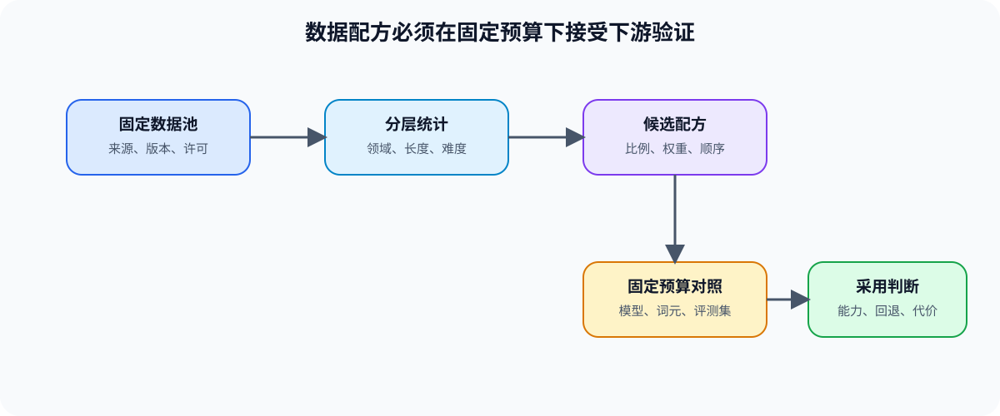

# 03 数据配比与难度递进

## 学习问题

数据清洗完成后，仍要决定哪些样本以什么比例、长度和顺序进入训练。数据配方的目标不是追求单一比例，而是在目标能力、通用能力、训练预算和输入分布之间提出可验证的候选。

## 配比改变的是什么

| 维度 | 要回答的问题 | 需要保留的证据 |
|:---|:---|:---|
| 来源与领域 | 通用、领域、合成或高风险样本各占多少？ | 来源比例、版本与许可 |
| 长度 | 长短样本如何混合，是否覆盖目标上下文？ | token 长度分布、截断率、packing 规则 |
| 难度与长尾 | 稀有任务是否得到足够采样？ | 分层标签、采样权重、覆盖率 |
| 顺序 | 是否从通用到专项或从短到长逐步调整？ | 阶段规则、每阶段数据版本 |
| 预算 | 数据量与训练 token / step 预算是否匹配？ | 有效 token、重复率、训练成本 |

## 从配方到可验证实验

先固定模型、tokenizer、训练预算、评测集和优化器，再只比较一个数据配方维度。长度与 packing 同时影响训练样本呈现和系统吞吐：前者属于数据设计，后者的 CPU 准备、DataLoader、H2D 与计算重叠进入性能优化测量。

| 候选 | 保持不变 | 单独改变 | 下游门槛 |
|:---|:---|:---|:---|
| 基线配方 | 模型、训练 token、评测集 | 当前来源/长度比例 | 形成可复现基线 |
| 领域增强 | 同一训练预算 | 领域样本权重 | 领域提升不以明显通用回退为代价 |
| 长上下文增强 | 同一训练预算与模板 | 长样本比例、截断与 packing | 长度能力与吞吐一起记录 |
| 难度递进候选 | 同一来源池与总词元量 | 阶段顺序或难度权重 | 对照独立评测和失败类型 |

## 同一配方怎样接受不同下游验证

训练配比最终由[后训练优化](../post_training_optimization/intro.md)判断模型质量与对齐目标；长度、packing 和输入等待由[性能优化](../performance_optimization/intro.md)判断是否拖慢训练；RAG 的文档采样与 chunk 策略需要在[推理优化](../inference_optimization/intro.md)中以检索质量和服务成本复测。它们共享数据版本，但不共享结论。

## 什么结果可以支持配方选择

可比较的数据配方需要同时保存来源、长度、难度、阶段规则、有效词元、独立评测、性能记录和失败样本。只有目标能力提升、通用能力未越过退化门槛且训练代价可接受时，候选配方才具备采用条件。
