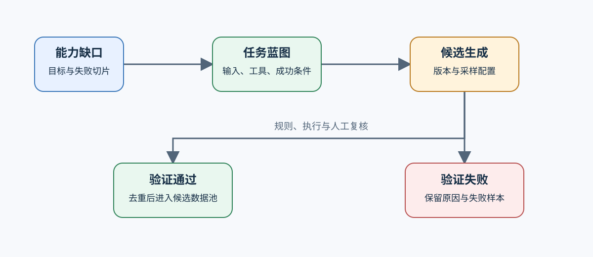
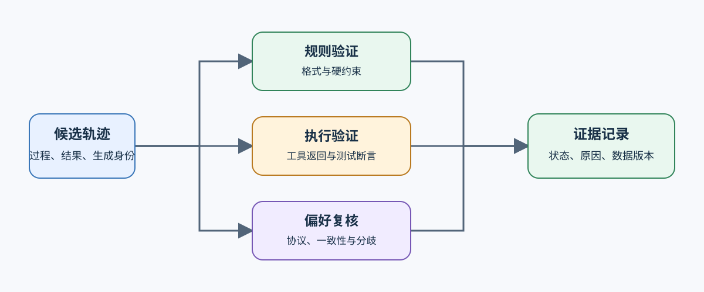

# 04 合成数据与轨迹验证

合成数据用于补足稀缺场景，不是把模型输出直接复制回训练集。进入数据池前，必须知道样本针对什么缺口、由哪个生成器产生、经过什么验证，以及失败样本是否被保留。

## 任务蓝图怎样约束生成范围

任务蓝图至少固定能力目标、输入约束、允许的工具、成功条件和独立评测切片。生成器版本、提示模板、采样参数和来源样本共同构成生成身份；其中任一项变化，都产生新的候选数据版本。

| 蓝图字段 | 需要回答的问题 | 缺失后的风险 |
|:---|:---|:---|
| 能力缺口 | 要补的是知识、格式、推理还是工具使用？ | 生成数量增加但目标能力不变 |
| 输入边界 | 长度、语言、领域和难度范围是什么？ | 数据分布偏离真实任务 |
| 成功条件 | 标准答案、测试、约束或人工规则是什么？ | 无法区分流畅回答与正确回答 |
| 失败切片 | 哪类失败要单独保留？ | 只留下成功样本，掩盖生成器偏差 |

## 验证器怎样分流候选样本

验证强度由任务决定。数学与代码可使用标准答案或执行测试；工具轨迹要检查调用参数、执行结果和最终回答的一致性；开放式回答需要偏好评审或人工抽样。单一分数不能替代过程证据。

| 验证路径 | 最小证据 | 合格条件 |
|:---|:---|:---|
| 规则验证 | 解析结果、规则版本、失败原因 | 输出格式和硬约束全部满足 |
| 执行验证 | 环境、输入、返回值、测试日志 | 执行成功且结果符合任务断言 |
| 偏好或人工复核 | 评审协议、评审者或模型版本、分歧 | 达到一致性阈值并保留分歧样本 |

## 合格样本怎样进入数据版本

验证通过不等于可以直接训练。还需检查与原始数据和评测集的重复、生成器偏差、难度分布以及同一任务的大量模板化变体。最终版本同时保存合格集、拒绝集、验证摘要和生成配置，使后续训练能解释收益或退化来自哪类样本。

## 从合成候选进入后训练接口

合格回答可转为 SFT 样本，成对候选可转为偏好数据，带奖励与策略版本的执行过程可转为在线强化学习轨迹。继续阅读 [05 后训练数据接口与诊断](./05_post_training_data_interfaces.md)；工具轨迹的执行语义由[智能体轨迹数据与验证](../agent/01_agent_trajectory_data.md)补充。
