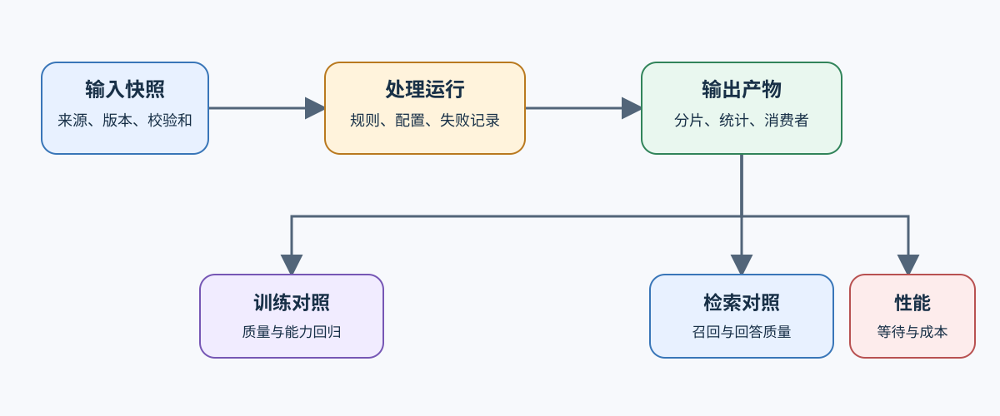
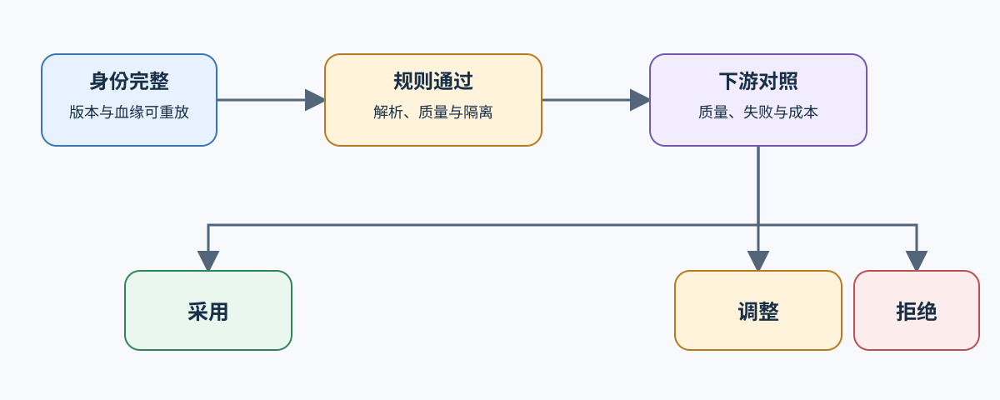

# 06 流水线血缘与下游验证

数据流水线的交付物不是一份最新文件，而是一次可重放的变更：输入版本、处理规则、输出分片、失败记录和下游比较必须能够对应到同一运行身份。

## 运行身份怎样连接输入、规则和输出

每次运行固定输入快照、代码或规则版本、配置摘要和随机种子，并为输出分片记录校验和。增量运行还要保存新增、更新、删除和未处理对象的清单，避免“只处理了部分数据”被误认为完整版本。

| 记录对象 | 最小字段 | 用途 |
|:---|:---|:---|
| 输入快照 | 来源版本、对象数量、校验和 | 确认比较从哪批数据开始 |
| 处理规则 | 规则版本、参数、依赖环境 | 重放解析、过滤和配比决策 |
| 输出产物 | 分片、样本数、校验和、消费者 | 确认训练或检索实际读取的版本 |
| 失败记录 | 对象身份、阶段、原因、重试状态 | 区分数据缺失与规则拒绝 |

## 增量执行怎样保持结果一致

增量执行只跳过输入和规则均未变化的对象。解析器、去重阈值、模板或切分规则改变时，受影响对象必须重新计算；失败重试不能覆盖原始错误。通过输入—规则—输出三元组判断缓存命中，比只看文件名或修改时间更可靠。

## 下游对照怎样决定采用或回滚

数据版本必须进入至少一个真实消费者对照：训练数据看独立质量和能力回归，检索数据看召回、回答质量和失败文档，输入流水线看吞吐与等待。只通过结构校验的版本可以继续验证，但不能直接采用。

| 判断 | 必须满足的条件 | 动作 |
|:---|:---|:---|
| 采用 | 身份完整、规则通过、下游质量达标且成本可接受 | 发布数据版本和消费者清单 |
| 调整 | 方向有效，但失败切片、配比或运行成本仍超出目标 | 保留证据并生成新候选版本 |
| 拒绝 | 污染、质量退化、不可重放或消费者契约不兼容 | 回滚到上一版本并冻结失败记录 |

## 从数据版本进入项目交付

[Part 02 · 64 SFT 数据质量项目](../../02_PyTorch_Algorithms/64_SFT_Data_Quality_Project.ipynb)验证训练数据准入；[Part 05 · 后训练交付综合项目](../../05_Integrated_Projects_and_Decisions/02_Post_Training_Delivery_Project.md)消费固定数据版本并给出候选采用判断。检索或性能消费者使用同一运行身份，但采用各自的质量和成本指标。
