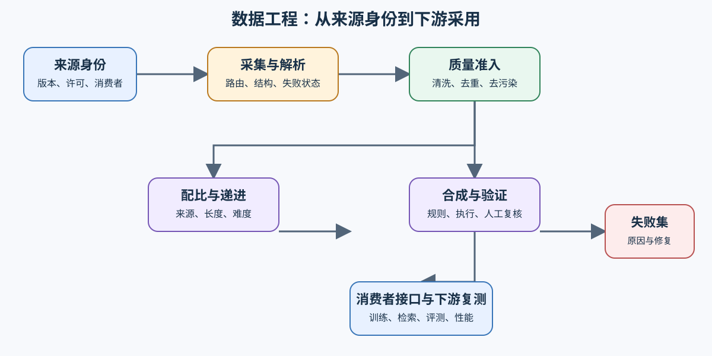
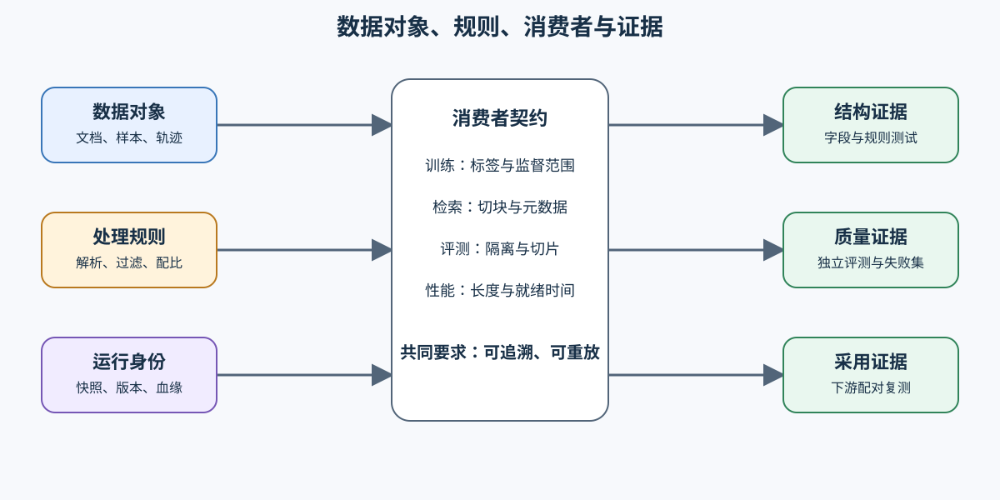

# 数据工程（Data Engineering）

> 专题类型：横向工程专题　主服务目标：让训练、检索与评测使用可追溯、可复查的数据。

数据工程不是后训练的附属步骤。训练数据、检索增强生成（RAG）语料与线上知识库都要经历采集、解析、清洗、去重、质量评估、版本治理和格式转换；它们只在消费阶段进入不同路径：微调关心样本格式与配比，检索关心切块、富化与索引，性能工程关心长度分布、数据加载和 I/O 等待。

本专题负责数据身份、处理规则、血缘和质量证据。后训练优化根据这些输入选择训练路线，性能优化判断数据路径是否成为瓶颈，推理优化验证检索数据对请求质量和服务成本的影响。

## 学习路线

先建立“来源—版本—处理—切分—消费者”的数据身份，再按问题进入清洗、配比、合成或后训练接口。评测集隔离和下游复测贯穿整条路线，不能等训练结束后再补。

| Task / 主题 | 本阶段要回答的问题 | 学习入口与验证出口 | 学习顺序 | 主要正文入口 |
|:---|:---|:---|:---|:---|
| Task0 · 数据生命周期与消费者 | 一份数据怎样从来源、版本和处理规则流向预训练、后训练与检索？ | 核心：[Part 00 · 04 配置与数据入口](../../00_Prerequisites/04_Python_Config_and_Data_Entry.ipynb)、[Part 02 · 32 SFT 数据准入](../../02_PyTorch_Algorithms/32_Data_Engineering_for_SFT.ipynb) | 来源身份 → 数据版本 → 消费者契约 | [00 数据生命周期与消费者契约](./00_data_lifecycle_and_contract.md) |
| Task1 · 采集、解析与来源契约 | 异构文件怎样变成保留来源和失败状态的统一记录？ | 核心：[Part 00 · 04 配置与数据入口](../../00_Prerequisites/04_Python_Config_and_Data_Entry.ipynb) | 内容检测 → 解析路由 → 失败留存 | [01 采集、解析与来源契约](./01_collection_parsing_contract.md) |
| Task2 · 清洗、去重与质量过滤 | 样本怎样在不污染独立评测的前提下通过质量准入？ | 核心：[Part 02 · 32 SFT 数据准入](../../02_PyTorch_Algorithms/32_Data_Engineering_for_SFT.ipynb)、[Part 02 · 50 偏好数据与评测](../../02_PyTorch_Algorithms/50_Preference_Data_and_Evaluation.ipynb) | 清洗 → 去重 → 去污染 → 评测快照 | [02 清洗、去重与质量证据链](./02_cleaning_quality_chain.md) |
| Task3 · 数据配比与难度递进 | 来源、长度、难度与长尾样本怎样形成可消融的数据配方？ | 核心：[Part 02 · 30 长上下文微调](../../02_PyTorch_Algorithms/30_Long_Context_Fine_Tuning.ipynb)、[Part 02 · 33 微调准入](../../02_PyTorch_Algorithms/33_Fine_Tuning_Readiness.ipynb) | 固定数据池 → 配比候选 → 下游消融 | [03 数据配比与难度递进](./03_data_mixture_and_curriculum.md) |
| Task4 · 合成数据与轨迹验证 | 生成样本怎样通过规则、执行结果和独立复核后进入数据池？ | 核心：[Part 02 · 50 偏好数据与评测](../../02_PyTorch_Algorithms/50_Preference_Data_and_Evaluation.ipynb)；扩展：[智能体 · 01 轨迹数据与验证](../agent/01_agent_trajectory_data.md) | 任务蓝图 → 候选生成 → 验证分流 → 版本冻结 | [04 合成数据与轨迹验证](./04_synthetic_data_and_trajectory_validation.md) |
| Task5 · 后训练数据接口 | 同一来源怎样转换为 SFT、偏好与强化学习数据而不丢失身份？ | 核心：[Part 02 · 13 SFT 训练循环](../../02_PyTorch_Algorithms/13_SFT_Training_Loop.ipynb)、[Part 02 · 15 端到端微调](../../02_PyTorch_Algorithms/15_End_to_End_Fine_Tuning_Experiment.ipynb) | 合格样本 → 监督接口 → 偏好/轨迹接口 → 失败切片 | [05 后训练数据接口与诊断](./05_post_training_data_interfaces.md) |
| Task6 · 流水线与下游验证 | 数据变更怎样可重放、可审计，并由下游对照决定是否采用？ | 项目：[Part 02 · 64 SFT 数据质量项目](../../02_PyTorch_Algorithms/64_SFT_Data_Quality_Project.ipynb)、[Part 05 · 后训练交付综合项目](../../05_Integrated_Projects_and_Decisions/02_Post_Training_Delivery_Project.md) | 变更清单 → 增量执行 → 下游复测 → 采用或回滚 | [06 流水线血缘与下游验证](./06_pipeline_lineage_and_downstream_validation.md) |

## 扩展与跨专题入口

| 使用场景 | 建议路径 | 数据工程提供的证据 | 下游专题作出的判断 |
|:---|:---|:---|:---|
| SFT 或偏好数据 | Task0 → Task2 → Task3 → Task5 → Task6 | 样本身份、切分、污染检查、配比与数据版本 | [后训练优化](../post_training_optimization/intro.md)判断训练、对齐和交付是否可信 |
| RAG 语料 | Task0 → Task1 → Task2 | 解析结果、切块输入、来源与质量记录 | [推理优化](../inference_optimization/intro.md)判断检索质量、延迟和服务成本 |
| 训练输入性能 | Task0 → Task2 → Task3 | 词元长度、打包、预处理和 I/O 记录 | [性能优化](../performance_optimization/intro.md)判断等待是否位于关键路径 |
| 合成或工具轨迹数据 | Task0 → Task4 → Task6 | 任务蓝图、候选轨迹、执行反馈和验证状态 | [智能体基础设施](../agent/intro.md)判断工具使用和任务闭环是否有效 |

模型评测与数据工程共享评测样本，但职责不同。数据工程保证样本身份、切分隔离、污染检查、切片字段和失败样本可追溯；模型评测负责计算质量、安全与鲁棒性指标，并比较基线和候选。数据质量通过不能替代模型采用判断，模型分数变化也不能反向证明数据处理正确。

按需回补入口：

- 配置、路径与运行清单：[Part 00 · 04](../../00_Prerequisites/04_Python_Config_and_Data_Entry.ipynb)；
- 分词器、标签和训练接口：[Part 02 · 13](../../02_PyTorch_Algorithms/13_SFT_Training_Loop.ipynb)与[Part 02 · 15](../../02_PyTorch_Algorithms/15_End_to_End_Fine_Tuning_Experiment.ipynb)；
- 长度、打包与训练预算：[Part 02 · 30](../../02_PyTorch_Algorithms/30_Long_Context_Fine_Tuning.ipynb)与[Part 02 · 33](../../02_PyTorch_Algorithms/33_Fine_Tuning_Readiness.ipynb)；
- 数据质量和评测隔离：[Part 02 · 50](../../02_PyTorch_Algorithms/50_Preference_Data_and_Evaluation.ipynb)与[Part 02 · 64](../../02_PyTorch_Algorithms/64_SFT_Data_Quality_Project.ipynb)。

## 实验与项目出口

| 验证层级 | 运行条件 | 可以确认的结论 | 不能替代的证据 |
|:---|:---|:---|:---|
| CPU 机制 | Python、PyTorch 或分词器替身 | 字段、解析路由、去重、切分、长度和规则逻辑 | 真实训练收益与服务质量 |
| 单卡训练 | Transformers、Datasets、PEFT | 打包、数据加载、训练格式与局部质量变化 | 多卡吞吐与生产稳定性 |
| 检索与服务 | 检索组件和推理后端 | 文档处理对召回、延迟、成本和失败样本的影响 | 训练候选的采用判断 |
| 工程化项目 | 数据版本库、编排器和观测工具 | 数据血缘、增量运行、失败恢复与可复现交付 | 未固定数据版本时的跨运行比较 |

- 想沿一份数据连续推进：阅读[数据工程问题链](./walkthrough.md)；
- 已有数据集、训练结果或检索失败样本：阅读[数据工程判断手册](./casebook.md)；
- 需要交付后训练候选：进入[Part 05 · 后训练交付综合项目](../../05_Integrated_Projects_and_Decisions/02_Post_Training_Delivery_Project.md)。

任何“数据更好”的结论都必须对应固定数据版本、独立评测集和下游复测。缺少其中任一项时，只能保留为待验证候选。
