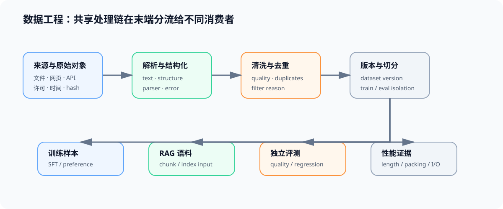

# 数据工程问题链：从原始数据到训练与 RAG 证据

假设团队拿到一批网页、PDF、表格和历史对话：一部分要转成 SFT 数据，一部分要进入 RAG 知识库。真正的问题不是“能否读出文本”，而是每个下游结果能否追溯到来源、处理规则、数据版本和失败样本。

## 第一段：先定义数据的消费者与契约

先区分数据最终交给谁。训练需要样本、labels、template、split 与评测隔离；RAG 需要保留文档结构、chunk、元数据和索引输入；性能分析需要长度、packing 与 batch 就绪时间。它们可以共享来源和清洗链，但不能共用最后的消费 schema。

这一段对应[00 数据生命周期与消费者契约](./00_data_lifecycle_and_contract.md)。先填写来源、许可、版本和消费者字段，再决定后续处理规则。

## 第二段：让异构来源变成可复查的结构化内容

文件扩展名不能决定解析路径。应先检测内容类型、编码、语言与可提取性，再路由到文本、表格、OCR 或媒体解析器；同时保存 parser 版本、降级路径和失败状态。否则“解析成功”可能掩盖表格、顺序或图像文字的丢失。

这一段对应[01 采集、解析与来源契约](./01_collection_parsing_contract.md)。输出不是一段裸文本，而是一份带来源与解析状态的结构化记录。

## 第三段：再缩小重复、污染与低质量风险

清洗、去重、质量过滤和去污染分别处理不同问题。删除比例很高不代表质量更好；过滤器必须留下重复组、阈值、抽样复核和独立评测证据，才能判断长尾样本是否被误删、训练集是否泄漏到评测集。

这一段对应[02 清洗、去重与质量证据链](./02_cleaning_quality_chain.md)。完成后才能讨论样本配比，而不是把不稳定的数据直接混入训练。

## 第四段：按目标设计配比与数据呈现顺序

当数据可用后，训练侧仍要决定来源、领域、长度、难度与长尾样本的比例，以及是否随训练阶段调整。这里的输出不是唯一“最佳配方”，而是一份可消融的数据配方：每个候选配比都有固定版本、对照组、质量门槛和成本记录。

这一段对应[03 数据配比与难度递进](./03_data_mixture_and_curriculum.md)。长度和样本打包会同时影响训练样本覆盖与训练吞吐，应把这两类证据分别交给后训练与性能优化解释。

## 第五段：把合格数据转成后训练接口

SFT、偏好与推理数据的共同前提是可追溯、去污染和独立评测；它们的差异在于监督信号。SFT 需要 prompt/response 与 labels，偏好数据需要 chosen/rejected，推理数据还需说明过程与结果的验证方式。

这一段对应[05 后训练数据接口与诊断](./05_post_training_data_interfaces.md)。训练 loss 下降只能说明优化目标被拟合；是否真正获得目标能力，仍要回到独立评测和失败样本。

## 第六段：把处理记录带到下游结论

最后按消费者验证数据是否真的改善结果：训练看独立质量与行为回归，RAG 看检索/回答质量与失败文档，性能看长度、packing、CPU 准备和 H2D 是否拖慢关键路径。任一结论都要能回查数据版本、处理规则和输入分布。

合成数据与流水线编排将在 Task4、Task6 建设后接入这条链；当前不要把“生成过样本”或“脚本能运行”写成数据质量结论。
