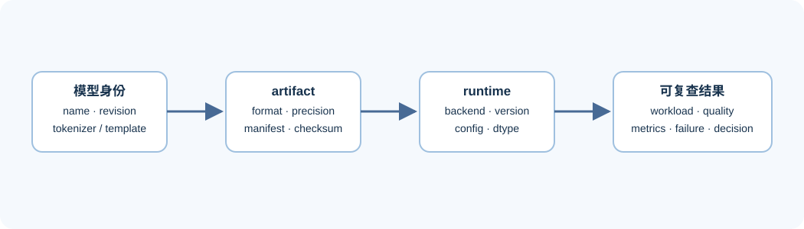
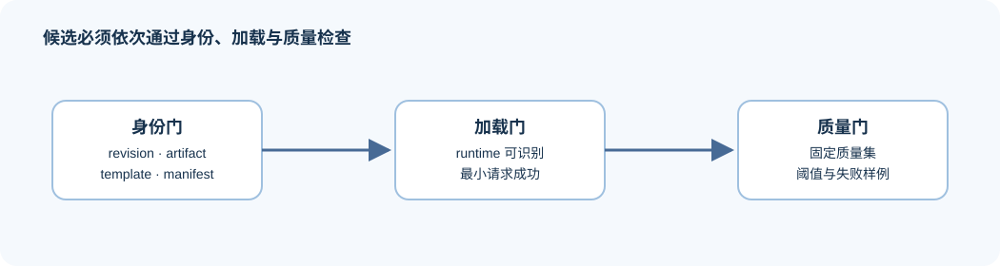

# 01 模型产物与部署契约

为什么“有权重文件”不等于得到一个可部署候选？部署时实际执行的是模型版本、分词器、对话模板、模型产物与运行时配置的组合。缺失其中任一项，后续基准测试即使有数字也无法可靠复现或比较。

## 候选身份怎样保持可追溯



| 契约层 | 应固定的内容 | 常见失配 |
|:---|:---|:---|
| 模型身份 | 名称、revision、架构、许可和来源 | 同名模型不同 revision，权重或配置已变更 |
| 输入语义 | tokenizer、chat template、特殊 token、模态处理器 | prompt 看似相同，但实际 token 序列不同 |
| 模型产物 | 权重格式、量化方式、缩放元数据、校验和 | 文件可见但推理后端无法识别或缺少配套文件 |
| 运行时 | 引擎、版本、数据类型、关键配置和启动参数 | 默认配置改变了上下文、缓存或执行路径 |
| 输出与质量 | 采样参数、停止条件、任务指标和失败规则 | 只比较延迟，没有确认输出是否仍满足目标 |

部署记录的最小单位不是“模型名”，而是 `model + revision + artifact + tokenizer/template + backend config + workload`。这份组合就是后续比较中的候选身份。

## 产物清单怎样连接三道检查门

产物清单不替代模型仓库或日志；它把复测所需的关键引用汇总到一次实验旁边。建议每个候选至少写入：

```text
artifact_id / model_revision / tokenizer_revision / format / checksum
backend / backend_version / precision / launch_config
hardware / runtime / workload_id / quality_protocol
```

当加载失败时，也保留同一份产物清单和错误摘要。失败是兼容性证据，不应被静默丢弃。

### 可复用的产物清单

下面的结构不绑定某个推理后端。项目可以增加专属字段，但不能省略候选身份、输入契约和质量协议。

```json
{
  "candidate_id": "qwen-text-int4-v1",
  "model": {"name": "", "revision": "", "architecture": ""},
  "input_contract": {"tokenizer_revision": "", "chat_template": "", "modalities": ["text"]},
  "artifact": {"format": "", "precision": "", "path": "", "checksum": ""},
  "quality_gate": {"dataset": "", "metric": "", "threshold": null},
  "provenance": {"source": "", "created_at": "", "notes": ""}
}
```

`candidate_id` 用于把 artifact、启动配置和结果 JSON 串起来；它不是对模型能力的命名。若只修改量化格式、revision 或 template 中任一项，就应生成新的候选身份，避免把不可比较的结果混在一起。

### 身份、加载与质量门槛

| 检查门 | 必须确认的事实 | 失败后的正确处理 |
|:---|:---|:---|
| 身份门 | 模型版本、分词器、模板与模型产物引用完整 | 补全产物清单；不要开始性能比较 |
| 加载门 | 目标运行时能识别模型产物并完成最小请求 | 记录兼容性失败和环境，不填写性能字段 |
| 质量门 | 固定质量集上的输出满足阈值或人工复核规则 | 标记为 `reject` 或回到量化/训练调整，不用速度收益覆盖质量问题 |

这三道门的顺序很重要：性能比较必须位于加载门和质量门之后。[Part 02 · 82 量化产物评估](../../02_PyTorch_Algorithms/82_Quantization_Artifact_Evaluation_Project.ipynb)承载产物与质量准入；[Part 02 · 72 单卡多模型部署](../../02_PyTorch_Algorithms/72_Multi_Model_Deployment_Comparison.ipynb)和[Part 02 · 83 量化服务分析](../../02_PyTorch_Algorithms/83_Quantized_Serving_Profile_Benchmark.ipynb)承接通过准入后的服务比较。



## 哪些证据允许进入性能比较

模型产物通过加载门，只说明当前环境可以启动；通过质量门，才具备进入性能比较的资格。任何缺失模型版本、模板或质量协议的结果，都应标为“候选身份不完整”，而不是与其他候选比较速度。

## 从产物进入后端验证

量化专题负责解释 format、scale 与误差；后训练专题负责产生 adapter、merged model 或 checkpoint。部署专题检查这些产物是否携带完整身份、能否被目标 runtime 加载，并在同一质量协议下进入比较。

下一步阅读 [02 后端兼容性与单机执行](./02_backend_compatibility_and_single_node_execution.md)，把静态模型产物接到实际运行时。
