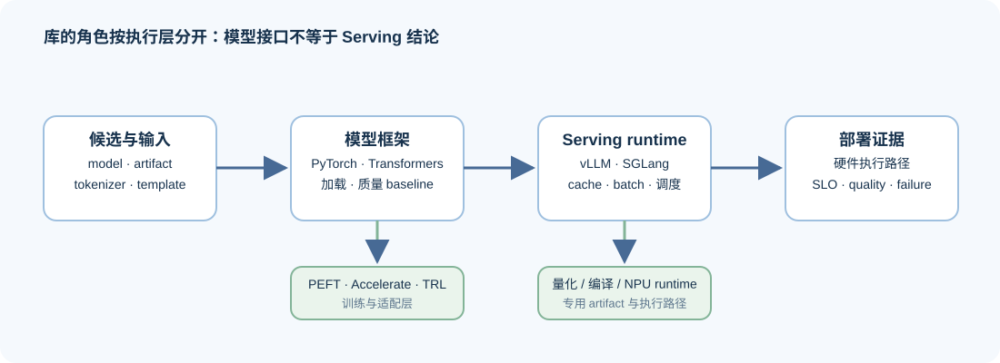
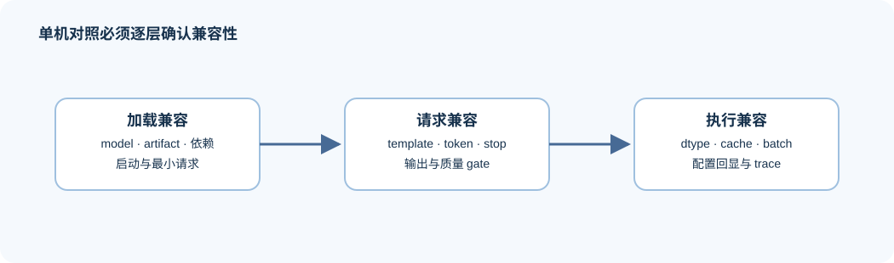

# 02 推理后端兼容性与单机执行

同一模型可能被多个推理后端加载，却不一定走相同的缓存、批处理、量化计算内核或采样路径。后端比较的起点不是排名，而是确认候选身份、输入契约和工作负载是否真的等价。

## 不同执行栈分别回答什么

`Transformers` 是模型、配置、tokenizer / processor 与通用 `generate` 接口的重要入口。它适合读取模型契约、验证输入输出、建立质量 baseline，以及完成轻量的 CPU / GPU smoke；它本身不代表连续批处理、分页缓存或生产级调度策略。

| 使用场景 | 优先使用的层 | 典型职责 | 仍需补的证据 |
|:---|:---|:---|:---|
| 模型与输入正确性 | PyTorch / Transformers | config、权重、tokenizer、processor、generate、质量 baseline | backend 是否接受相同 artifact / 输入契约 |
| 训练与适配 | PEFT / Accelerate / TRL | adapter、训练编排、偏好或 RL 训练 | 合并或导出后的 artifact 是否可部署 |
| 推理服务 | vLLM / SGLang / TensorRT-LLM 等 runtime | cache、batch、调度、流式接口、服务配置 | 同 workload 下的延迟、吞吐、峰值资源和质量 |
| 量化产物 | bitsandbytes、GPTQ / AWQ 工具链、格式工具 | 生成、加载或描述低比特 artifact | 实际 backend 的 kernel、显存与任务质量 |
| 多卡运行 | torch.distributed / NCCL / DeepSpeed / FSDP | 分片、通信、训练或执行并行 | 实际拓扑下的通信暴露、扩展效率和服务尾延迟 |

“Transformers 能跑”只说明候选已通过一部分模型与请求契约检查。每一层都可能拒绝上一层的候选：模型架构、量化 metadata、processor、runtime 版本或设备能力都可能构成不兼容原因。

## 加载、请求与执行兼容如何分层

| 兼容层次 | 要回答的问题 | 最小证据 | 仍不能说明什么 |
|:---|:---|:---|:---|
| 加载兼容 | 能否识别模型、artifact 与依赖？ | 启动日志、版本、最小加载结果 | 生成语义或低比特 kernel 是否正确 |
| 请求兼容 | 同一输入契约能否产生可比较的输出？ | 序列化请求、token 数、停止原因、质量 gate | 性能差异来自 runtime 本身 |
| 执行兼容 | 是否走了预期 dtype、cache、batch 或量化路径？ | 配置回显、runtime 日志、必要时 trace | 该路径在所有 workload 下都更优 |

实际 backend 能力矩阵应使用“已验证 / 未验证 / 不支持”三个状态，而不是仅写支持或不支持；版本变化后应重新验证对应单元格。

## 怎样进行固定工作负载的单机对照

先固定模型 revision、artifact、输入集、最大输出长度、采样参数、并发、warmup 与重复次数，再只替换一个主要变量，例如 backend 或 precision。这样才能判断差异来自候选，而非 workload 漂移。

## 怎样解释失败和差异

| 失败类型 | 先检查 | 下一步 |
|:---|:---|:---|
| 无法加载 | format、依赖版本、量化元数据、架构支持 | 记录为兼容性失败，不虚构性能结果 |
| 输出不一致 | template、tokenizer、停止条件、采样配置 | 回到共同请求契约复核 |
| OOM / 容量不足 | 权重、KV、workspace、allocator 与上下文 | 调整候选或进入量化 / 缓存路径 |
| 延迟波动过大 | warmup、并发、设备争用、请求长度 | 增加重复与 trace，不急于下结论 |

## 从单机对照进入项目验证

不同工具只在改变候选身份、加载边界或执行路径时进入比较。先确认它承担模型语义、训练产物、量化产物还是推理服务，再选择对应验证入口。

| 工具层 | Part 02 入口 | 在该入口中验证什么 | 不应从该入口推断什么 |
|:---|:---|:---|:---|
| Transformers / PyTorch | [Part 02 · 13 SFT 训练循环](../../02_PyTorch_Algorithms/13_SFT_Training_Loop.ipynb)、[Part 02 · 15 端到端微调](../../02_PyTorch_Algorithms/15_End_to_End_Fine_Tuning_Experiment.ipynb) | 模型训练、输入格式和检查点产物 | 生产服务的吞吐或调度能力 |
| 注意力与计算内核 | [Part 02 · 20 FlashAttention 模拟](../../02_PyTorch_Algorithms/20_FlashAttention_Sim.ipynb) | 注意力路径、SDPA 对照和局部机制 | 某一服务运行时的完整执行行为 |
| vLLM / SGLang | [Part 02 · 22 PagedAttention](../../02_PyTorch_Algorithms/22_vLLM_PagedAttention.ipynb)、[Part 02 · 34 RadixAttention](../../02_PyTorch_Algorithms/34_SGLang_RadixAttention.ipynb)、[Part 02 · 66 推理性能比较](../../02_PyTorch_Algorithms/66_Inference_Performance_Comparison.ipynb) | 缓存、后端机制与共同请求指标 | 任意模型、硬件、版本下的通用排名 |
| 量化与产物 | [Part 02 · 25 W8A16](../../02_PyTorch_Algorithms/25_Quantization_W8A16.ipynb)、[Part 02 · 40 GPTQ / AWQ](../../02_PyTorch_Algorithms/40_GPTQ_and_AWQ_Weight_Quantization.ipynb)、[Part 02 · 41 FP8 运行时](../../02_PyTorch_Algorithms/41_FP8_Runtime_Low_Precision_Paths.ipynb)、[Part 02 · 54 KV Cache 量化](../../02_PyTorch_Algorithms/54_KV_Cache_Quantization_Strategies.ipynb)、[Part 02 · 82 产物项目](../../02_PyTorch_Algorithms/82_Quantization_Artifact_Evaluation_Project.ipynb) | 表示、误差、产物准入与质量记录 | 低比特计算内核必然更快 |
| 服务交付 | [Part 02 · 67 量化推理部署](../../02_PyTorch_Algorithms/67_Quantized_Inference_and_Deployment.ipynb)、[Part 02 · 72 多模型部署](../../02_PyTorch_Algorithms/72_Multi_Model_Deployment_Comparison.ipynb) | 后端实测、失败记录、部署决策 | 多卡、PD 或异构硬件的扩展结论 |
| 通信与并行 | [Part 02 · 47 NCCL Profiling](../../02_PyTorch_Algorithms/47_Communication_Profiling_with_NCCL.ipynb)、[Part 02 · 79 分布式并行](../../02_PyTorch_Algorithms/79_Distributed_Parallel_Benchmark.ipynb) | 通信机制、配置与扩展证据 | 单机后端的性能结论 |

[Part 02 · 66 推理性能比较](../../02_PyTorch_Algorithms/66_Inference_Performance_Comparison.ipynb)提供浮点基线，[Part 02 · 67 量化部署](../../02_PyTorch_Algorithms/67_Quantized_Inference_and_Deployment.ipynb)与[Part 02 · 83 服务配置基准](../../02_PyTorch_Algorithms/83_Quantized_Serving_Profile_Benchmark.ipynb)补充量化产物和服务路径证据，[Part 02 · 72 单卡部署比较](../../02_PyTorch_Algorithms/72_Multi_Model_Deployment_Comparison.ipynb)再形成单机候选对照。设备间对象移动继续阅读[03 设备协同与数据路径](./03_device_coordination_and_data_path.md)。
