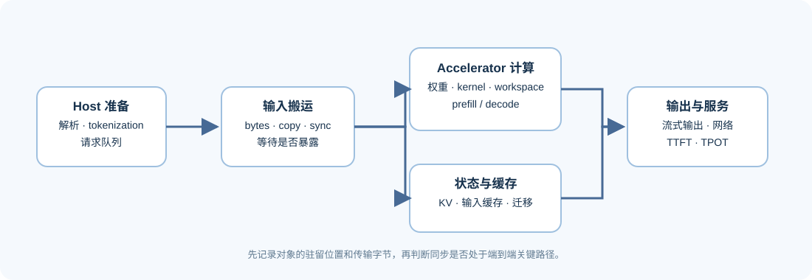
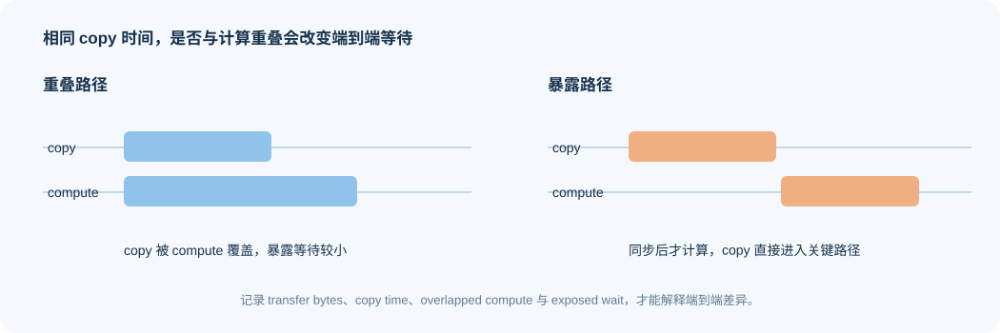

# 03 设备协同与数据路径

一次请求通常包含 CPU 侧解析与 tokenization、主机到设备的数据搬运、设备上的模型计算、KV 状态读写、可能的设备间交接，以及流式输出。异构系统的关键问题是：每个阶段的执行位置是否合理，跨设备传输是否暴露在端到端关键路径上。



| 对象 | 典型驻留位置 | 主要代价 | 应观察的证据 |
|:---|:---|:---|
| 请求解析、tokenization、业务逻辑 | CPU / host | 排队、CPU 饱和、串行准备 | queue wait、CPU time、输入长度 |
| 权重与中间 workspace | GPU / accelerator | 容量、读写带宽、kernel 适配 | 常驻/峰值显存、kernel 时间 |
| KV / 输入缓存 | accelerator memory 或分层缓存 | 容量、读写、迁移与命中 | cache bytes、命中率、TPOT |
| 输入和状态交接 | PCIe、NVLink、网络或共享内存 | transfer bytes、同步与等待 | copy time、通信暴露时间、失败 |
| 结果流 | host / network | 首 token、回压、连接占用 | TTFT、流式间隔、断连率 |

## 对象驻留与传输怎样形成账本

先确认“数据在哪里”，再确认“数据移动了多少”，最后再解释“移动是否暴露为等待”。仅看到 CPU 或 GPU 利用率低，不能直接判断是设备太慢；可能是另一侧准备、同步、缓存 miss 或网络传输阻塞了关键路径。

对一个阶段，可以先记录近似的传输账本：

```text
transfer_bytes = input_bytes + state_bytes + output_bytes
copy_time ≈ transfer_bytes / effective_bandwidth
exposed_wait = max(0, copy_time - overlapped_compute_time)
```

这不是精确性能模型：协议开销、同步、排队、碎片化和设备实现都会改变真实时间。它的作用是帮助学习者提出可测问题：传输量是否随 batch、上下文或 KV handoff 增长；复制是否与计算重叠；端到端时间增加是否真的由搬运暴露造成。

| 观察到的现象 | 先拆开的字段 | 可能的下一步 |
|:---|:---|:---|
| 首 token 很慢 | CPU 准备、H2D、prefill、queue wait | 固定输入长度，查看准备与搬运是否串行 |
| 长请求越多越不稳定 | KV bytes、缓存命中、迁移次数、allocator | 检查 cache 容量和状态是否频繁移动 |
| 多设备后吞吐无增长 | transfer bytes、通信时间、overlap、pool 利用率 | 回到拓扑与分层设计，不先改模型参数 |

## 搬运何时被计算隐藏

复制与计算可以重叠，也可能因同步、队列或状态依赖而直接出现在关键路径。相同的传输字节，在两种情况下对端到端延迟的影响不同。



## 哪些证据可以定位数据路径

在设备、模型产物、运行时和关键路径均通过 [07 加速器与运行时兼容性](./07_accelerator_runtime_compatibility.md) 的检查后，再建立单实例的数据路径账本。单卡主机—设备搬运只能解释本机路径；多卡通信、预填充—解码状态交接和异构资源路由还需要真实拓扑下的通信与扩展证据。

## 从单实例路径进入服务拓扑

下一步进入 [04 多设备与服务分层](./04_multi_device_and_service_tiers.md)。
