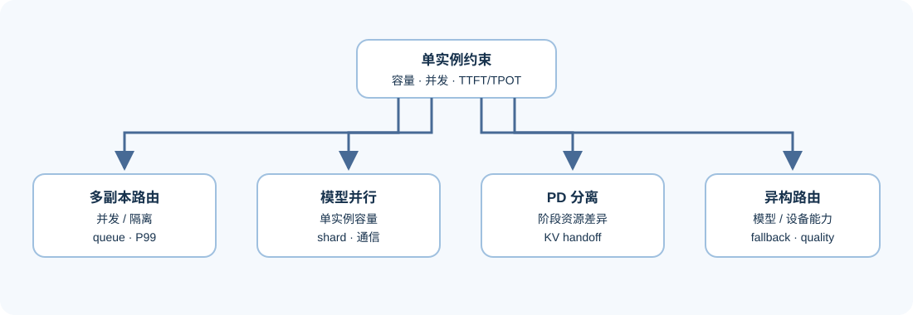
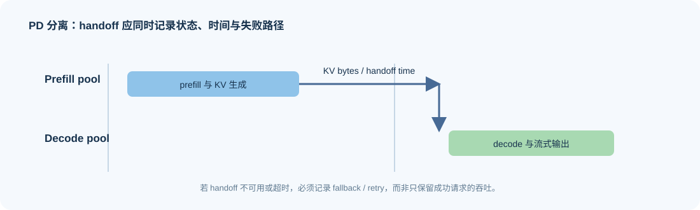

# 04. Multi-Device and Service Tiers | 多设备与服务分层

## 问题起点

当权重、KV Cache、并发或尾延迟超过单实例预算时，问题不再只是“加一张卡”。需要判断模型状态如何切分、Prefill 和 Decode 是否分层、KV 如何交接，以及通信和故障边界是否抵消了扩展收益。

## 核心机制一：服务形态解决的约束不同
| 候选形态 | 主要解决什么 | 新增代价 | 需要保留的验证字段 |
|:---|:---|:---|:---|
| 多副本路由 | 提升请求并发与隔离 | 副本容量、负载倾斜 | 池利用率、queue wait、P95/P99 |
| 模型并行实例 | 单模型超出单卡容量 | 通信、同步、拓扑依赖 | shard、通信时间、扩展效率 |
| Prefill / Decode 分离 | 阶段资源需求差异 | KV handoff、调度复杂度 | transfer bytes、handoff time、TTFT/TPOT |
| 异构路由 | 不同模型/设备处理不同请求 | 能力矩阵、降级与一致性 | 路由原因、quality、fallback、成本 |

## 核心机制二：从症状选择服务形态

| 首要症状 | 优先候选 | 选择前必须排除的误判 |
|:---|:---|:---|
| 单卡能放下模型，但并发导致排队 | 多副本路由或连续批处理 | 不是 KV 容量或单请求 prefill 本身已超预算 |
| 单卡无法容纳候选模型或上下文 | 模型并行、量化或更大容量设备 | 不把“加副本”误认为能解决单实例容量 |
| TTFT 与 TPOT 的资源需求冲突 | PD 分离或分层池 | handoff 传输和队列重排没有吞掉阶段收益 |
| 不同请求需要不同模型或设备能力 | 异构路由和明确 fallback | 路由后仍有共同质量协议与可解释降级 |

## 核心机制三：handoff 与降级

PD 分离或跨设备状态迁移时，至少记录发送/接收端、KV 或其他状态字节、传输持续时间、是否与计算重叠、失败/重试和请求质量。只报告整体吞吐无法判断收益来自真正的分层，还是由 workload 或排队变化造成。

## 证据与判断

Part 02 · 39 解释异构 PD 与服务分层的机制；81 则要求在真实多卡条件下保存配置、通信与扩展证据。部署专题在这里负责把这些机制放回实际交付的拓扑与失败边界。路由到不同设备或模型时，质量门槛和 fallback 原因必须与性能字段一起记录。

## 项目出口与相关阅读

需要把服务分层扩展到端、边、云时，继续阅读 [08 端—边—云放置与状态交接](./08_edge_cloud_placement_and_handoff.md)；随后进入 [05 可观测性、回归与发布](./05_observability_regression_and_release.md)，确认分层后仍能发现路径偏移和质量回归。
