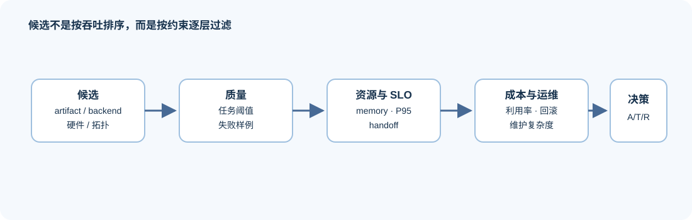
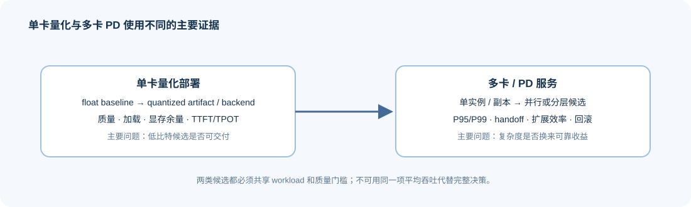

# 06 异构选型与成本决策

设备、模型、量化格式、推理后端和服务拓扑相互依赖。一个候选即使吞吐更高，也可能因质量回归、容量余量不足、状态交接暴露或维护复杂度而不适合目标服务。



## 候选比较需要固定哪些维度
| 决策维度 | 需要比较的候选 | 不能忽略的约束 |
|:---|:---|:---|
| 模型与 artifact | revision、精度、量化、模态能力 | 质量门槛、许可、加载兼容性 |
| 硬件与 runtime | GPU / NPU / CPU、显存、带宽、互连 | 可用容量、驱动、算子与 backend 支持 |
| backend | 调度、缓存、量化执行、观测能力 | 输入契约、版本、运行稳定性 |
| 服务拓扑 | 单机、副本、多卡、PD 分离、异构路由 | 传输、故障边界、P95/P99、运维成本 |
| 成本 | 设备、运行、网络、存储和人力 | 单请求成本、利用率、扩容与回滚风险 |

## 单卡量化与多设备服务怎样分别比较

| 决策问题 | 合理的 baseline / candidate | 最关键的门槛 | 常见误判 |
|:---|:---|:---|:---|
| 单卡量化服务是否可交付 | 同模型浮点 baseline ↔ 同 workload 的量化 artifact / backend | 质量、加载兼容、显存余量、TTFT/TPOT | 用模型文件大小代替服务性能 |
| PD / 多卡服务是否值得增加复杂度 | 单实例或多副本 baseline ↔ 分层/并行候选 | P95/P99、handoff、扩展效率、故障恢复 | 用平均吞吐忽略尾延迟和状态交接 |

## 成本假设怎样保持可替换

成本模型不需要一开始给出精确价格，但必须暴露假设，例如设备小时成本、目标并发、有效吞吐、存储/网络成本和人工维护成本。可先用：

```text
unit_request_cost ≈ (device_cost_per_hour / effective_requests_per_hour)
                    + transfer_cost + storage_cost + estimated_operations_cost
```

其中 `effective_requests_per_hour` 必须来自满足质量门槛、处于同一 workload 的稳定结果。若候选尚未通过加载、质量或重复验证，成本计算只能作为规划假设，不能作为采购或上线结论。



## 哪些条件对应采用、调优或拒绝

- `reject`：artifact / backend 不兼容，质量未达门槛，或资源与可靠性约束不可接受；
- `tune`：方向成立，但 workload、重复、trace、质量样本或成本假设仍不足；
- `accept`：在固定模型、硬件、backend、workload 与质量门槛下，候选有可重复收益，并具备回滚与失败处理路径。

## 从候选比较进入综合交付

先由 [Part 02 · 72 单卡多模型部署](../../02_PyTorch_Algorithms/72_Multi_Model_Deployment_Comparison.ipynb)完成单机候选比较，再由 [Part 02 · 83 量化服务分析](../../02_PyTorch_Algorithms/83_Quantized_Serving_Profile_Benchmark.ipynb)补齐运行路径证据，最后进入 [Part 05 推理服务综合项目](../../05_Integrated_Projects_and_Decisions/01_Inference_Service_Integrated_Project.md)。多模型、多模态或异构硬件是后续扩展变量；缺少共同质量协议时不做跨设备排名。
