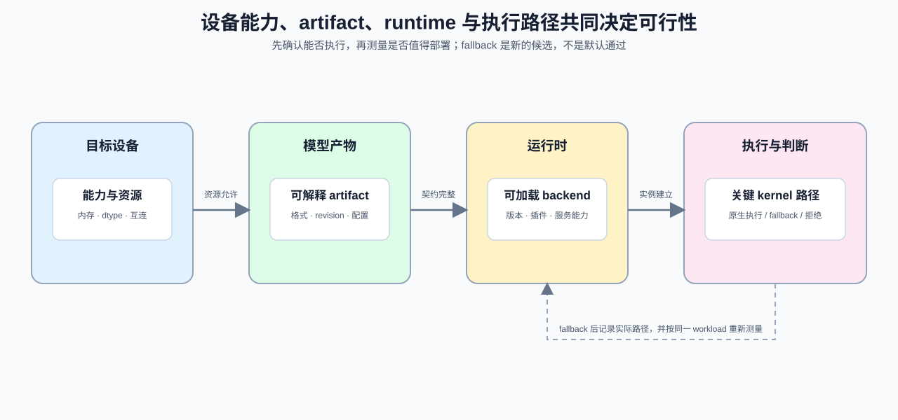
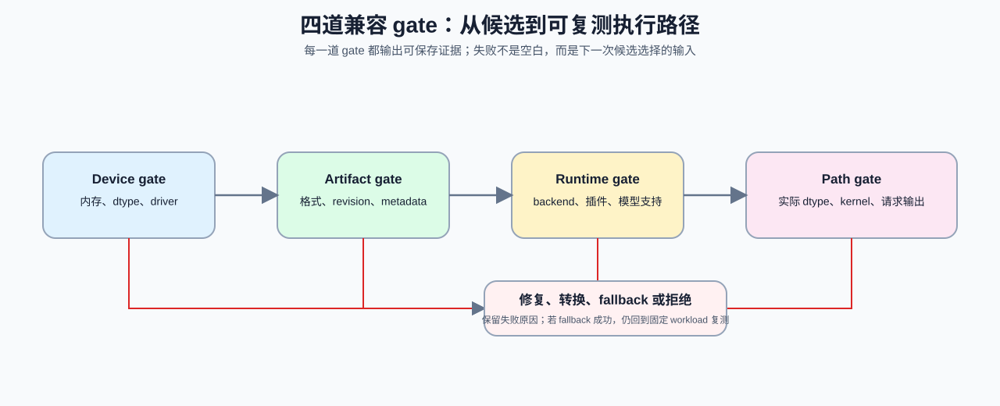

# 07 加速器与运行时兼容性

同一份模型文件不一定能在目标设备上执行。设备支持的数据类型、运行时能接收的模型产物、关键算子的计算内核路径，以及服务功能共同决定一个候选能否进入基准测试。部署前先完成兼容检查，可以把“无法加载、执行时回退、输出偏差或性能异常”定位到明确的一层。

| 检查对象 | 要确认的问题 | 失败时的处理 |
|:---|:---|:---|
| 设备能力 | 可用内存、dtype、互连和关键指令是否满足候选配置？ | 换精度、换设备或缩小模型/上下文预算 |
| artifact | 权重格式、tokenizer、量化元数据和 revision 是否完整？ | 修复 manifest、重新转换或拒绝该候选 |
| runtime / backend | 版本、插件、模型架构和服务功能是否被支持？ | 更换 runtime、启用匹配插件或回退实现 |
| 关键路径 | Attention、量化 linear、KV Cache、通信等路径是否有可用 kernel？ | 记录 fallback；重新判断性能与成本 |

## 四道能力门槛怎样逐层收窄候选

兼容性不是“设备能看见”或“模型能 import”之一。一个候选至少要通过四道 gate：设备资源足够、artifact 可解释、runtime 可加载、关键路径可执行。前一层通过不能证明后一层已经满足。

| Gate | 最小输入 | 可保存的证据 | 通过后的含义 |
|:---|:---|:---|:---|
| device | 设备型号、内存、driver/runtime、可用 dtype | `hardware` 字段、环境日志 | 有资格尝试该配置 |
| artifact | revision、格式、量化配置、tokenizer/template | manifest、校验信息 | 输入与权重可被解释 |
| runtime | backend 版本、模型架构、插件、服务配置 | 加载日志、能力矩阵 | 可以建立执行实例 |
| path | 实际 dtype、kernel/fallback、请求输出 | trace、结果 JSON、失败记录 | 可进入固定 workload 比较 |

## 路径回退为什么需要重新计量

运行时能为不匹配的候选提供转换、通用 kernel 或 CPU 路径；这使请求“能跑”，但不等于仍满足原来的延迟、显存或成本预期。将 fallback 视为一次新的候选：保留触发原因、实际 dtype、执行设备和关键路径，再以同一 workload 复测。

| 观察到的现象 | 先记录什么 | 后续判断 |
|:---|:---|:---|
| 加载失败 | artifact / runtime 版本、缺失算子或插件 | 修复契约或拒绝候选，不能直接比较性能 |
| 自动转换 dtype | 请求 dtype、实际 dtype、转换位置 | 质量与显存账本都需重测 |
| kernel 回退 | 原目标路径、fallback 路径、触发条件 | 用 trace 和同口径 benchmark 判断是否仍可接受 |
| 设备切换 | 原设备、实际设备、传输和等待 | 回到[设备协同与数据路径](./03_device_coordination_and_data_path.md)解释端到端变化 |

## 兼容结果怎样进入固定工作负载

兼容矩阵的结论只回答“是否值得进入 benchmark”，不替代真实 benchmark。通过全部 gate 后，使用固定 workload 保存 `artifact`、`hardware`、`backend`、实际 dtype、fallback、质量和性能字段；任一 gate 失败也应写入结果 JSON，方便复测或切换候选。

## 从兼容检查进入单卡部署

先将兼容结论写入 [Part 02 · 72 单卡多模型部署](../../02_PyTorch_Algorithms/72_Multi_Model_Deployment_Comparison.ipynb) 的候选配置；需要分析对象搬运时进入[03 设备协同与数据路径](./03_device_coordination_and_data_path.md)，单实例无法满足 SLO 时进入[04 多设备与服务分层](./04_multi_device_and_service_tiers.md)。

- [vLLM 安装与硬件平台](https://docs.vllm.ai/en/stable/getting_started/installation/)：以实际版本的设备支持与插件说明为准。
- [vLLM Platform API](https://docs.vllm.ai/en/latest/api/vllm/platforms/index.html)：查看平台如何检查配置与 dtype 能力。
- [Part 01 · 1F 硬件适配与系统约束](../../01_Hardware_Math_and_Systems/1F.md)：回补设备、资源隔离与可行性判断的基础概念。
