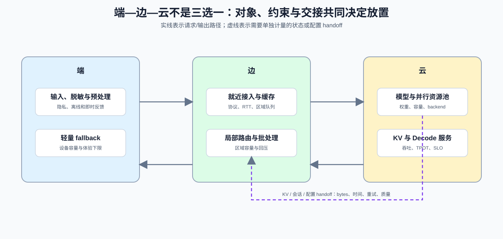
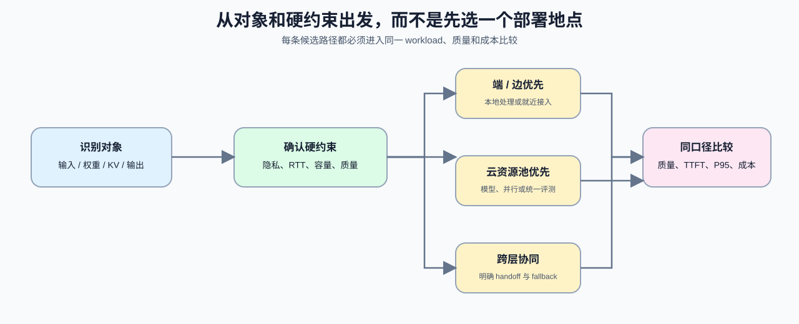

# 08. Edge–Cloud Placement and State Handoff | 端—边—云放置与状态交接

## 问题起点

端、边、云不是三种同义的部署地点。它们在设备能力、网络距离、数据边界、并发池与运维方式上不同。一次推理服务需要分别决定：请求在哪进入，预处理在哪里完成，模型和 KV 状态是否固定驻留，何时跨层交接，以及失败后如何降级。

| 放置层 | 更适合承担的对象 | 常见约束 | 需要保留的证据 |
|:---|:---|:---|:---|
| 端 | 轻量预处理、隐私敏感输入、离线或低依赖功能 | 设备资源、模型尺寸、升级频率 | 本地容量、离线质量、fallback 原因 |
| 边 | 就近接入、协议转换、缓存、局部批处理 | 区域容量、网络抖动、模型同步 | RTT、queue wait、缓存命中、区域负载 |
| 云 | 大模型执行、跨区域池化、多设备并行与统一评测 | 网络往返、成本、数据治理 | TTFT、P95/P99、吞吐、容量和成本 |

## 核心机制一：先放置对象，再选择服务形态

放置决策不是先选“端”或“云”，而是先识别对象和约束。模型权重、KV 状态、原始输入和输出流的移动成本不同：权重通常避免按请求搬运，KV handoff 需要显式计入字节和等待，输入与输出则需要同时评估网络延迟、隐私规则和降级方案。

| 对象 | 先问的问题 | 合理的默认倾向 |
|:---|:---|:---|
| 原始输入 | 是否必须在本地处理；上传是否增加不可接受的等待或治理风险？ | 优先在端/边完成必要的过滤与脱敏 |
| 模型权重 | 是否需要跨请求共享；目标层是否有稳定的容量与 runtime？ | 固定驻留在可提供所需能力的资源池 |
| KV 状态 | 请求是否会跨层、跨实例或跨阶段继续生成？ | 尽量与 decode 所在池共址；交接时记录 handoff 成本 |
| 输出流 | 首 token 与持续流式响应对网络和回压是否敏感？ | 保留端到端 TTFT、间隔和断连证据 |

## 核心机制二：handoff 是可测的服务边界

跨层交接可能发生在请求进入云端、Prefill 与 Decode 分离、设备池迁移或故障回退时。每次 handoff 都应有发送端、接收端、状态类型、字节数、传输时间、重试和质量/会话一致性记录。没有这些字段，无法判断分层是否改善了体验，还是把等待从一个阶段移动到另一个阶段。

| 交接类型 | 最少记录字段 | 需要与什么共同判断 |
|:---|:---|:---|
| 输入上行 | payload bytes、RTT、排队、认证/解析时间 | TTFT、失败率与数据边界 |
| KV / 会话状态 | state bytes、发送/接收端、handoff time、重试 | TPOT、P95/P99、会话连续性 |
| 模型或配置切换 | revision、artifact、加载时间、回滚版本 | 输出一致性、容量与发布风险 |
| 降级 | 触发条件、目标模型/层、质量门槛 | 用户可见质量、成本和恢复动作 |

## 证据与判断

端—边—云方案至少与一个“全部在云”或“单层执行”候选在相同请求集合下比较。记录端到端 TTFT、P95/P99、传输/等待、质量、失败和成本；如果引入 KV handoff，还需单独说明状态字节和是否与计算重叠。目标不是让层级越多越好，而是在明确的数据、延迟和容量约束下选择最少必要的交接。

## 项目出口与相关阅读

本页连接 [04 多设备与服务分层](./04_multi_device_and_service_tiers.md) 的 PD、路由与多实例方案；在真实多卡环境中由 [81 分布式推理项目](../../02_PyTorch_Algorithms/81_Distributed_Inference_Project.ipynb) 保存通信与扩展证据，最终进入 Part 05 的推理服务综合项目。

- [OpenTelemetry 语义约定](https://opentelemetry.io/docs/concepts/semantic-conventions/)：为跨层 trace 保留一致的资源与请求属性。
- [Part 02 · 39 异构 PD 与服务分层](../../02_PyTorch_Algorithms/39_Hetero_PD_and_Serving_Tiers.ipynb)：回补 Prefill / Decode 分离和状态交接机制。
- [部署问题链](./walkthrough.md)：从 artifact 到端—边—云决策的完整证据顺序。
