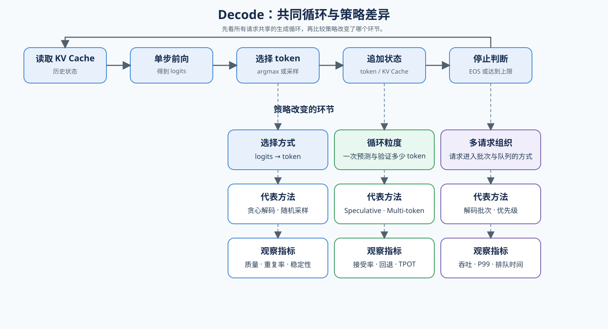

# 03 解码策略（Decoding Strategies）

## 学习问题

首个词元产生后，模型如何反复读取历史状态、选择下一个词元并判断停止？引入草稿候选后，怎样在保持目标模型分布的前提下提高每轮有效推进量？

## 核心机制

### 单步解码与质量契约

普通解码每轮读取已有 KV 状态，计算下一位置的对数概率，选择一个词元，再把新词元及其状态追加到序列。贪心解码选择概率最大的词元，适合作为确定性基线；随机采样还要固定随机种子、温度以及 Top-k、Top-p 参数。

| 生成环节 | 核心问题 | 需要固定或记录的证据 |
|:---|:---|:---|
| 读取历史状态 | 本轮访问了多长的 KV Cache？ | 上下文长度、缓存表示、单轮延迟 |
| 计算与选择 | 使用贪心还是随机采样？ | 随机种子、温度、Top-k、Top-p |
| 停止 | 是否遇到终止词元或长度上限？ | 生成词元数、停止原因 |
| 质量检查 | 更快的路径是否改变输出分布或任务质量？ | 固定输入、输出散列、质量指标 |

### 草稿、验证与校正

投机解码先用较低成本的路径提出一段候选，再由目标模型一次验证多个位置。验证器从左到右提交满足接受条件的连续前缀；首个拒绝位置由目标分布重新采样，后续候选全部丢弃。拒绝采样或等价校正规则保证最终分布与直接从目标模型采样一致。

真正的收益来自“每轮提交更多有效词元”，而不是候选数量本身。候选过长会增加草稿和验证成本；候选过短则不足以摊薄目标模型调用。因此需要同时观察：

\[
\text{有效推进量}=\frac{\text{最终提交词元数}}{\text{目标模型验证轮数}}
\]

| 证据 | 回答的问题 |
|:---|:---|
| 连续接受长度 | 每轮实际提交了多少候选？ |
| 接受率与首个拒绝位置 | 草稿从哪里开始偏离目标模型？ |
| 草稿与验证耗时 | 接受收益是否覆盖额外计算？ |
| 回退次数 | 校正路径被触发得多频繁？ |
| 端到端延迟与输出质量 | 局部接受率是否转化为真实收益？ |

### 三类候选来源

候选可以来自模型内置预测头、外置特征草稿器或并行块草稿。三者共享同一验证与校正语义，但候选成本、资产要求和后端支持不同。

| 候选来源 | 候选如何产生 | 主要收益 | 主要约束 |
|:---|:---|:---|:---|
| 原生多词元预测（MTP） | 目标模型内部的预测层提出后续词元 | 不需要加载独立草稿模型 | 模型必须包含对应预测层，后端必须支持 |
| EAGLE | 外置轻量草稿器读取目标模型隐藏表示并扩展候选树 | 候选与目标模型特征更一致 | 草稿权重必须与目标模型版本配对 |
| DFlash / DSpark | 块扩散并行提出候选；DSpark 再加入块内依赖与置信度控制 | 降低逐词元草稿的串行成本 | 需要专用草稿资产和执行后端 |

DFlash 关注一次提出一个候选块；DSpark 在并行主干之外加入轻量顺序依赖和置信度估计，动态决定候选前缀。它们不是经典双模型投机解码的必经步骤，而是候选生成的扩展分支。

### 动态候选预算与净收益

固定候选长度无法适应所有输入：草稿置信度高时可以增加候选，偏离风险升高时应尽早停止。动态预算依据置信度、历史接受情况或服务负载调整本轮候选长度，但不能改变首个拒绝位置之后全部回退的正确性规则。

## 选择条件与验证证据

| 现象 | 优先检查 | 动作 |
|:---|:---|:---|
| 接受率高但端到端延迟没有下降 | 草稿器和验证器额外开销 | 缩短候选或换用更轻的草稿路径 |
| 首个拒绝位置长期靠前 | 草稿与目标模型不匹配 | 检查模型版本、分词器和采样配置 |
| 短候选稳定、长候选退化 | 候选预算过大 | 使用置信度或历史接受长度收缩预算 |
| 单请求加速但高负载尾延迟变差 | 候选占用挤压批处理或缓存预算 | 进入服务调度实验复测 |

真实结论必须在同一目标模型、输入、采样规则和质量门槛下比较普通解码与候选路径，并同时记录端到端延迟、有效推进量、接受长度、额外显存和失败运行。

参考资料：[投机解码论文](https://arxiv.org/abs/2211.17192)、[EAGLE-3 论文](https://arxiv.org/abs/2503.01840)、[DFlash 论文](https://arxiv.org/abs/2602.06036)、[vLLM Speculators 算法指南](https://docs.vllm.ai/projects/speculators/en/latest/user_guide/algorithms/decision_guide/)。
