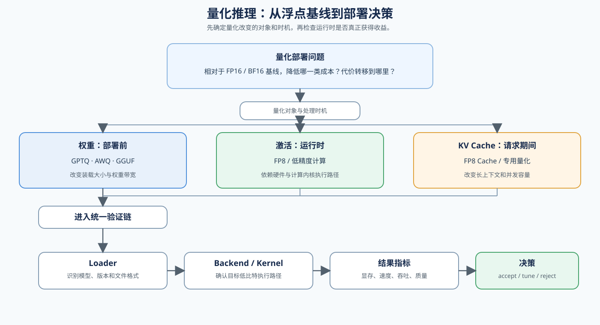

# 05 量化推理与部署（Quantized Inference and Deployment）

## 学习问题

从一个准备上线的模型开始：先观察模型装载、长上下文和并发分别受到什么约束，再区分权重、激活和 KV Cache 三类量化改变的是哪一部分成本。接着把量化算法或文件格式连接到加载器、执行后端和计算内核，理解为什么相同位宽在不同硬件和运行时上可能得到不同结果。完成量化对象、运行时和部署指标的对应后，你应该能够根据显存、速度、质量和部署支持条件，选择下一步要验证的量化路线，而不是只因为显存下降就切换方案。

## 核心机制

量化可以看成“资源占用与表示误差”的交换：降低位宽可能减少装载、显存读写或计算成本，但收益取决于硬件、计算内核和执行后端是否真正支持这条低比特路径。比较方案前，先用同一模型、执行后端和工作负载下的 FP16 / BF16 浮点部署建立基线。

部署判断还需要区分模型、产物和运行时：训练模型保存架构、权重与可继续训练的配置；推理部署产物是量化、转换或编译后交给加载器的文件；推理引擎则管理 KV Cache、请求调度和计算内核调用。“可以加载”只证明格式兼容，不证明已经命中目标低精度路径。

| 对象 | 主要职责 | 验证重点 |
|:---|:---|:---|
| 训练模型 | 保存架构、权重、分词器与可训练配置 | 模型和分词器版本、数据类型与上下文能力 |
| 推理部署产物 | 为加载和执行准备权重文件、量化配置或编译结果 | 文件哈希、量化对象、格式与加载要求 |
| 推理框架 | 提供参考加载、张量计算与生成接口 | 语义对照、模型兼容性和可观测性 |
| 推理引擎 / 运行时 | 管理执行状态、缓存、调度、计算内核和服务接口 | 实际数据类型、计算内核、回退路径和服务指标 |

还要区分量化的处理时机：GPTQ / AWQ 通常在部署前根据校准数据生成量化权重；FP8 可能由模型转换流程或运行时计算内核处理；KV Cache 量化发生在请求执行期间。GGUF 是量化权重的文件格式与部署封装，需要匹配的加载器和执行后端；`llama.cpp` 是常见实现，不能把 GGUF 当成 GPTQ / AWQ 算法。

参考入口：论文 [GPTQ](https://arxiv.org/abs/2210.17323) 与 [AWQ](https://arxiv.org/abs/2306.00978)；实现 [GPTQ](https://github.com/IST-DASLab/gptq)、[AWQ](https://github.com/mit-han-lab/llm-awq) 和 [llama.cpp](https://github.com/ggml-org/llama.cpp)。下面的图和表分别用于理解部署链与选择量化对象。

| 分类 | 量化对象 | 机制入口 | 常见路线 / 格式 | 适用场景 |
|:---|:---|:---|:---|:---|
| FP16 / BF16 浮点部署（基线） | 未量化的权重与运行态张量 | 固定模型、执行后端与工作负载 | 原始浮点模型 | 为显存、速度、吞吐和质量提供对照 |
| 误差与校准 | 统计范围、粒度和敏感对象 | [Part 02 · 52 校准与误差](../../02_PyTorch_Algorithms/52_Quantization_Calibration_and_Error.ipynb) | 校准集、逐张量/逐通道/逐组统计 | 先确定误差来源和比较口径 |
| 权重量化 | 模型权重 | [Part 02 · 25 W8A16](../../02_PyTorch_Algorithms/25_Quantization_W8A16.ipynb)、[Part 02 · 40 GPTQ / AWQ](../../02_PyTorch_Algorithms/40_GPTQ_and_AWQ_Weight_Quantization.ipynb) | W8A16、GPTQ、AWQ、GGUF | 模型装不下、权重带宽或部署成本受限 |
| 权重与激活量化 | 权重、激活和计算张量 | [Part 02 · 53 SmoothQuant / W8A8](../../02_PyTorch_Algorithms/53_Activation_Quantization_and_SmoothQuant.ipynb)、[Part 02 · 41 FP8](../../02_PyTorch_Algorithms/41_FP8_Runtime_Low_Precision_Paths.ipynb) | W8A8、FP8 | 计算和带宽成为瓶颈，且硬件 / 计算内核支持目标数据类型 |
| KV Cache 量化 | KV Cache | [Part 02 · 54 KV Cache 量化](../../02_PyTorch_Algorithms/54_KV_Cache_Quantization_Strategies.ipynb) | K/V 异轴、动态缩放和高精度残留窗口 | 长上下文或高并发时缓存预算不足 |
| 混合位宽 | 不同层或模块的位宽预算 | [Part 02 · QUANT-MIXED-BIT](../../02_PyTorch_Algorithms/QUANT-MIXED-BIT_Mixed_Bit_Allocation.ipynb) | 敏感度扫描、容量约束下的位宽分配 | 单一位宽无法同时满足质量与容量目标 |

量化表示、校准和误差决定产物是否可用，加载器、执行后端和计算内核决定产物是否真正进入低精度推理路径。验证不能在“模型成功加载”处结束：只有模型产物、加载器、计算内核和服务工作负载同时对上，显存或速度变化才有部署意义。只完成格式转换只能证明产物生成成功；成功加载但没有路径证据，只能证明兼容性。

| 验证层 | 需要确认什么 | 失败表现 | 通过证据 |
|:---|:---|:---|:---|
| 模型产物 | 量化对象、位宽、粒度、校准版本和模型版本 | 文件缺失、哈希变化、量化配置与权重不一致 | 产物清单、文件哈希和来源结果可追溯 |
| 加载器与执行后端 | 目标后端能否读取产物并映射目标数据类型 | 加载器拒绝、配置不兼容或模型无法完成往返生成 | 成功加载、非空生成和后端版本记录 |
| 计算内核路径 | 实际执行目标低精度或 FP8 计算内核 | 成功加载但静默回退到浮点或通用计算内核 | 性能分析器事件、内核名称、实际数据类型和回退原因 |
| 服务工作负载 | 固定输入、输出长度、并发和批量后的表现 | 内核命中但延迟、吞吐或峰值显存没有改善 | TTFT、TPOT、吞吐、P99 和峰值显存的配对结果 |
| 质量门槛 | 量化前后的目标任务是否仍可接受 | 性能通过但任务质量、格式或终止行为回归 | 独立质量集上的通过、调参或拒绝结论 |

量化回归要把“数值接近”与“任务可用”分开检查。权重误差较小，不代表长上下文、结构化输出或工具调用一定保持稳定；因此质量样例应覆盖目标服务真正关心的输入，而不是只测一组短文本。

| 回归层 | 建议检查 | 结论依据 |
|:---|:---|:---|
| 数值层 | 输出形状、非有限值、logits 或概率差异 | 是否存在明显数值异常 |
| 生成层 | 固定 Prompt、停止条件、输出长度和重复率 | Decode 行为是否改变 |
| 任务层 | 目标任务准确率、结构化格式或工具调用成功率 | 质量是否满足服务门槛 |
| 服务层 | TTFT、TPOT、吞吐、P99、峰值显存 | 资源收益是否抵消质量或尾延迟代价 |

## 选择条件与验证证据

先固定浮点工作负载，再按量化对象选择权重、激活、计算格式、KV Cache 或混合位宽机制，并用[执行融合与后端分派](../../02_PyTorch_Algorithms/INF-EXECUTION-DISPATCH_Inference_Fusion_and_Backend_Dispatch.ipynb)检查能力门槛、路径命中和回退。比较时固定模型版本、位宽、量化粒度、校准数据、目标数据类型、执行后端、硬件和质量指标。

| 观察到的现象 | 优先判断 | 下一步 |
|:---|:---|:---|
| 模型无法装入显存 | 权重驻留是主要约束 | 检查权重量化和执行后端格式 |
| 格式可以加载但执行后端不支持 | 加载器与运行时不匹配 | 检查 GGUF / GPTQ / AWQ 的执行后端和启动方式 |
| 显存下降但速度没有改善 | 带宽或计算内核没有受益 | 检查低比特计算内核和工作负载 |
| 长上下文 / 高并发受限 | KV Cache 占用过高 | 检查 KV Cache 量化 |
| 速度提升但质量回归 | 量化误差超过目标 | 调整 bit、粒度或校准数据 |
