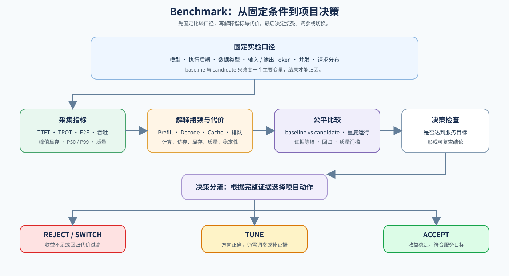

# 06. Benchmark and Decision | 端到端基准与决策

## 学习问题

把前面识别出的候选机制放回同一工作负载和服务目标，比较它们是否真的值得保留，并形成可以复查的采用决策。

## 核心机制

公平比较要固定模型、执行后端、数据类型、输入词元数、输出词元数、批量、并发度和缓存策略，并确保基线与候选只改变一个主要变量。下图展示从工作负载到决策的完整流程，表格说明每个阶段需要产出什么。

| 阶段 | 主要任务 | 关键输出 |
|:---|:---|:---|
| 固定工作负载 | 统一输入、请求分布和服务目标 | 可复现的实验条件 |
| 基线 / 候选 | 只改变一个主要变量 | 成对运行结果 |
| 指标与质量 | 采集 TTFT、TPOT、E2E、吞吐、P99、显存和质量 | 可比较的报告字段 |
| 策略决策 | 对照约束和证据等级 | `accept / tune / reject` 与下一步动作 |

一次运行得到的数字不能直接代表稳定结论。至少要区分预热、正式测量和汇总：预热用于排除首次装载影响，正式测量保留每次请求或每个批次的结果，汇总时同时报告中心趋势和尾部。不同工作负载、硬件或执行后端的结果应分开记录，不要把它们混成一行平均值。

| 测量阶段 | 建议做法 | 主要检查 |
|:---|:---|:---|
| 预热 | 固定若干次预热，不纳入正式结果 | 模型加载、编译和缓存初始化是否完成 |
| 正式测量 | 固定 repeats，保留原始 JSON 或 CSV | 每次 TTFT、TPOT、E2E、显存和错误 |
| 汇总 | 报告 mean 或 median，并报告 P50/P95/P99 | 是否存在尾部抖动或异常值 |
| 对照解释 | 只改变一个主要变量，注明 evidence level | 收益是否可归因、能否复查 |

Benchmark 的结论还要绑定服务目标。在线交互、离线批处理和容量优先的系统，对同一组结果的判断可能不同；因此报告中应先写清约束，再解释指标，而不是把最高吞吐默认为最佳方案。

| 服务目标 | 主要约束 | 优先指标 | 常见决策偏好 |
|:---|:---|:---|:---|
| 交互式在线服务 | 首 token 快、尾延迟稳定 | TTFT、P99、超时率 | 即使吞吐略低，也可能 accept |
| 离线批处理 | 单位时间产出高、成本低 | 吞吐、tokens/s、成本/词元 | 可接受更高 TTFT |
| 长上下文服务 | 缓存可容纳、质量稳定 | 峰值显存、缓存使用量、TTFT | 优先容量和复用收益 |
| 突发并发服务 | 负载上升时保持可用 | admission、P99、拒绝率、恢复时间 | 优先接纳控制和扩缩容 |

### 分布式服务的决策证据

副本、流水线并行、张量并行、上下文并行和专家并行具有不同的容量收益与通信代价。作出决策时，需要把单卡基线、通信、恢复、质量和成本证据放到同一服务目标下比较；各策略的进入条件见[分布式推理与并行扩展](./08_distributed_inference_and_parallelism.md)。

| 方案 | 优先适用条件 | 主要代价 | 必须观察 |
|:---|:---|:---|:---|
| 服务副本 | 模型单卡可装入，目标是提升并发或隔离租户 | 模型副本显存、路由不均、冷启动 | 排队时间、P99、路由公平性、实例利用率 |
| TP / PP / CP / EP | 单卡容量不足，或单请求计算与上下文成为瓶颈 | collective、同步、空转、负载不均 | 通信时间、暴露通信、扩展效率、失败恢复 |
| Replica + 模型内部并行 | 单实例需要多卡且还要横向扩展 | 两层调度、路由与通信耦合 | 每副本吞吐、跨副本尾延迟、通信与恢复成本 |

决策时先检查单卡基线，再确认候选是否具有真实多卡证据。只有容量、吞吐或可用性收益在目标 SLO 下覆盖通信、负载不均和恢复代价时才能采用；否则继续调参、保留单卡降级或拒绝候选。CPU 模拟和单卡切分不作为多卡收益证据。

成本不能只写 GPU 小时。至少把实例数量、运行时长、有效输出词元、失败或重试请求和质量门槛放到同一份报告中，才能比较量化、缓存、调度或执行后端变化带来的真实收益。

| 成本字段 | 计算方式或记录方式 |
|:---|:---|
| 资源成本 | GPU 数量 × 运行时间 × 单卡小时成本 |
| 单位产出成本 | 资源成本 ÷ 有效输出 tokens |
| 失败代价 | 超时、拒绝、重试和质量不达标请求的比例 |
| 容量收益 | 同一 SLO 下可接纳的并发或 tokens/s |

## 选择条件与验证证据

先明确服务目标：在线交互优先关注 TTFT 和 P99，离线批处理可能优先关注吞吐与单位成本；再检查报告是否记录下表字段。`accept` 表示当前约束下值得采用，`tune` 表示方向有效但证据或配置不足，`reject` 表示收益不足、代价过高或质量不达标。CPU 结果可以验证指标聚合和决策逻辑，真实服务结论仍需要固定工作负载下的 GPU 执行后端。

| 类别 | 最小字段 |
|:---|:---|
| 条件 | model、backend、dtype、prompt tokens、generated tokens、batch、concurrency、cache policy |
| 性能 | TTFT、TPOT、E2E latency、throughput、P99、peak memory |
| 策略约束 | quality、acceptance rate、cache hit rate 或公平性 |
| 结论 | accept、tune、reject、下一步动作 |
