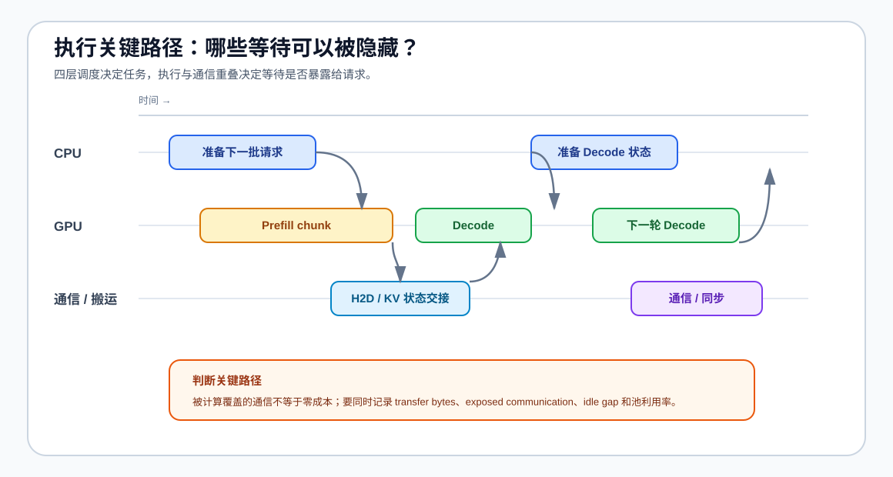
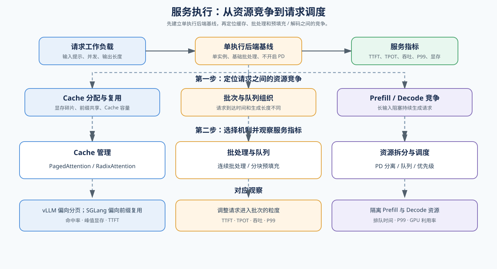

# 07 服务调度、预填充—解码分离与异构路由（Serving Scheduling, PD, and Heterogeneous Routing）

## 学习问题

从多个请求同时到达开始，观察 Prefill 和 Decode 如何争用计算、显存与队列资源；再逐层理解 Chunked Prefill、PD 分离、状态交接与异构资源路由如何共同影响服务质量。最后把调度决策放回 CPU 准备、GPU 计算和通信交接的时间线上，判断等待是否暴露在关键路径。

## 核心机制

### 单轮成本与批次上界

调度器每轮不仅要选请求，还要决定放入多少工作。理想重叠下，单轮时间可先近似为 `max(memory time, compute time) + scheduling / launch / exposed transfer`；实际可接纳批量则取五类上界的最小值。

| 上界 | 主要约束 | 超过后首先出现的现象 |
|:---|:---|:---|
| slot | 最大活跃序列数 | 无法继续补入请求 |
| KV | 每请求历史状态与可用显存 | OOM、抢占或驱逐 |
| scheduled token | 本轮 Prefill chunk 与 Decode token 总量 | 单轮时间和 TPOT 上升 |
| SLO | TTFT / TPOT / P99 目标 | 吞吐仍涨但用户等待恶化 |
| 执行后端 | 计算内核、张量形状与运行时能力 | 收益饱和、回退或执行失败 |

[迭代成本与批量上界](../../02_PyTorch_Algorithms/INF-ITERATION-BUDGET_Serving_Iteration_Cost_and_Batch_Bounds.ipynb)给出这些上界的定量计算。

### 调度问题的层次

调度分为六层：请求选择 → 准入与资源 → 迭代级组批 → 阶段级调度 → 执行级重叠 → 实例池与异构路由。迭代预算给出每轮工作的共同上界，再由六层决策依次消费。只有 MoE 服务需要拆分注意力与 FFN / 专家角色时，才进入 Attention–FFN 解耦分支。

| 层次 | 调度者在决定什么 | 主要输入 | 主要结果 | 对应入口 |
|:---|:---|:---|:---|:---|
| 请求选择 | 当前哪些请求获得执行机会 | 请求状态、优先级、等待时间、期限 | 执行顺序、公平性与抢占动作 | 请求调度 |
| 准入与资源 | 新请求能否进入活跃集合，已有状态能否继续保留 | 缓存容量、页块状态和回收结果 | 接纳、排队、暂停、驱逐或拒绝 | 请求调度与 KV 生命周期 |
| 迭代级组批 | 哪些请求进入下一轮实际批次 | 候选顺序、槽位、缓存容量、词元预算 | 批次成员、动态加入与退出 | 连续批处理 |
| 阶段级调度 | 预填充和解码如何分享本轮词元预算 | 长输入后缀、解码请求、分块大小 | 分块预填充、解码抖动与尾延迟 | 迭代预算与阶段调度 |
| 执行级重叠 | CPU 准备、GPU 计算和状态搬运怎样安排 | 依赖关系、流、传输量和当前批次 | 空闲间隙、暴露传输与端到端时间 | 执行重叠 |
| 实例池与异构路由 | 请求在哪个实例或预填充/解码池执行 | 两池能力、链路、状态大小和 SLO | KV 交接、重算、同池回退与池利用率 | 异构 PD；MoE 可进入 Attention–FFN 解耦 |

### 执行关键路径与重叠

前四层决定请求顺序、准入状态、批次成员和阶段词元预算；第五层把这些决定放到执行时间线上，第六层处理实例池与异构路由。CPU 准备、GPU 计算、数据搬运和 KV 交接如果连续排队，就会把等待暴露给请求；只有在依赖允许时重叠，才可能缩短关键路径。局部状态交接属于服务执行路径，跨 GPU 集合通信则需要另行记录通信与扩展证据。

| 时间层次 | 调度要安排什么 | 典型策略 | 关键证据 |
|:---|:---|:---|:---|
| 执行级 | CPU 准备、GPU 计算、搬运和收尾的先后与重叠 | 双流、双线程、流水线 | overlap ratio、idle gap、端到端延迟 |
| 通信级 | 状态传输或集合通信与计算的重叠 | KV handoff、communication-compute overlap、DBO 类批次拆分 | transfer bytes、通信暴露时间、池利用率 |

读图时先区分两种时间：`total elapsed` 是请求真正等待的时间，`overlap` 是被其他工作隐藏的时间。只有通信或搬运从关键路径中移开，吞吐或尾延迟才可能改善；单纯增加并行任务而造成同步、争用或池闲置，不应直接判断为优化。

| 观察对象 | 需要回答的问题 | 证据字段 |
|:---|:---|:---|
| 请求进入 | 请求是在排队，还是在等待输入准备？ | `queue_wait_ms`、`input_transfer_ms` |
| CPU / GPU 重叠 | CPU 准备是否填补了 GPU 空闲间隙？ | `idle_gap`、`overlap_ratio`、端到端延迟 |
| KV handoff | 状态传输是否阻塞 Decode？ | `transfer_bytes`、`handoff_ms`、`recompute_ms` |
| 网络与集合通信 | 数据是否在通信路径上暴露出来？ | `network_wait_ms`、`communication_ms`、`exposed_comm_ms` |
| 模型启动与流式输出 | 冷启动或输出发送是否被误算为热请求性能？ | `model_load_ms`、`stream_output_ms`、`cold_start` |
| 池间平衡 | 一侧加速是否造成另一侧等待或闲置？ | Prefill / Decode 池利用率、P95/P99 |

### I/O 等待如何进入调度证据

先按时间位置区分等待、搬运和计算；不要把模型加载、请求排队和 KV 交接相加后直接当成 TPOT。

| 证据阶段 | 记录什么 | 与调度的关系 | 解释时的注意点 |
|:---|:---|:---|:---|
| 请求进入 | `queue_wait_ms`、`input_transfer_bytes`、`input_transfer_ms` | 反映接纳、排队与输入准备 | 排队时间上升不等于 GPU 变慢 |
| 预填充 / 解码执行 | `idle_gap`、`overlap_ratio`、`stream_output_ms` | 判断准备、计算和输出是否重叠 | 只能用同一工作负载比较 |
| PD / KV 交接 | `transfer_bytes`、`handoff_ms`、`recompute_ms` | 判断传输、重算或同池回退的代价 | handoff 与 recompute 不能重复计入 |
| 网络 / 通信 | `network_wait_ms`、`communication_ms`、`exposed_comm_ms` | 判断通信是否暴露在关键路径 | 暴露时间应和总 elapsed 分开记录 |
| 启动阶段 | `model_load_ms`、`cold_start` | 区分扩容或首次请求成本 | 冷启动不能和热请求 TTFT 混合平均 |

这里要区分五个容易混淆的对象：

- **请求调度**决定“先服务谁、这一轮服务谁”；
- **缓存管理**决定“请求的状态放在哪里、能保留多久”；
- **PD 分离**决定“Prefill 和 Decode 由哪个资源池执行”；
- **Attention–FFN 解耦（AFD）**决定 MoE 服务中的注意力与 FFN / 专家是否由不同工作进程组执行，并引入双向激活传输和角色间同步；
- **异构路由**决定“两池能力不同时，状态怎样交接、何时回到同池”。

这些对象可以协同，但改动一个对象并不等于同时完成其他对象的优化。例如扩大缓存容量可能提高可接纳并发，却不会自动改善队列公平性；把预填充和解码拆成两个池，也需要重新检查跨池通信和负载平衡。

当请求量超过当前资源能够稳定处理的范围时，调度器还要做“是否接纳”的决定。接纳控制不是简单拒绝请求，而是根据缓存预算、队列等待、服务等级和预计工作量选择排队、限流、降级或转移。它决定系统是在负载上升时保持 P99，还是让所有请求一起变慢。

| 接纳动作 | 触发条件 | 保护对象 | 需要观察 |
|:---|:---|:---|:---|
| 排队 | 当前资源短时不足，但预计可以恢复 | 请求完整性 | queue time、P99、队列长度 |
| 限流或拒绝 | 队列或缓存超过安全水位 | 已接纳请求的 SLO | 拒绝率、超时率、P99 |
| 降级 | 质量目标允许降低资源开销 | 整体可用性 | 输出长度、数据类型、质量指标 |
| 转移或扩容 | 单实例或单池持续饱和 | 服务容量 | 利用率、迁移/通信时间、吞吐 |

### 服务执行后端与调度闭环

服务调度面对的不是单个算子，而是请求之间的资源竞争。先用“单执行后端、基础批处理、单实例、不开启 PD 分离”的配置建立参考行为，固定请求分布、并发度和输出长度，记录 TTFT、TPOT、吞吐、P99 与峰值显存。预填充通常带来突发计算和显存申请，解码则需要持续读取 KV Cache；如果把两者简单混在同一批次，长输入可能阻塞正在生成的请求。因此需要分别观察批处理、队列、缓存预算和 GPU 资源分配。

vLLM 和 SGLang 都是服务执行后端，但适合观察的机制重点不同：vLLM 适合观察 PagedAttention、连续批处理和调度；SGLang 适合观察 RadixAttention、前缀复用、结构化程序和 PD 分离。下面的图片说明共同请求链路以及两种后端的侧重点。

| 执行后端 | 重点机制 | 更适合观察的问题 | 证据要求 |
|:---|:---|:---|:---|
| 单后端基线 | 基础批处理、单实例、不开启 PD 分离 | 建立 TTFT、TPOT、吞吐、P99 和峰值显存参照 | 固定模型、请求分布和采样参数 |
| vLLM | PagedAttention、连续批处理、请求调度 | 缓存分配、吞吐、TTFT / TPOT、P99 | 服务指标、缓存指标和运行时配置 |
| SGLang | RadixAttention、前缀复用、结构化执行、PD 分离 | 前缀缓存、共享前缀、请求组织与资源拆分 | 服务指标、前缀命中和路由状态 |

| 机制 | 主要解决的问题 | 观察指标 |
|:---|:---|:---|
| Continuous Batching | 请求到达时间不同、生成长度不同 | 吞吐、TPOT、P99 |
| Chunked Prefill | 单次长 Prefill 阻塞其他请求 | TTFT、P99、Decode 抖动 |
| Prefill / Decode 分离 | 两类计算互相争用资源 | TTFT、TPOT、P95、池利用率 |
| 异构 PD 路由 | 两池能力、链路或执行后端不同 | 交接时间、传输量、重算时间、P99、失败状态 |
| Attention–FFN 解耦 | 注意力与 FFN / 专家压力不对称，且执行后端明确支持角色连接器 | 角色利用率、双向载荷、暴露传输时间、同步模式、回退状态 |
| 队列与资源调度 | 并发、容量和服务等级变化 | 排队时间、并发容量、SLA |

把服务调度看成一个循环：请求进入队列后，系统根据可用缓存、预填充/解码计算预算和服务等级选择下一批请求；运行结果再影响下一轮调度。这样可以用资源账本和服务指标解释调度结果，而不是只看 GPU 利用率。

| 调度决策依据 | 影响的系统对象 | 需要观察的结果 |
|:---|:---|:---|
| 等待时间与服务等级 | 队列顺序、请求公平性 | P50/P99、最大等待时间、超时率 |
| Prompt / Decode 工作量 | Prefill 与 Decode 的批次组成 | TTFT、TPOT、批次利用率 |
| 缓存可用容量 | 是否接纳、暂停或驱逐请求 | 缓存使用量、OOM、并发容量 |
| 实例与链路状态 | 单实例、PD 池和跨设备通信 | 吞吐、通信时间、资源利用率 |
| 状态交接预算 | KV 传输、重算或保持同池 | handoff ms、recompute ms、P99 |

学习和实验时按同一顺序推进：先验证请求选择与准入，再读取缓存容量和暂停/恢复状态；随后观察迭代成员变化，比较整段与分块预填充，检查准备、计算和搬运的重叠，最后判断异构资源路由、KV 传输/重算和 SLO 回退。真实后端对照应固定工作负载，比较 TTFT、TPOT、吞吐、P99、并发容量、公平性与池利用率。

| 扩展方向 | 新增约束 | 需要补充的证据 |
|:---|:---|:---|
| 张量 / 流水线 / 上下文并行 | 模型或上下文分片、同步和负载平衡 | 通信时间、空转、吞吐、显存 |
| MoE 专家并行 | 词元分发、专家容量和负载不均 | 专家负载、通信时间、空转、吞吐 |
| PD 多实例 | 跨池传输和池间负载不均 | 传输时间、池利用率、P99 |
| 异构 PD | 资源能力、链路或执行后端不同 | 交接 / 重算、路由命中、P99、回退率 |
| Attention–FFN 解耦 | MoE 的注意力与 FFN / 专家资源需求不同 | 角色利用率、激活传输、连接器等待、失败回退 |
| 自动扩缩容 | 冷启动、迁移和容量预测 | 扩容延迟、恢复时间、拒绝率 |

参考入口：开源项目 [vLLM](https://github.com/vllm-project/vllm) 与 [SGLang](https://github.com/sgl-project/sglang)；论文 [SGLang](https://arxiv.org/abs/2312.07104) 和官方文档 [PD Disaggregation](https://github.com/sgl-project/sglang/blob/main/docs_new/docs/advanced_features/pd_disaggregation.mdx)。

## 选择条件与验证证据

比较调度候选前，先固定请求分布、输入长度、输出长度、并发度、批处理策略和缓存策略，再区分计算、排队、交接与资源分配问题。只有在 MoE 模型、角色压力不对称且执行后端明确支持连接器时，才进入 [Attention–FFN 解耦](../../02_PyTorch_Algorithms/INF-AFD_Attention_FFN_Disaggregation.ipynb)分支。

| 观察到的现象 | 优先判断 | 下一步 |
|:---|:---|:---|
| 长 Prompt 到达后 Decode 请求明显抖动 | Prefill 抢占或批次组织不合理 | 检查 Chunked Prefill 和 Continuous Batching |
| TTFT 可接受但 TPOT / P99 变差 | Decode 资源被挤占或排队积累 | 检查 Decode 调度和资源配额 |
| 单实例无法同时满足两类请求 | Prefill 与 Decode 资源需求不同 | 评估 Chunked Prefill 与 PD 分离 |
| PD 吞吐改善但 P99 变差 | 交接或池间失衡暴露在关键路径 | 比较 KV 传输、重算与同池回退 |
| GPU 利用率低但排队时间高 | 调度粒度、批次或跨实例通信不合理 | 检查执行轨迹与真实服务基准 |
