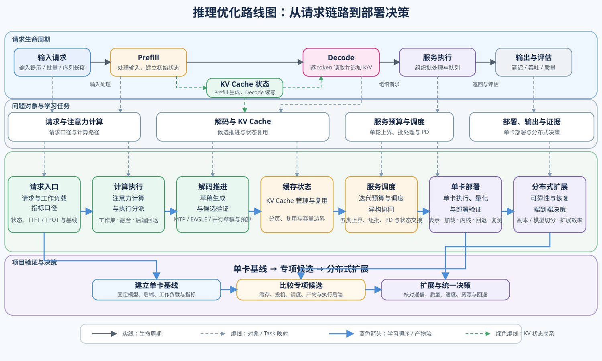
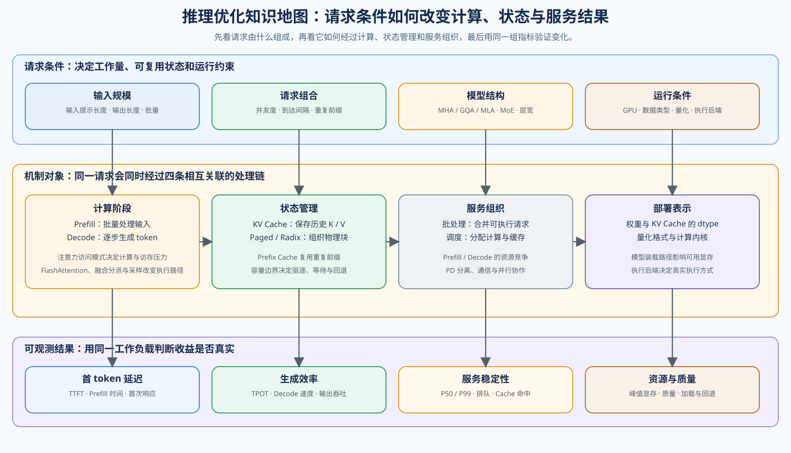

# 推理优化（Inference Optimization）

> 专题类型：主学习路线　主服务目标：请求性能与 Serving 决策

推理优化研究模型如何把一组输入 Token 转换为连续输出，以及请求在排队、预填充（Prefill）、解码（Decode）、KV Cache 和执行后端中为何产生延迟、容量与吞吐差异。学习重点是把请求现象还原为状态、工作负载、执行路径和可比较证据。

本路线先固定请求生命周期和可比指标，再解释注意力执行、解码推进、KV Cache 管理、服务调度、低精度部署与分布式扩展如何改变延迟、吞吐和容量。最终结论必须来自固定工作负载下的真实执行路径和配对证据。

## 学习路线

按 Task 顺序学习时使用下表；需要连续理解请求因果关系时进入[推理优化问题链](./walkthrough.md)，遇到延迟、容量、缓存或回退异常时使用[推理优化判断手册](./casebook.md)，术语差异查询[专题术语表](./glossary.md)。

| Task / 主题 | 本阶段要回答的问题 | 学习入口与验证出口 | 学习顺序 | 主要正文入口 |
|:---|:---|:---|:---|:---|
| Task0 · 请求、工作负载与指标 | 一次仅解码器自回归请求如何经过预填充、逐词元解码和终止，并产生可比较的阶段指标？ | 核心：[Part 02 · INF-REQUEST 请求生命周期](../../02_PyTorch_Algorithms/INF-REQUEST-LIFECYCLE_Inference_Request_Lifecycle.ipynb)；项目：[Part 02 · 66 推理性能比较](../../02_PyTorch_Algorithms/66_Inference_Performance_Comparison.ipynb) | 仅解码器生成路径 → 请求事件与状态 → 阶段指标 → 工作负载契约 → 失败与证据 → 真实后端基线验证 | [专题正文 · 01 请求链路与指标](./01_request_path_and_metrics.md) |
| Task1 · 注意力计算与执行分派 | 注意力表示与执行路径如何决定预填充工作集、KV 状态和后续解码成本？ | 核心：[Part 02 · 04 MHA / GQA](../../02_PyTorch_Algorithms/04_Attention_MHA_GQA.ipynb) → [Part 02 · 20 FlashAttention / SDPA](../../02_PyTorch_Algorithms/20_FlashAttention_Sim.ipynb) → [Part 02 · INF-EXECUTION-DISPATCH](../../02_PyTorch_Algorithms/INF-EXECUTION-DISPATCH_Inference_Fusion_and_Backend_Dispatch.ipynb)；扩展：[算子优化](../operator_optimization/intro.md) | 复用 Task0 工作负载 → 注意力头表示 → 预填充建立 KV → 分块工作集与融合 → 执行后端能力门槛 → 向解码阶段交付 KV 状态 | [专题正文 · 02 预填充与注意力计算内核](./02_prefill_and_attention_kernel.md) |
| Task2 · 解码推进与候选验证 | 解码如何读取已有状态，并通过草稿、验证和动态预算提高每轮有效推进量，同时保持目标分布？ | 核心：[Part 02 · 21 解码策略](../../02_PyTorch_Algorithms/21_Decoding_Strategies.ipynb) → [Part 02 · 23 投机解码](../../02_PyTorch_Algorithms/23_Speculative_Decoding.ipynb) → [Part 02 · 35 原生 MTP](../../02_PyTorch_Algorithms/35_Multi_Token_Decoding.ipynb)或[Part 02 · INF-EAGLE](../../02_PyTorch_Algorithms/INF-EAGLE_Feature_Drafter_and_Candidate_Tree.ipynb) → [Part 02 · INF-PROPOSAL 动态预算](../../02_PyTorch_Algorithms/INF-PROPOSAL_Dynamic_Proposal_and_Verification_Budget.ipynb)；项目：[Part 02 · 68 投机解码基准](../../02_PyTorch_Algorithms/68_Speculative_Decoding_Benchmark.ipynb)；扩展：[Part 02 · INF-PARALLEL-DRAFTING 并行草稿](../../02_PyTorch_Algorithms/INF-PARALLEL-DRAFTING_DFlash_and_DSpark.ipynb) | 单步解码与采样 → 精确验证语义 → MTP / EAGLE / 并行草稿候选 → 动态候选预算 → 真实模型净收益复测 | [专题正文 · 03 解码策略](./03_decoding_strategies.md) |
| Task3 · KV Cache 表示、管理与复用 | KV Cache 在预填充阶段如何建立，并在持续解码中如何分页、追加、复用、驱逐与压缩？ | 核心：[Part 02 · 04 MHA / GQA](../../02_PyTorch_Algorithms/04_Attention_MHA_GQA.ipynb) → [Part 02 · 22 PagedAttention](../../02_PyTorch_Algorithms/22_vLLM_PagedAttention.ipynb) → [Part 02 · 37 KV 生命周期](../../02_PyTorch_Algorithms/37_KV_Cache_Lifecycle_and_Capacity_Control.ipynb) → [Part 02 · 24 Prefix Cache](../../02_PyTorch_Algorithms/24_Prefix_Cache_Matching_and_Reuse.ipynb) → [Part 02 · 34 RadixAttention](../../02_PyTorch_Algorithms/34_SGLang_RadixAttention.ipynb)；项目：[Part 02 · 69 Prefix Cache](../../02_PyTorch_Algorithms/69_Prefix_Caching_Benchmark.ipynb)；扩展：[Part 02 · ARCH-MLA 紧凑 KV 表示](../../02_PyTorch_Algorithms/ARCH-MLA_Multihead_Latent_Attention.ipynb) → [Part 02 · 71 MLA 基准](../../02_PyTorch_Algorithms/71_MLA_KV_Cache_Architecture_Benchmark.ipynb)，以及 [Part 02 · 54 KV Cache 量化](../../02_PyTorch_Algorithms/54_KV_Cache_Quantization_Strategies.ipynb) | KV 表示与容量 → 分页分配 → 生命周期与容量控制 → 通用前缀匹配 → Radix 索引 → 真实复用验证；按容量问题扩展 MLA 或 KV 量化 | [专题正文 · 04 KV Cache 表示、管理与复用](./04_kv_cache_lifecycle_and_reuse.md) |
| Task4 · 服务迭代预算、调度与异构协同 | 单轮工作量上界如何进入请求选择、动态批次、阶段调度与异构路由？ | 核心：[Part 02 · INF-ITERATION-BUDGET](../../02_PyTorch_Algorithms/INF-ITERATION-BUDGET_Serving_Iteration_Cost_and_Batch_Bounds.ipynb) → [Part 02 · 36 请求调度](../../02_PyTorch_Algorithms/36_Decode_Scheduling.ipynb) → [Part 02 · INF-CONTINUOUS-BATCHING](../../02_PyTorch_Algorithms/INF-CONTINUOUS-BATCHING_Continuous_Batching.ipynb) → [Part 02 · 38 阶段调度](../../02_PyTorch_Algorithms/38_Prefill_Decode_Scheduling.ipynb) → [Part 02 · INF-SERVING-OVERLAP](../../02_PyTorch_Algorithms/INF-SERVING-OVERLAP_Serving_Overlap_and_State_Handoff.ipynb) → [Part 02 · 39 异构 PD](../../02_PyTorch_Algorithms/39_Hetero_PD_and_Serving_Tiers.ipynb)；项目：[Part 02 · 70 Serving 调度](../../02_PyTorch_Algorithms/70_Serving_Scheduler_Benchmark.ipynb)；扩展：[Part 02 · INF-AFD](../../02_PyTorch_Algorithms/INF-AFD_Attention_FFN_Disaggregation.ipynb) | 读取 Task3 容量状态 → 单轮预算 → 请求选择 → 动态批次 → 阶段调度 → 重叠与异构路由 → 真实后端调度复测 | [专题正文 · 07 Serving 调度与 PD 分离](./07_serving_scheduling_and_pd.md) |
| Task5 · 低精度执行与单卡部署准入 | 一个浮点或量化产物怎样通过加载器、执行后端和计算内核检查，并在单卡工作负载下形成可复现的准入结论？ | 核心：[Part 02 · 66 浮点基线](../../02_PyTorch_Algorithms/66_Inference_Performance_Comparison.ipynb) → [Part 02 · 52 校准与误差](../../02_PyTorch_Algorithms/52_Quantization_Calibration_and_Error.ipynb) → [Part 02 · 25 W8A16](../../02_PyTorch_Algorithms/25_Quantization_W8A16.ipynb) → [Part 02 · INF-EXECUTION-DISPATCH](../../02_PyTorch_Algorithms/INF-EXECUTION-DISPATCH_Inference_Fusion_and_Backend_Dispatch.ipynb)；项目：[Part 02 · 82 量化产物准入](../../02_PyTorch_Algorithms/82_Quantization_Artifact_Evaluation_Project.ipynb) → [Part 02 · 67 量化部署](../../02_PyTorch_Algorithms/67_Quantized_Inference_and_Deployment.ipynb) → [Part 02 · 83 Serving 复测](../../02_PyTorch_Algorithms/83_Quantized_Serving_Profile_Benchmark.ipynb)；扩展：[量化与压缩 · Task2–6](../quantization_compression/intro.md) | 浮点基线 → 量化对象与误差 → 产物 → 加载器 → 执行后端 → 计算内核或回退 → 单卡配对复测 | [专题正文 · 05 量化推理与部署](./05_quantized_inference_and_deployment.md) |
| Task6 · 分布式 Serving、可靠性与 SLO 决策 | 单卡基线不足或设备失效时，应选择请求副本还是模型内部并行？通信、恢复和扩展代价能否满足目标 SLO？ | 核心：[Part 01 · 26 并行策略决策](../../01_Hardware_Math_and_Systems/26_Parallel_Strategy_Decision_Framework.ipynb) → [Part 02 · PAR-REPLICA 请求副本](../../02_PyTorch_Algorithms/PAR-REPLICA_Serving_Replica_Routing.ipynb) / [Part 02 · 87 模型内部并行](../../02_PyTorch_Algorithms/87_Model_Internal_Parallel_Benchmark.ipynb)；项目：[Part 02 · 81 分布式推理验证](../../02_PyTorch_Algorithms/81_Distributed_Inference_Project.ipynb)；扩展：[通信与并行](../communication_parallelism/intro.md) | 单卡基线 → 请求副本 / 模型内部并行 → 通信与恢复证据 → 扩展效率与 SLO 决策 | [专题正文 · 08 分布式推理与并行](./08_distributed_inference_and_parallelism.md) |

Task5 复用量化专题的机制 JSON 和版本化产物，不重复局部量化实验；当前 KV Cache 量化证据仅覆盖 Transformers `QuantizedCache` + HQQ，不能外推到 vLLM 或 SGLang。Task6 的 CPU 内容用于理解切分、路由和恢复决策，多卡通信、扩展效率与故障恢复证据暂缓到真实多 GPU 环境验证。

## 扩展与跨专题入口

### 按需回补：架构与共享前置

遇到架构、MoE、dtype 或精度方面的知识缺口时，从下表回补对应入口，再回到当前 Task 继续学习。

| 补充主题 | Notebook 入口 | 建议时机 |
|:---|:---|:---|
| Benchmark 证据与实验设计 | [Part 00 · 20 性能证据与实验设计](../../00_Prerequisites/20_Performance_Evidence_and_Experiment_Design.ipynb) | Task0 / Task6；需要固定工作负载、基线、重复测量、失败记录和证据等级时 |
| 模型计算量与硬件资源 | [Part 01 · 02 参数量与 FLOPs](../../01_Hardware_Math_and_Systems/02_LLM_Params_and_FLOPs.ipynb) → [Part 01 · 03 GPU 架构与显存](../../01_Hardware_Math_and_Systems/03_GPU_Architecture_and_Memory.ipynb) | Task0–1；需要估算计算、带宽与容量上界时 |
| 注意力工作集与显存 | [Part 01 · 04 注意力显存优化](../../01_Hardware_Math_and_Systems/04_Attention_Memory_Optimization.ipynb) → [Part 01 · 14 FlashAttention 显存模型](../../01_Hardware_Math_and_Systems/14_FlashAttention_Memory_Model.ipynb) | Task1；需要先建立完整分数矩阵、分块工作集和显存读写直觉时 |
| KV Cache 容量增长 | [Part 01 · 11 KV Cache 与显存增长](../../01_Hardware_Math_and_Systems/11_KV_Cache_and_Memory_Growth.ipynb) | Task3；需要从层数、KV 头数、上下文长度和并发度估算容量上界时 |
| 架构基础 | [Part 02 · 05 LLaMA3 Block](../../02_PyTorch_Algorithms/05_LLaMA3_Block_Tutorial.ipynb)、[Part 02 · 08 Architecture Tricks](../../02_PyTorch_Algorithms/08_Architecture_Tricks.ipynb) | Task0 开始时需要确认仅解码器模型的数据流、持久状态或架构配置时 |
| 数据类型、量化表示与运行时约束 | [Part 01 · 01 数据类型与精度](../../01_Hardware_Math_and_Systems/01_Data_Types_and_Precision.ipynb) → [Part 01 · 21 量化理论](../../01_Hardware_Math_and_Systems/21_Quantization_Theory_and_INT4_INT8.ipynb) → [Part 01 · 34 异构运行时约束](../../01_Hardware_Math_and_Systems/34_Heterogeneous_Accelerators_and_Runtime_Constraints.ipynb) | Task5；需要解释数据类型、产物兼容性或执行回退时 |
| 异步执行与状态交接 | [Part 01 · 17 CUDA Stream](../../01_Hardware_Math_and_Systems/17_CUDA_Stream_and_Asynchrony.ipynb) | Task4；需要解释准备、计算和搬运重叠时 |
| 通信拓扑与集合通信 | [Part 01 · 05 通信拓扑](../../01_Hardware_Math_and_Systems/05_Communication_Topologies.ipynb) → [Part 01 · 20 NCCL 与 AllReduce](../../01_Hardware_Math_and_Systems/20_NCCL_and_AllReduce_Basics.ipynb) | Task6；需要解释多卡通信上界时 |
| 可靠性与恢复 | [Part 01 · 28 故障容错与检查点](../../01_Hardware_Math_and_Systems/28_Fault_Tolerance_and_Checkpointing.ipynb) | Task6；需要检查副本失效、重试、状态恢复和降级条件时 |
| MoE 架构与计算 | [Part 02 · 06 MoE Router](../../02_PyTorch_Algorithms/06_MoE_Router.ipynb)、[Part 02 · 07 MoE Load Balancing](../../02_PyTorch_Algorithms/07_MoE_Load_Balancing_Loss.ipynb)、[Part 01 · 22 MoE 参数与计算](../../01_Hardware_Math_and_Systems/22_MoE_Parameter_and_Compute.ipynb) | Task4 / Task6；进入 AFD 或专家并行前 |

### 跨专题入口

需要核对注意力表示、MoE 或混合记忆时进入[模型架构演进](../llm_architecture_evolution/intro.md)；定位延迟和容量来源时进入[性能分析](../performance_analysis/intro.md)，比较候选和瓶颈转移时进入[性能优化](../performance_optimization/intro.md)；量化产物与低精度路径进入[量化与压缩](../quantization_compression/intro.md)，多卡切分与通信证据进入[通信与并行](../communication_parallelism/intro.md)，计算内核与融合进入[算子优化](../operator_optimization/intro.md)。

## 实验与项目出口

首次运行先按[实验 Quickstart](./quickstart.md)创建或恢复环境，再从[实验资产表](./experiment_assets.md)选择 Profile、模型、工作负载、候选和结果路径；跨专题的软件版本与硬件快照查询[GPU 环境资产表](../../docs/gpu_environment_assets.md)。机制页验证一个受控变量，项目页再进入真实执行后端、请求队列和部署决策。

| 证据阶段 | 要回答的问题 | 输出与入口 |
|:---|:---|:---|
| CPU 机制 | 状态转换、公式、预算或选择规则是否成立？ | 各机制页的题目、测试、答案与解析 |
| 单卡机制 GPU | 真实模型、算子或运行时路径是否改变局部质量、延迟或显存？ | [Part 02 · 20 FlashAttention / SDPA](../../02_PyTorch_Algorithms/20_FlashAttention_Sim.ipynb)、INF-ITERATION-BUDGET、INF-EXECUTION-DISPATCH、INF-PROPOSAL、INF-SERVING-OVERLAP，以及量化专题 25、40、41、53、54 和 Mixed-bit 的机制 JSON |
| 专项后端 | 缓存、调度或投机策略是否在真实请求中成立？ | [Part 02 · 68 投机解码](../../02_PyTorch_Algorithms/68_Speculative_Decoding_Benchmark.ipynb)、[Part 02 · 69 前缀缓存](../../02_PyTorch_Algorithms/69_Prefix_Caching_Benchmark.ipynb)、[Part 02 · 70 服务调度](../../02_PyTorch_Algorithms/70_Serving_Scheduler_Benchmark.ipynb) |
| 单卡部署 | 合格产物是否被目标执行后端正确加载并产生可复现收益？ | 后续项目链：[Part 02 · 66 浮点基线](../../02_PyTorch_Algorithms/66_Inference_Performance_Comparison.ipynb) → [Part 02 · 82 产物准入](../../02_PyTorch_Algorithms/82_Quantization_Artifact_Evaluation_Project.ipynb) → [Part 02 · 67 量化部署](../../02_PyTorch_Algorithms/67_Quantized_Inference_and_Deployment.ipynb) → [Part 02 · 83 服务 Profile](../../02_PyTorch_Algorithms/83_Quantized_Serving_Profile_Benchmark.ipynb) → [Part 02 · 72 单卡部署](../../02_PyTorch_Algorithms/72_Multi_Model_Deployment_Comparison.ipynb)；项目统一重构前不计为已完成证据 |
| 分布式决策 | 多卡方案能否在通信代价下改善容量、延迟或吞吐？ | [Part 02 · 87 模型内部并行](../../02_PyTorch_Algorithms/87_Model_Internal_Parallel_Benchmark.ipynb) → [Part 02 · 81 分布式推理验证](../../02_PyTorch_Algorithms/81_Distributed_Inference_Project.ipynb) |
