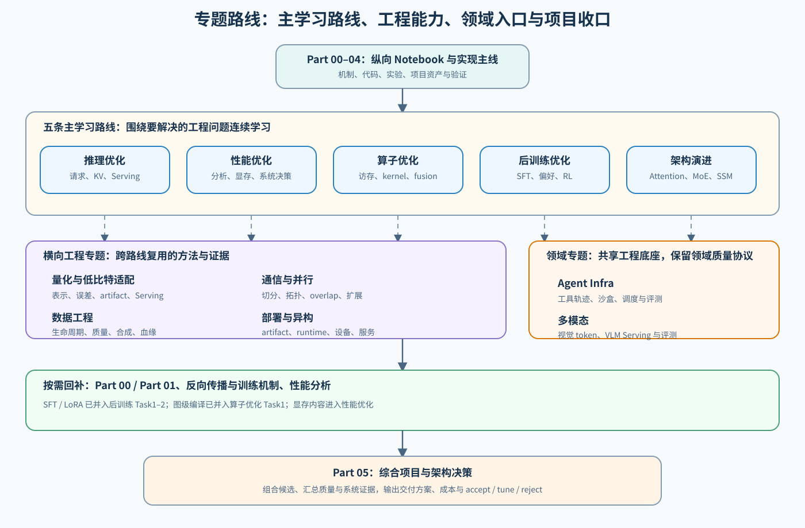

# 专题路线总览

`topic_discussion` 是跨 Part 的路线与证据导航层。它不复制 Notebook 的代码、题目或实验结果，而是回答三个问题：当前要解决什么问题、应按什么顺序学习、一个结论需要哪些机制与证据支持。

## 如何使用专题路线

先按目标选择一条主学习路线；遇到量化、通信、部署或数据问题时进入横向工程专题；任务面向 Agent 或多模态时再补领域专题。Part 00/01、反向传播机制与 SFT 基础只在出现知识缺口时回查。完成局部机制与 benchmark 后，由 Part 05 将多个候选收束为项目交付和架构决策。

专题页负责关系、判断条件和项目入口；代码实现、CPU 机制实验、GPU/backend benchmark 仍以对应 Part 的 Notebook 为准。

## 五条主学习路线

五条路线可按目标独立进入；下表从模型结构、能力形成依次排到服务运行、性能诊断和底层实现，用来表达对象层次，而不是严格的前置依赖。

| 路线 | 解决的核心问题 | 主要入口 | 当前建设重点 |
|:---|:---|:---|:---|
| 大模型架构演进 | 如何解释并比较 Block、Attention、位置、MoE 与混合架构选择？ | [大模型架构演进](./llm_architecture_evolution/intro.md) | 架构演进链、模型审计和选型判断 |
| 后训练优化 | 如何完成 SFT、偏好优化、RL 对齐及其工程交付？ | [后训练优化](./post_training_optimization/intro.md) | 数据、DPO、GRPO、RL 工程与评测 |
| 推理优化 | 如何降低请求延迟、提高吞吐并稳定 Serving？ | [推理优化](./inference_optimization/intro.md) | decode、KV Cache、调度、PD 与分布式推理 |
| 性能优化 | 如何定位计算、显存、通信与 I/O 瓶颈，并形成可信决策？ | [性能优化](./performance_optimization/intro.md) | 可观测性、显存账本、系统级复测 |
| 算子优化 | 如何在 kernel、访存、融合和后端层消除局部瓶颈？ | [算子优化](./operator_optimization/intro.md) | Triton、经典算子、Attention 与 CUDA 下探 |

## 横向工程专题

这些专题服务多条主路线；它们不是彼此替代关系。

| 专题 | 主要服务对象 | 当前判断 |
|:---|:---|:---|
| [量化与压缩](./quantization_compression/intro.md) | 推理、后训练、部署 | 主线已覆盖对象、校准、PTQ、QLoRA、运行时低精度、artifact 与 Serving 决策；剪枝、蒸馏和稀疏化仍是后续扩展，不应被默认当作已覆盖内容。 |
| [通信与并行](./communication_parallelism/intro.md) | 训练、推理、MoE、性能 | 覆盖通信原语、状态切分、并行、EP hotspot、overlap 与 benchmark；真实多卡项目提供最终证据。 |
| [数据工程](./data_engineering/intro.md) | 后训练、RAG、性能 | 负责数据生命周期、解析、清洗、去重、质量、配比、合成与血缘；当前先建设路线和正文。 |
| [部署与异构系统](./deployment_heterogeneous/intro.md) | 推理、量化、通信、领域服务 | 把 artifact、backend、设备兼容、数据路径、服务分层、端边云、发布与成本收束为可交付部署方案。 |

量化专题输出可复测的 artifact、质量与 Serving 候选；部署专题继续验证其目标设备、runtime、服务拓扑和成本。通信专题解释多设备机制；性能专题负责采集、归因和复测它们的系统代价。

## 领域专题

| 专题 | 关注的对象 | 当前建设阶段 |
|:---|:---|:---|
| [Agent 基础设施](./agent/intro.md) | 工具轨迹、沙盒、任务调度、可观测性与 Agentic RL | 已确定 Task0–6；优先建设数据生产与沙盒环境。 |
| [多模态与视觉推理](./multimodal/intro.md) | 视觉 token、视觉 KV、VLM Serving、压缩与性能分析 | 已确定 Task0–6；先建设模型架构与多模态 workload。 |

领域专题复用推理、后训练、数据、性能和部署的共同证据字段，但应保留自己的质量协议，例如任务完成率、VQA/OCR 指标或轨迹正确性。

## 基础与诊断入口

| 入口 | 用途 | 何时进入 |
|:---|:---|:---|
| [反向传播与训练机制](./backpropagation_training_mechanism/intro.md) | autograd、saved tensors、checkpoint、offload 与训练状态账本 | 训练、后训练或训练侧性能问题需要回补机制时 |
| [性能分析](./performance_analysis/intro.md) | profiling、trace、回归验证与行动决策 | 需要先拿到时间、显存、通信或服务路径证据时 |

SFT / LoRA 已并入[后训练优化](./post_training_optimization/intro.md)的 Task1–2；图级优化与编译已并入[算子优化](./operator_optimization/intro.md)的 Task1。它们可以保留内部正文目录，但不再作为单独专题入口。显存优化的核心内容已迁入[性能优化](./performance_optimization/intro.md) Task2–3，不再作为专题路线入口；性能分析则继续作为独立的基础取证专题，为所有主路线提供测量方法。

## 从现象选择入口

| 遇到的现象 | 优先进入 | 常见的下一跳 |
|:---|:---|:---|
| TTFT、TPOT、吞吐、排队或 KV Cache 问题 | 推理优化 | 性能优化、量化、部署与异构 |
| OOM、activation、offload、显存预算问题 | 性能优化 | 反向传播与训练机制、量化 |
| 单 kernel 慢、访存利用率低、融合无收益 | 算子优化 | 性能优化、算子优化 Task1 的图级变换与编译内容 |
| SFT、偏好数据、DPO、GRPO、reward 问题 | 后训练优化 | 数据工程、反向传播与训练机制 |
| 模型结构、上下文、MoE 或 Attention 选择 | 大模型架构演进 | 推理优化、通信与并行 |
| 量化 artifact、dtype、质量或低比特 Serving 问题 | 量化与低比特适配 | 部署与异构、性能优化 |
| 多卡扩展、NCCL、EP 或通信等待 | 通信与并行 | 性能优化、部署与异构 |
| 模型无法加载、目标设备不兼容、端边云放置 | 部署与异构系统 | 量化、通信与并行、Part 05 |

## 模型评测与决策的跨专题分工

模型评测不是某一条路线末尾的附加步骤，而是所有会改变数据、模型表示、执行路径或部署环境的专题共同遵守的质量门槛。当前由[后训练优化 Task6](./post_training_optimization/09_preference_data_and_project_decision.md)维护共同的模型质量、对齐、鲁棒性、失败记录与 `accept / tune / reject` 协议；各专题只补充自己改变对象的专项证据。

| 专题 | 模型评测中的主责 | 需要交给其他专题的部分 |
|:---|:---|:---|
| [数据工程](./data_engineering/intro.md) | 评测集版本、训练/评测隔离、去污染、覆盖与血缘 | 后训练判断能力提升；推理判断检索与服务效果 |
| [后训练优化](./post_training_optimization/intro.md) | 任务质量、安全、有用性、鲁棒性、judge 一致性与在线回滚 | 数据工程保证评测可信；性能优化解释资源代价 |
| [量化与压缩](./quantization_compression/intro.md) | 复用质量门槛，检查低比特表示造成的质量回归 | 性能与部署记录 artifact、延迟、显存和 backend 路径 |
| [通信与并行](./communication_parallelism/intro.md) | 复用质量门槛，检查数值一致性和训练回归 | 性能优化记录通信、overflow 与扩展代价 |
| [部署与异构系统](./deployment_heterogeneous/intro.md) | 复用固定质量集，检查跨 backend / 设备输出一致性 | Part05 收束兼容性、成本和交付选择 |
| [性能优化](./performance_optimization/intro.md) | 保证性能收益不以降低质量条件为代价 | 后训练或任务页定义质量指标 |

## 统一模型角色与结果可比性

横向专题共享模型角色，但不强制所有实验使用同一模型。稳定功能基线用于验证代码和执行路径，现代兼容性候选用于检查新架构与新工具栈，性能工作负载和生产候选才用于形成资源与系统结论。

| 模型角色 | 默认选择 | 主要用途 | 能否形成性能结论 |
|:---|:---|:---|:---|
| 稳定功能基线 | `Qwen/Qwen2.5-0.5B-Instruct` | 加载、前向、量化、训练和分布式机制 smoke | 否，只证明功能路径可运行 |
| 现代兼容性候选 | `Qwen/Qwen3-0.6B`，固定 `enable_thinking` | Qwen3 架构、tokenizer、chat template 与新版 backend 兼容性 | 否，只解释候选兼容性 |
| 性能工作负载 | 各专题登记的 1.5B–7B 模型或合成大 Payload | 显存、吞吐、延迟、通信和扩展效率 | 可以，但必须固定比较契约 |
| 生产候选 | 项目指定模型与产物 | 真实部署、成本和交付决策 | 只对登记环境与工作负载有效 |

功能基线不能外推生产性能；Qwen2.5 与 Qwen3 的架构、KV Head、tokenizer 和 chat template 不同，不能直接比较结果。跨专题复用证据时，至少固定 `model_id`、revision、tokenizer、chat template、Thinking 模式和实际输入/输出 token。具体模型版本、技术栈要求和适用专题统一登记在 [模型、执行栈与环境资产表](../docs/gpu_environment_assets.md)，各专题只解释为什么选择该角色。

## 统一执行栈角色与版本口径

同一个模型可以经过不同执行栈运行，但这些工具回答的问题不同。专题页选择执行栈时先按实验目的分层，不用“都能生成文本”作为横向比较依据。

| 执行栈 | 教程中的主要角色 | 适合回答的问题 | 不直接承担的结论 |
|:---|:---|:---|:---|
| Transformers | 模型语义与固定输入参考路径 | 模型、tokenizer、chat template、训练接口和原生前向是否正确 | 生产 Serving 吞吐或调度优劣 |
| vLLM | GPU Serving 主基线 | Continuous Batching、KV Cache、并发、TTFT、TPOT 与吞吐 | SGLang 或其他引擎在不同 workload 下的表现 |
| SGLang | 结构化执行与缓存/调度对照 | Prefix Cache、RadixAttention、结构化生成与调度策略 | 无共同输入和版本条件时的跨引擎排名 |
| llama.cpp | GGUF 与本地、CPU、端侧执行路径 | 低资源部署、CPU/GPU offload、端侧延迟和内存 | NVIDIA 数据中心 Serving 的替代基线 |
| TensorRT-LLM | NVIDIA 优化引擎候选 | Engine 构建、插件与精度路径、目标 GPU 上的优化部署 | 脱离 CUDA、TensorRT、GPU 架构和构建产物的通用收益 |

版本采用三层口径：requirements 记录仓库安装意图，模型、执行栈与环境资产表记录最低兼容与已验证快照，单次结果 JSON 记录真正参与实验的版本。文档中的“当前版本”不等于已验证版本；没有运行快照时只能标记为待验证。具体固定方式、官方矩阵和仓库状态见 [模型、执行栈与环境资产表](../docs/gpu_environment_assets.md)。

## 统一证据与项目复用

跨专题结论至少要说明以下内容：

| 字段组 | 最少说明 |
|:---|:---|
| workload | 输入/输出长度、并发、warmup、重复、质量集版本 |
| candidate | 模型 revision、artifact、量化/并行/服务配置 |
| environment | 设备、driver/runtime、backend、实际 dtype 与关键路径 |
| metrics | 质量、TTFT、TPOT、吞吐、P95/P99、峰值显存、通信/传输等待、成本 |
| evidence | CPU 模拟、GPU 探针、load smoke、固定 benchmark 或真实部署；失败记录与 `accept / tune / reject` |

同一个 Part 02 或 Part 05 项目可以被多个专题引用，但只能有一个主叙事：主专题定义问题、质量协议和最终判断；关联专题只解释其中的机制或复用相应证据。例如，量化项目 67 的主叙事是量化部署，部署专题复用它的 artifact 与 backend 结论，性能专题复用其测量证据。

## 建设优先级

1. 完成部署与异构的 Task2/3：07 兼容 gate、08 端边云放置已建立，下一步接入 72、81 与 Part 05 的真实项目字段。
2. 完成数据工程的 Task0–2：全景、解析与清洗质量链。
3. 完成 Agent 的 Task0–2 与多模态的 Task0–1，先建立各自的 workload、数据与环境概念。
4. 继续收口性能优化与后训练优化的项目证据；算子优化在 Part 03/04 的实现资产稳定后继续下探。

## Part 05 收口

[Part 05：综合项目与架构决策](../05_Integrated_Projects_and_Decisions/intro.md)负责将多条路线组合为真实工程项目：推理服务、训练优化、Agent、多模态，以及硬件、架构、引擎、部署和 TCO 选型。它不重复专题机制，而是要求项目说明候选、证据、约束、失败与最终决策。
