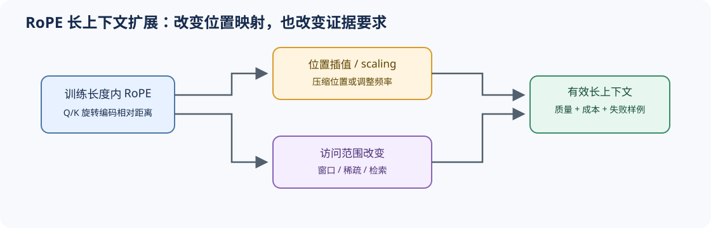

# 05 RoPE 与长上下文位置机制（RoPE and Long-Context Positioning）

## 学习问题

注意力本身无法区分顺序。位置机制不仅要告诉模型“谁在前、谁在后”，还要决定模型在训练长度之外如何解释距离。绝对位置、相对位置、RoPE 和位置缩放采用不同方式编码顺序，也具有不同的外推条件。

## 核心机制

### 设计压力：顺序信息如何进入 Q/K？

绝对位置将位置向量直接加入输入，相对位置关注词元间距离；RoPE 则旋转 Q/K，使注意力内积自然携带相对位置信息。长上下文扩展的困难在于：改变旋转频率可以延长可用范围，也可能破坏模型训练时形成的位置分布。

### 结构机制：基频、维度与距离共同作用

RoPE 把相邻特征维组成二维平面，并按位置 $p$ 旋转角度 $p\theta_i$。两个位置的 Q/K 内积因此依赖位置差 $p-q$；低频维度变化慢，适合较长距离，高频维度变化快，保留局部位置分辨率。扩大上下文时，缩放位置或调整频率谱会同时改变这两类能力。

长度扩展不能只比较配置中的最大长度。至少要区分训练长度内、刚越过训练长度和目标最大长度三个区间，并固定相同文本、分词器和访问模式；否则位置机制、稀疏注意力和 KV 容量变化会混在同一个结果中。

| 路径 | 改变什么 | 主要收益 | 主要风险 |
|:---|:---|:---|:---|
| 绝对位置编码 | 输入位置向量 | 实现直观 | 固定表难以外推 |
| 相对位置偏置 | 注意力分数 | 直接表达距离 | 形式与实现路径较多 |
| RoPE | Q/K 各维旋转角 | 与注意力计算紧密结合 | 超出训练长度后频率行为变化 |
| 插值 / 缩放 | 位置或频率映射 | 扩大可用上下文 | 短程分辨率和长程质量需重新验证 |

## 选择条件与验证证据

长上下文判断至少需要长度阶梯、训练长度内外标记、检索或推理质量、预填充成本和 KV/状态容量。仅验证模型“能够接收”长输入，不能证明它仍能可靠利用远处信息。

先在 [Part 02 · 03](../../02_PyTorch_Algorithms/03_RoPE_Tutorial.ipynb)验证旋转与频率维度，再由 [Part 02 · 44](../../02_PyTorch_Algorithms/44_Local_Sliding_and_Sparse_Attention.ipynb)隔离访问范围变量；真实长度阶梯的质量与成本进入 [Part 02 · 77](../../02_PyTorch_Algorithms/77_Long_Sequence_Memory_Architecture_Benchmark.ipynb)。

## 相关阅读

- [RoFormer](https://arxiv.org/abs/2104.09864)
- [ALiBi](https://arxiv.org/abs/2108.12409)
- [LongRoPE](https://arxiv.org/abs/2402.13753)
