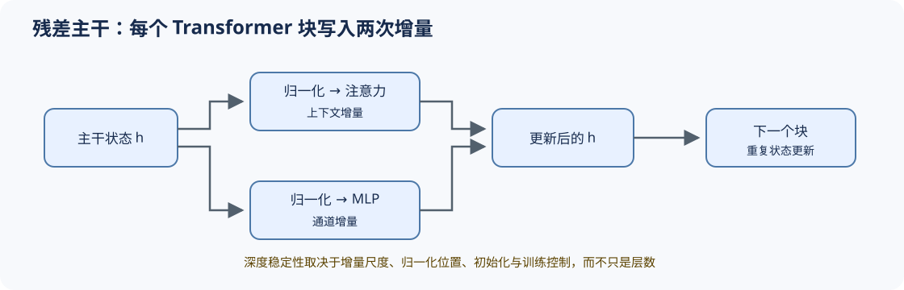

# 06 Transformer 块与残差主干（Block and Residual Stream）

## 学习问题

单个算子不能解释模型深度。解码器块通过残差流把注意力与 MLP 的增量写回主干；归一化位置、分支尺度和层数共同决定状态能否稳定传播。连续堆叠时，每个块都必须保持主状态形状，并控制分支增量的尺度。

## 核心机制

### 设计压力：为什么需要一条稳定的主干状态？

如果每个子层都直接覆盖隐状态，深层模型难以保留已有信息，也更容易出现梯度衰减或放大。残差流让子层学习增量更新，前置归一化则在分支读取主干前控制尺度。

### 结构机制：一个 Transformer 块是两次受控状态更新

设进入第 $l$ 个块的主干状态为 $h_l$，Pre-Norm 块先形成注意力增量 $a_l$，再形成 MLP 增量 $m_l$：$a_l=\mathrm{Attn}(\mathrm{Norm}(h_l))$，$m_l=\mathrm{MLP}(\mathrm{Norm}(h_l+a_l))$，最终 $h_{l+1}=h_l+a_l+m_l$。形状保持不变并不代表数值稳定；增量相对主干的比例会随深度累积。

残差缩放、分支初始化和额外归一化都在控制增量写入速度。比较块变体时应固定深度、隐藏维度、参数预算和训练批次，再观察稳定性；只跑单个块无法暴露深度累积问题。

| 阶段 | 主干状态变化 | 应观察的量 | 关键约束 |
|:---|:---|:---|:---|
| 注意力更新 | `h ← h + a` | `‖a‖ / ‖h‖`、注意力输出范围 | 上下文访问、位置机制、注意力表示 |
| MLP 更新 | `h ← h + m` | `‖m‖ / ‖h+a‖`、门控激活范围 | 通道扩张、门控激活、稠密 FFN 或 MoE |
| 多层堆叠 | 重复两次增量更新 | 层间激活 RMS、梯度范数、非有限值 | 残差缩放、深度、初始化和数值精度 |

## 选择条件与验证证据

Transformer 块变体要同时检查结构合法性、参数量/FLOPs、激活与梯度尺度、训练稳定性和目标任务质量。残差缩放或额外归一化只有在相同训练口径下，才能形成较强的稳定性证据。

组件到 Transformer 块的映射见 [Part 00 · 13](../../00_Prerequisites/13_Transformer_Block_Dataflow_and_Residual_Stream.ipynb)，两次残差更新和配置审计分别进入 [Part 02 · 05](../../02_PyTorch_Algorithms/05_LLaMA3_Block_Tutorial.ipynb)与 [Part 02 · 08](../../02_PyTorch_Algorithms/08_Architecture_Tricks.ipynb)；多层稳定性证据由 [Part 02 · 60](../../02_PyTorch_Algorithms/60_Decoder_Block_Stability_Benchmark.ipynb)承接。

## 相关阅读

- [On Layer Normalization in the Transformer Architecture](https://arxiv.org/abs/2002.04745)
- [DeepNet](https://arxiv.org/abs/2203.00555)
- [LLaMA](https://arxiv.org/abs/2302.13971)
