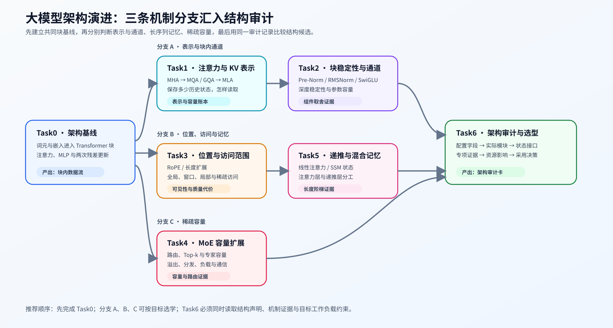
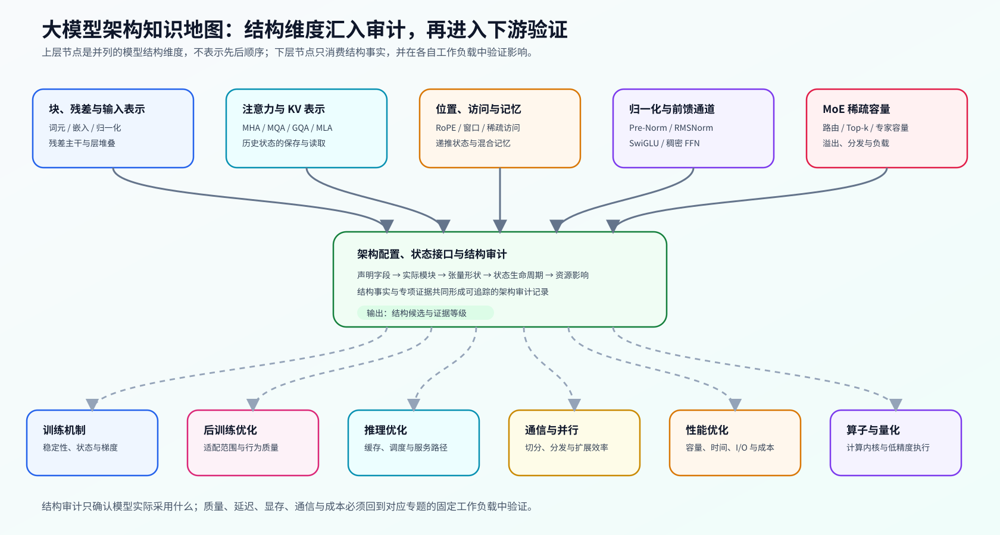

# 大模型架构演进（LLM Architecture Evolution）

> 专题类型：主学习路线　学习目标：判断结构选择怎样改变模型能力、状态表示、资源成本与适用条件

本专题从仅解码器（Decoder-only）基线出发，依次解释输入表示、Transformer 块、注意力与 KV 表示、归一化与前馈网络、位置与访问范围、MoE 稀疏容量，以及线性注意力、SSM 和混合记忆。

## 学习路线

连续学习时进入[架构演进问题链](./walkthrough.md)，遇到配置、容量或质量异常时使用[架构问题排查手册](./casebook.md)，术语差异查询[专题术语表](./glossary.md)。

| Task / 主题 | 本阶段要回答的问题 | 学习入口与验证出口 | 学习顺序 | 主要正文入口 |
|:---|:---|:---|:---|:---|
| Task0 · Transformer 块与架构基线 | 词元怎样成为隐状态，并沿 Transformer 块的两次残差更新向前传递？ | 核心：[Part 02 · 00 PyTorch 热身](../../02_PyTorch_Algorithms/00_PyTorch_Warmup.ipynb) → [Part 02 · 05 LLaMA3 Block](../../02_PyTorch_Algorithms/05_LLaMA3_Block_Tutorial.ipynb)；项目：[Part 02 · 60 Transformer 块稳定性](../../02_PyTorch_Algorithms/60_Decoder_Block_Stability_Benchmark.ipynb) | 词元表示 → 解码器主干 → 两次残差更新 → 稳定性证据 | [01 仅解码器主干](./01_transformer_decoder.md) → [02 分词与输入表示](./02_tokenization_embedding.md) → [06 Transformer 块与残差主干](./06_block_residual_path.md) |
| Task1 · 注意力表示与 KV 压缩 | MHA、MQA、GQA 和 MLA 怎样改变 Q/K/V 关系、历史状态大小与解码读取路径？ | 核心：[Part 02 · 04 MHA / GQA](../../02_PyTorch_Algorithms/04_Attention_MHA_GQA.ipynb) → [Part 02 · ARCH-MLA](../../02_PyTorch_Algorithms/ARCH-MLA_Multihead_Latent_Attention.ipynb)；项目：[Part 02 · 71 MLA / KV 结构基准](../../02_PyTorch_Algorithms/71_MLA_KV_Cache_Architecture_Benchmark.ipynb) | 头关系 → KV 表示 → 历史状态大小 → 解码读取 | [04 注意力表示演进](./04_attention_evolution.md) |
| Task2 · Transformer 块稳定性与通道演进 | 前置归一化、RMSNorm 和门控 FFN 为什么成为现代 Transformer 块的常见组合？ | 核心：[Part 02 · 01 RMSNorm](../../02_PyTorch_Algorithms/01_RMSNorm_Tutorial.ipynb) → [Part 02 · 02 SwiGLU](../../02_PyTorch_Algorithms/02_SwiGLU_Activation.ipynb)；项目：[Part 02 · 60 Transformer 块稳定性](../../02_PyTorch_Algorithms/60_Decoder_Block_Stability_Benchmark.ipynb) | 归一化位置 → 尺度控制 → 门控通道 → 残差稳定性 | [03 归一化演进](./03_norm_evolution.md) → [07 MLP / FFN 演进](./07_mlp_ffn_evolution.md) |
| Task3 · 位置、访问范围与长上下文 | 位置怎样进入 Q/K；全局、窗口、局部和稀疏访问分别保留哪些历史信息？ | 核心：[Part 02 · 03 RoPE](../../02_PyTorch_Algorithms/03_RoPE_Tutorial.ipynb) → [Part 02 · 44 局部与稀疏注意力](../../02_PyTorch_Algorithms/44_Local_Sliding_and_Sparse_Attention.ipynb)；项目：[Part 02 · 78 注意力访问模式](../../02_PyTorch_Algorithms/78_Attention_Access_Pattern_Benchmark.ipynb) | 位置注入 → 访问范围 → 长程覆盖 → 质量与执行代价 | [05 RoPE 与长上下文位置机制](./05_rope_position_encoding.md) |
| Task4 · MoE 容量扩展与稀疏化 | 怎样扩大总参数容量，同时控制每个词元的激活计算、容量溢出和跨卡代价？ | 核心：[Part 02 · 06 MoE 路由](../../02_PyTorch_Algorithms/06_MoE_Router.ipynb) → [Part 02 · 07 负载均衡](../../02_PyTorch_Algorithms/07_MoE_Load_Balancing_Loss.ipynb)；项目：[Part 02 · 80 MoE 专家并行](../../02_PyTorch_Algorithms/80_MoE_Expert_Parallel_Benchmark.ipynb) | 专家容量 → 词元路由 → 负载均衡 → 跨卡交换 | [09 MoE 与稀疏容量](./09_moe_sparsity_evolution.md) |
| Task5 · 递推状态、SSM 与混合记忆 | 不保存完整词元级历史时，递推状态如何更新；哪些层仍需要注意力的显式检索？ | 核心：[Part 02 · 45 线性注意力](../../02_PyTorch_Algorithms/45_Linear_Attention_and_Recurrent_State.ipynb) → [Part 02 · ARCH-HYBRID-MEMORY](../../02_PyTorch_Algorithms/ARCH-HYBRID-MEMORY_Attention_SSM_Hybrid.ipynb)；项目：[Part 02 · 77 长序列记忆架构](../../02_PyTorch_Algorithms/77_Long_Sequence_Memory_Architecture_Benchmark.ipynb) | 历史压缩 → 递推状态 → 显式检索层 → 混合记忆 | [10 线性注意力、SSM 与混合记忆](./10_linear_attention_ssm_and_hybrid.md) |
| Task6 · 架构审计与选型决策 | 怎样从配置和模块树识别真实结构，并判断创新、代价与适用条件？ | 核心：[Part 02 · 08 配置与结构审计](../../02_PyTorch_Algorithms/08_Architecture_Tricks.ipynb)；项目：[Part 02 · 61 模型架构探索](../../02_PyTorch_Algorithms/61_Model_Architecture_Exploration.ipynb) | 配置声明 → 模块树核对 → 结构差异 → 专项证据 → 选型 | [08 代表模型与结构审计](./08_representative_models.md) |

## 扩展与跨专题入口

### 按需回补

| 补充主题 | Notebook 入口 | 建议时机 |
|:---|:---|:---|
| 注意力与掩码基础 | [Part 00 · 16 注意力入门](../../00_Prerequisites/16_Attention_Mechanism_Intro.ipynb) | Task0–1；Q/K/V、因果掩码或注意力头关系尚不清楚时 |
| 参数量、FLOPs 与 KV 增长 | [Part 01 · 02 参数与 FLOPs](../../01_Hardware_Math_and_Systems/02_LLM_Params_and_FLOPs.ipynb) → [Part 01 · 11 KV Cache 增长](../../01_Hardware_Math_and_Systems/11_KV_Cache_and_Memory_Growth.ipynb) | Task1、Task6；需要建立结构容量账本时 |
| 注意力访存与稀疏计算 | [Part 01 · 04 注意力显存优化](../../01_Hardware_Math_and_Systems/04_Attention_Memory_Optimization.ipynb) → [Part 01 · 25 稀疏计算](../../01_Hardware_Math_and_Systems/25_Sparse_Computation_and_Sparse_Attention.ipynb) | Task3；需要解释访问模式的硬件与复杂度条件时 |
| MoE 参数与计算 | [Part 01 · 22 MoE 参数与计算](../../01_Hardware_Math_and_Systems/22_MoE_Parameter_and_Compute.ipynb) | Task4；需要区分总参数、激活参数和通信负载时 |

### 跨专题入口

本专题解释结构机制；缓存与调度进入[推理优化](../inference_optimization/intro.md)，训练更新与模型适配分别进入[反向传播与训练机制](../backpropagation_training_mechanism/intro.md)和[后训练优化](../post_training_optimization/intro.md)，低精度执行与跨卡扩展分别进入[量化与压缩](../quantization_compression/intro.md)和[通信与并行](../communication_parallelism/intro.md)，时间、容量与成本由[性能分析](../performance_analysis/intro.md)和[性能优化](../performance_optimization/intro.md)继续验证。

## 实验与项目出口

首次运行先按[实验 Quickstart](./quickstart.md)创建环境，再从[实验资产表](./experiment_assets.md)选择机制页、模型、工作负载、结果路径和证据状态；跨专题的软件版本和硬件快照查询[GPU 环境资产表](../../docs/gpu_environment_assets.md)。

| 证据阶段 | 要回答的问题 | 输出与入口 |
|:---|:---|:---|
| 机制证据 | 组件、状态表示、访问范围或路由行为是否按预期变化？ | Part 02 架构机制页的 CPU / GPU 结果 |
| 专项基准 | 单变量结构候选是否在固定条件下改变稳定性、容量、质量或成本？ | Task0–5 对应项目；具体 ID 与结果状态见[实验资产表](./experiment_assets.md) |
| 交叉证据 | MoE、推理缓存或执行路径是否需要真实系统证据？ | 推理、通信、量化和性能专题出口 |
| 架构决策 | 声明结构、实际模块和专项证据能否支持采用、继续验证或拒绝？ | Task6 模型架构审计与[架构问题排查手册](./casebook.md) |
