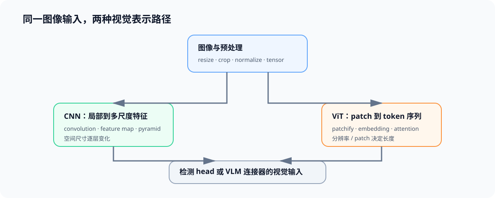

# 00 视觉表示：从 CNN 到 ViT

## 学习问题

图像进入检测模型或视觉语言模型前，必须先被转换为可计算的表示。CNN 通过局部卷积逐层扩大感受野；ViT 将图像拆成 patch token，再用注意力建立全局关系。两条路径的表示粒度、计算分布和输入长度不同，直接影响后续检测、视觉 token 与部署成本。

## 局部特征与图块词元怎样组织图像

| 机制 | CNN | ViT | 对后续任务的影响 |
|:---|:---|:---|:---|
| 基本单元 | 局部卷积核与特征图 | 图块与词元序列 | 决定特征组织方式 |
| 空间关系 | 逐层扩大感受野 | 注意力直接关联词元 | 影响长距离关系与计算分布 |
| 多尺度 | 特征金字塔或下采样层 | 图块层级、窗口或额外特征层 | 影响小目标和不同分辨率 |
| 输入代价 | 像素规模影响特征图 | 分辨率与图块大小决定词元数 | 影响视觉编码时间、显存与 VLM 预填充 |

## 图像输入契约

| 字段 | 需要固定的内容 | 为什么需要记录 |
|:---|:---|:---|
| 图像 | 数量、尺寸、宽高比、颜色空间与格式 | 决定预处理和像素成本 |
| 预处理 | resize、crop、normalize、padding 与插值方式 | 同一图片可产生不同输入张量 |
| 表示 | backbone、patch size、输出层级与 dtype | 决定特征/token 数和精度路径 |
| 任务 | 分类、检测、VQA 或 OCR 的质量目标 | 防止只比较编码速度 |

## 表示变化怎样影响后续任务

| 需要补的能力 | 入口 | 本页如何使用 |
|:---|:---|:---|
| 张量、卷积与基础视觉计算 | [Part 00 · 02 NumPy 与 Einsum](../../00_Prerequisites/02_NumPy_and_Einsum.ipynb)、[算子优化](../operator_optimization/intro.md) | 理解特征张量、访存和视觉编码热点 |
| 注意力与 Transformer 块 | [Part 02 · 04 Attention](../../02_PyTorch_Algorithms/04_Attention_MHA_GQA.ipynb)、[Part 02 · 05 LLaMA3 Block](../../02_PyTorch_Algorithms/05_LLaMA3_Block_Tutorial.ipynb) | 将图块词元连接到注意力计算 |
| 模型架构演进 | [大模型架构](../llm_architecture_evolution/intro.md) | 回补残差、归一化和 Transformer 设计选择 |

## 什么记录可以支持表示对照

表示账本至少记录“像素规模 → 特征图或图块词元 → 下游模型输入”，并说明分辨率或图块大小变化时，表示长度、视觉计算和显存怎样变化。缺少统一输入和质量任务时，不能只按编码速度选择表示方案。
