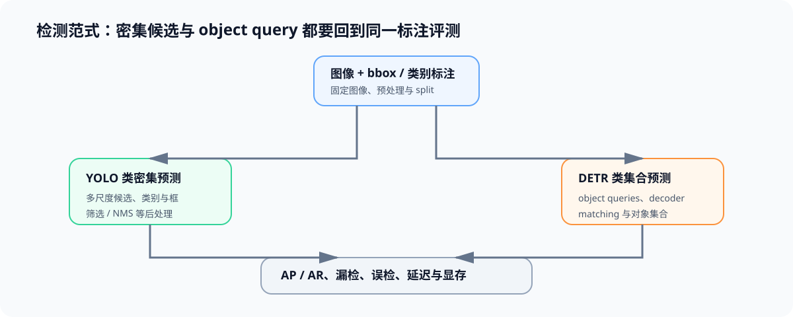

# 01 目标检测：从 YOLO 到 DETR

## 页面目标

目标检测需要同时回答“有什么、在哪里、置信度如何”。YOLO 类模型将密集预测、候选筛选与后处理组合起来；DETR 将检测表示为固定数量 object queries 与集合匹配，直接输出对象集合。理解两种范式的输出与训练契约，是比较实时检测模型和接入视觉服务的前提。

## 核心机制：密集预测与集合预测

| 维度 | YOLO 类范式 | DETR 类范式 | 影响 |
|:---|:---|:---|:---|
| 预测组织 | 网格/多尺度密集候选 | object queries 与 decoder 输出 | 候选数量和中间表示不同 |
| 重复处理 | 通常依赖 NMS 或等价筛选 | 通过集合匹配训练，推理直接输出集合 | 后处理路径不同 |
| 标签分配 | anchor/位置或密集监督规则 | bipartite matching 的集合监督 | 训练数据与 loss 解释不同 |
| 主要质量指标 | AP、召回、误检/漏检 | AP、召回、误检/漏检 | 不可只用单帧 FPS 判断 |

## 检测 workload 与数据契约

| 字段组 | 至少记录 | 用途 |
|:---|:---|:---|
| 样本 | image_id、原图尺寸、图像版本与 split | 确保同一输入集可复测 |
| 标注 | bbox、类别、遮挡/小目标属性与格式 | 检查坐标变换和标签兼容性 |
| 预处理 | resize、padding、增强与坐标映射 | 避免精度差异来自输入变换 |
| 输出 | boxes、scores、labels、阈值与后处理规则 | 对齐模型结果与评测器 |
| 结果 | AP/AR、类别错误、漏检/误检、延迟与显存 | 同时判断质量与实时性 |

## 连接到后续内容

[数据工程](../data_engineering/intro.md)负责图像来源、标注版本、格式解析和 train/eval 隔离；Task2 在同一类输入、标注和质量指标下，进一步解释实时 DETR 的架构演进。完成检测范式后，再进入 VLM：后者将视觉表示作为语言模型上下文，而不是把 bbox 检测输出直接当作视觉 token。

## 交付物

完成本页后，应能写出一份检测输入/输出契约，并解释一次模型对比中应如何同时保存 COCO 风格标注版本、预处理、AP/AR、延迟、显存和失败样本。
