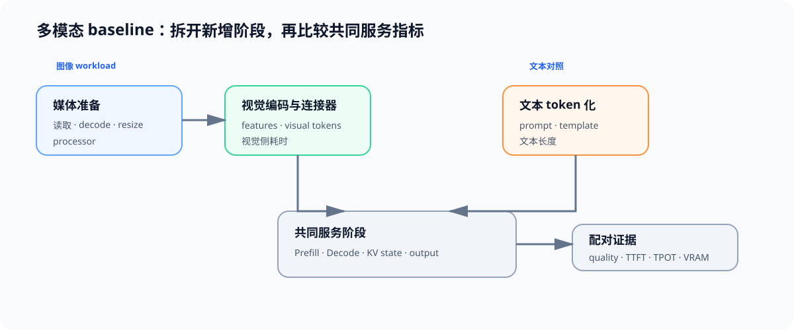

# 04 多模态 Workload、缓存与 Baseline

## 页面目标

纯文本请求通常从 token 化后直接进入 Prefill；图像请求在此之前还会经历媒体读取、预处理、视觉编码和连接器映射。多模态性能比较首先要拆开这些阶段，再判断视觉 token 如何扩大 Prefill 与 KV 状态，并决定瓶颈来自视觉侧、语言侧还是请求配置。

## 核心机制：图像请求新增的关键路径

| 阶段 | 纯文本请求 | 图像请求新增或改变的工作 | 应记录的指标 |
|:---|:---|:---|:---|
| 输入准备 | token 化与模板 | 读取、decode、resize、processor | 输入时间、图片规格、失败率 |
| 表示生成 | 文本 embedding | 视觉编码器与连接器 | 视觉编码时间、视觉 token 数 |
| Prefill | 文本上下文计算 | 文本与视觉 token 共同进入上下文 | prefill 时间、TTFT、峰值显存 |
| Decode 与状态 | 输出 token 生成 | 仍自回归，但读取包含视觉/文本上下文的 KV 状态 | TPOT、输出长度、视觉/文本 KV 占用 |

## 缓存与 Baseline 契约

比较不是让“没有图像的请求”替代多模态 baseline，而是在任务目标一致的前提下，分别固定图像 workload 和文本 workload，说明两者的输入差异。

| 字段组 | 图像 workload | 文本对照 | 共同要求 |
|:---|:---|:---|:---|
| 任务 | 图像、问题、预期答案与质量规则 | 可回答同一目标的文本描述或文本任务 | 成功标准与评测集隔离 |
| 输入 | 图片数量、分辨率、视觉 token、文本长度 | 文本长度、模板与上下文 | 输出上限、warmup、重复规则 |
| 环境 | processor、视觉塔、模型、dtype、backend | 模型、dtype、backend | 硬件、版本、并发与记录路径 |
| 结果 | 预处理、视觉编码、Prefill、Decode、TTFT/TPOT、VRAM | Prefill、Decode、TTFT/TPOT、VRAM | 质量、失败、evidence level |

视觉特征、视觉 token 与文本 token 的缓存位置并不相同：媒体预处理结果可避免重复 decode/resize；视觉编码结果可避免同一图像重复进入视觉塔；进入语言模型的视觉 token 会像文本上下文一样影响 Prefill 和 KV 容量。后续缓存策略必须分别记录命中对象、复用范围和质量回归，不能把“图像已经处理过”直接等同于“KV Cache 已复用”。

## 连接到现有专题

| 需要补的能力 | 入口 | 本页如何使用 |
|:---|:---|:---|
| Benchmark 与阶段归因 | [性能优化](../performance_optimization/intro.md)、[66 推理性能对比](../../02_PyTorch_Algorithms/66_Inference_Performance_Comparison.ipynb) | 固定 workload、分阶段计时、记录失败和证据等级 |
| Prefill、Decode 与 KV | [推理优化](../inference_optimization/intro.md)、[Part02 · 71 MLA / KV 项目](../../02_PyTorch_Algorithms/71_MLA_KV_Cache_Architecture_Benchmark.ipynb) | 判断视觉 token 如何改变容量与服务指标 |
| 输入处理与数据契约 | [数据工程](../data_engineering/intro.md) | 区分媒体解析质量问题与模型服务瓶颈 |

## 交付物

完成本页后，应有一份可复测的多模态 benchmark 配置：模型和 processor、图片集与任务、分辨率、文本模板、输出上限、硬件、阶段指标、质量规则与失败记录。Task2–6 的 token 压缩、缓存和 backend 对照均复用这份配置。
