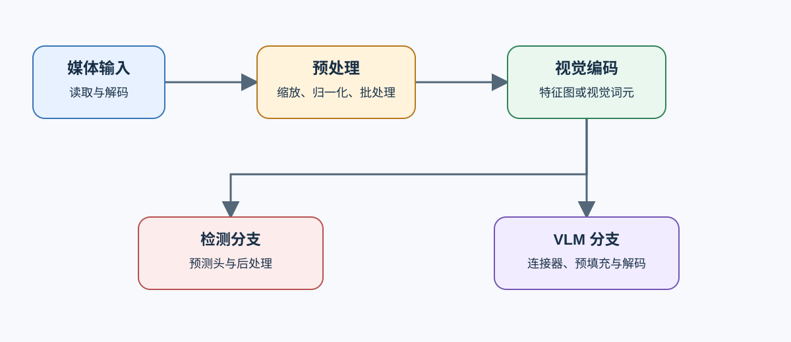
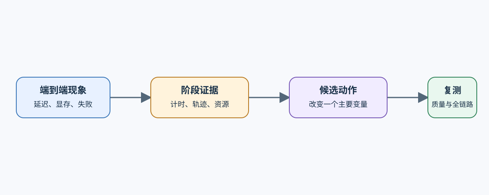

# 05 视觉与多模态关键路径

性能归因必须从固定任务开始。检测请求和 VLM 请求都包含媒体读取与视觉计算，但后半段不同：检测进入预测头与后处理，VLM 进入连接器、预填充和自回归解码。

## 阶段边界怎样保持可比较

| 分支 | 固定输入 | 需要拆开的阶段 | 质量检查 |
|:---|:---|:---|:---|
| 检测 | 图像版本、尺寸、批大小 | 读取、预处理、视觉主干、预测头、后处理 | AP/AR、类别和漏检切片 |
| VLM | 图片数、分辨率、问题、输出上限 | 读取、预处理、视觉编码、连接器、预填充、解码 | 任务得分、格式和失败回答 |

每个阶段记录主机时间、设备时间、峰值显存和失败状态。异步设备执行必须用事件或执行轨迹确认，不能用 Python 调用耗时替代计算内核时间。

## 瓶颈怎样从现象落到执行路径

| 现象 | 先检查 | 可能的候选动作 | 必须复测 |
|:---|:---|:---|:---|
| 输入阶段占比高 | 解码、缩放、数据加载与搬运 | 缓存预处理结果、并行准备或固定尺寸桶 | 端到端延迟与数据质量 |
| 视觉编码占比高 | 分辨率、视觉词元、数据类型与计算内核 | 降低视觉预算、低精度或复用视觉特征 | 任务质量与峰值显存 |
| 检测后处理占比高 | 候选数量、筛选和 NMS/匹配 | 收窄候选或更换导出路径 | AP/AR 与尾延迟 |
| VLM 首词元慢 | 视觉词元、预填充和排队 | 压缩视觉词元、缓存视觉特征或调度分流 | TTFT、质量和缓存命中 |

## 归因结果怎样进入部署验证

局部阶段变快不等于服务收益。候选还要在相同质量协议、运行时和请求分布下重测端到端延迟、吞吐、峰值资源和失败率。运行时不支持处理器、视觉塔或导出算子时，记录兼容性失败，不填充性能结果。

## 从关键路径进入候选决策

继续阅读 [06 视觉与多模态交付决策](./06_multimodal_delivery_decision.md)。通用执行轨迹方法由[性能分析](../performance_analysis/intro.md)负责，产物和运行时兼容由[部署与异构](../deployment_heterogeneous/intro.md)负责。
