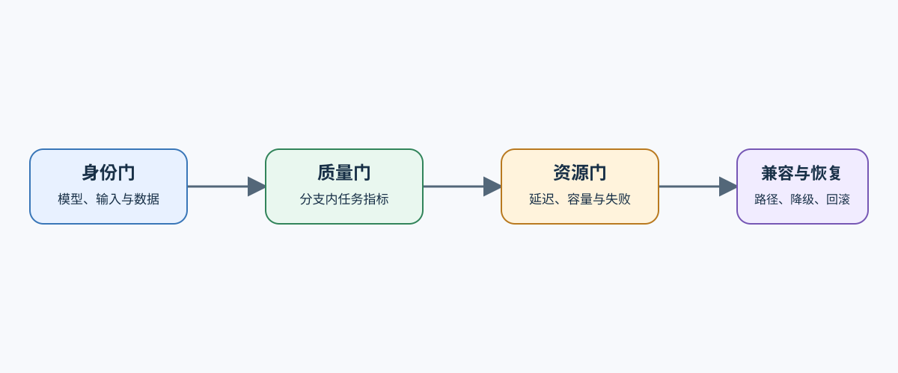
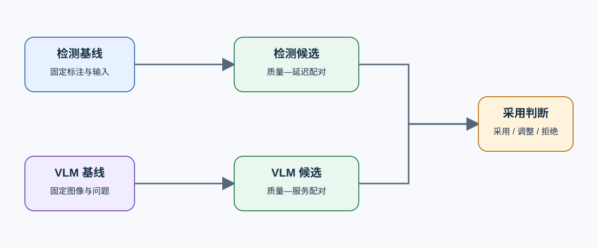

# 06 视觉与多模态交付决策

最终比较必须在同一任务分支内进行。检测候选与检测基线比较，VLM 候选与 VLM 基线比较；两条分支可以共享资源和部署约束，但不共享质量分数。

## 候选需要通过哪些门槛

| 门槛 | 检测证据 | VLM 证据 | 失败动作 |
|:---|:---|:---|:---|
| 身份 | 模型、权重、输入尺寸、数据版本 | 模型、视觉塔、处理器、模板、数据版本 | 补齐身份后重跑 |
| 质量 | AP/AR、类别与失败切片 | 任务得分、格式、安全与失败回答 | 拒绝或调整候选 |
| 性能与容量 | 端到端延迟、P95、FPS、峰值显存 | TTFT、TPOT、吞吐、缓存与峰值显存 | 回到关键路径归因 |
| 兼容与恢复 | 导出算子、运行时、回退路径 | 处理器、视觉算子、后端和回滚版本 | 更换路径或保留基线 |

## 配对复测怎样避免错误比较

一次只改变主要候选变量，并固定硬件、数据、输入规格、质量集、预热和重复规则。模型规模、图像分辨率和运行时同时变化时，只能形成方案比较，不能把差异归因给单一机制。

## 怎样作出采用、调整或拒绝

- 采用：质量门槛通过，端到端收益可重复，容量和运行时兼容，且有回滚路径。
- 调整：方向成立，但失败切片、重复次数、尾延迟或运行路径证据不足。
- 拒绝：质量退化、产物无法加载、容量不可接受，或局部优化没有端到端收益。

## 两条分支怎样进入综合交付

检测部署和 VLM 服务分别携带各自的质量基线、阶段性能、运行时兼容性和回滚证据进入 [Part 05 综合项目](../../05_Integrated_Projects_and_Decisions/intro.md)。综合交付可以比较资源与维护代价，但采用判断仍须在各自任务分支内完成，不能用检测 AP/AR 与 VLM 任务分数互相替代。
