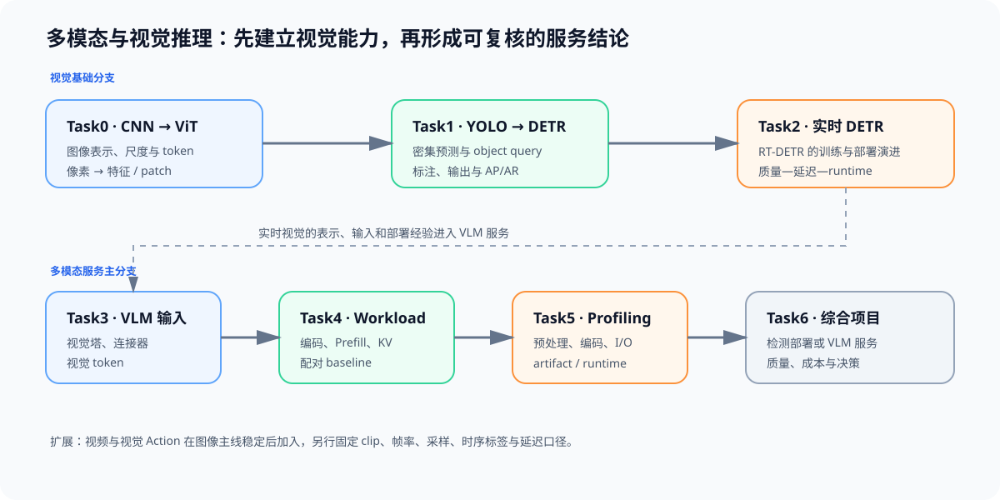
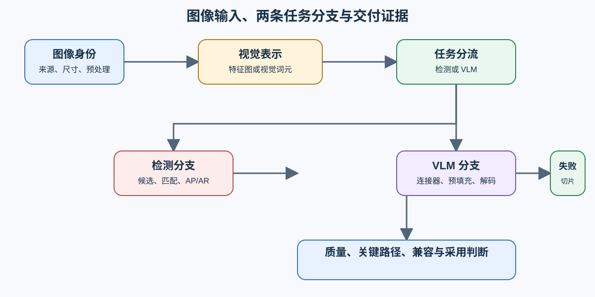

# 多模态与视觉推理（Multimodal and Vision Inference）

> 专题类型：领域专题　主服务目标：解释图像怎样变成检测结果或语言模型上下文，并形成可复测的质量、性能与部署判断。

本专题从两条图像主线展开：视觉表示进入目标检测，或通过连接器进入视觉语言模型（VLM）。两条分支共享图像来源、预处理和视觉编码基础，但输出契约不同：检测关注边界框、类别与 AP/AR，VLM 关注图像—文本任务质量、视觉词元和生成服务指标。视频、音频和视觉动作识别需要新的时序数据与运行协议，因此作为扩展入口单独验证。

## 学习路线

| Task / 主题 | 本阶段要回答的问题 | 学习入口与验证出口 | 学习顺序 | 主要正文入口 |
|:---|:---|:---|:---|:---|
| Task0 · 视觉表示与输入身份 | 像素怎样变成可计算、可计量的视觉表示？ | 核心：[Part 00 · 02 NumPy 与 Einsum](../../00_Prerequisites/02_NumPy_and_Einsum.ipynb)；扩展：[模型架构](../llm_architecture_evolution/intro.md) | 图像规格 → CNN 特征图 / ViT 视觉词元 → 表示账本 | [00 视觉表示：从 CNN 到 ViT](./00_visual_representation_cnn_to_vit.md) |
| Task1 · 检测输出契约 | 密集候选与集合预测怎样改变标签、匹配和后处理？ | 核心：[数据工程](../data_engineering/intro.md) | 标注身份 → 候选生成 → 匹配/筛选 → AP/AR | [01 目标检测：从 YOLO 到 DETR](./01_detection_yolo_to_detr.md) |
| Task2 · 实时检测候选 | 实时检测候选怎样在固定数据、输入和运行时下比较？ | 核心：[性能分析](../performance_analysis/intro.md)；扩展：[部署与异构](../deployment_heterogeneous/intro.md) | 固定检测契约 → 训练/架构差异 → 导出路径 → 质量—延迟对照 | [02 实时检测 Transformer](./02_realtime_detr_evolution.md) |
| Task3 · VLM 输入与融合 | 视觉特征怎样通过连接器进入语言模型上下文？ | 核心：[Part 02 · 04 MHA/GQA](../../02_PyTorch_Algorithms/04_Attention_MHA_GQA.ipynb)；扩展：[模型架构](../llm_architecture_evolution/intro.md) | 视觉塔 → 连接器 → 视觉词元 → 文本输出 | [03 VLM 架构与图像输入契约](./03_vlm_architecture_and_input_contract.md) |
| Task4 · 多模态请求状态 | 图像请求怎样改变输入准备、预填充、缓存和解码？ | 核心：[推理优化](../inference_optimization/intro.md) | 媒体读取 → 视觉编码 → 预填充 → 解码/缓存 | [04 多模态工作负载、缓存与基线](./04_vlm_workload_and_cache.md) |
| Task5 · 关键路径归因 | 检测或 VLM 请求的延迟、显存与失败来自哪个阶段？ | 核心：[Part 00 · 17 性能分析基础](../../00_Prerequisites/17_PyTorch_Profiling_Basics.ipynb)、[性能分析](../performance_analysis/intro.md) | 固定工作负载 → 阶段计时 → 执行轨迹 → 瓶颈归因 | [05 视觉与多模态关键路径](./05_multimodal_profiling_and_deployment.md) |
| Task6 · 候选交付决策 | 候选怎样同时通过质量、性能、容量和部署兼容门槛？ | 扩展：[部署与异构](../deployment_heterogeneous/intro.md)；项目：[Part 05 综合项目](../../05_Integrated_Projects_and_Decisions/intro.md) | 分支内基线 → 配对复测 → 兼容检查 → 采用/调整/拒绝 | [06 视觉与多模态交付决策](./06_multimodal_delivery_decision.md) |

## 扩展与跨专题入口

| 场景 | 进入本专题前固定什么 | 本专题输出 | 转交方向 |
|:---|:---|:---|:---|
| 实时检测 | 图像版本、标注、尺寸和质量协议 | 检测候选卡、阶段延迟与失败切片 | 性能分析、部署与异构 |
| 图像问答或 OCR | 图片、问题模板、答案规则和输出上限 | VLM 输入卡、视觉词元和请求阶段证据 | 推理优化、性能优化 |
| 媒体数据治理 | 来源、许可、解析器和评测隔离 | 失败媒体与消费者契约 | 数据工程 |
| 视频、音频或动作识别 | 时序采样、同步和任务指标 | 暂不在本专题形成主线结论 | 后续独立扩展 |

## 实验与项目出口

CPU 实验适合验证图像尺寸、标签、视觉词元和结果字段；真实 GPU 对照需要固定模型或检测器、处理器、图像集、精度、运行时、预热和重复次数。检测与 VLM 使用不同质量协议，不能把两条分支的速度或显存直接排名。

- 连续理解两条分支及其汇合证据：阅读[多模态问题链](./walkthrough.md)。
- 已有失败样本或性能现象：使用[多模态判断手册](./casebook.md)。
- 运行前核对环境、数据和结果字段：查看[实验资产](./experiment_assets.md)。
- 中英文术语差异：查看[专题术语表](./glossary.md)。
