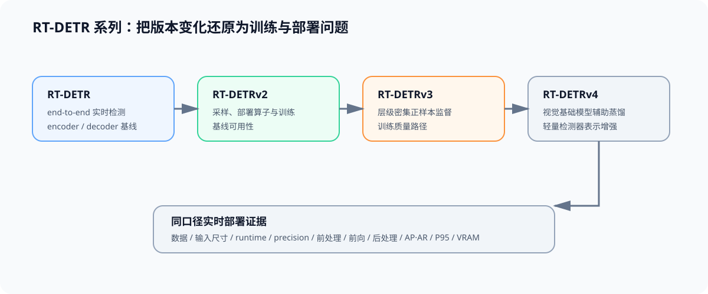

# 多模态问题链：一张图怎样变成可交付结果

从同一张图像开始，先固定来源、尺寸和预处理，再观察它如何进入检测分支或 VLM 分支。最终目标不是得到一个输出，而是让质量、延迟、显存和失败证据都能回查到同一输入与候选身份。

## 图像怎样变成视觉表示

CNN 以局部特征图逐层聚合信息，ViT 以图块词元建立全局关系。分辨率、图块大小和预处理规则共同决定视觉计算量，必须写入输入身份。

## 检测分支怎样形成对象集合

密集预测与集合预测使用不同的候选、匹配和后处理路径。进入实时检测比较前，先固定标注版本、输入尺寸和 AP/AR 协议。

## VLM 分支怎样进入语言模型上下文

视觉塔、连接器和语言模型分别改变表示长度、融合方式和生成状态。处理器与对话模板属于候选身份，不能只记录语言模型名称。

## 两条分支怎样定位关键路径

共享阶段包括媒体读取、预处理和视觉编码；检测随后进入预测头和后处理，VLM 进入连接器、预填充和解码。阶段计时只有在任务和输入固定时才可比较。

## 分支内证据怎样形成交付判断

检测和 VLM 分别与各自基线配对。质量门槛、端到端收益、运行时兼容和回滚条件全部满足后，候选才可采用；否则保留调整或拒绝证据。
