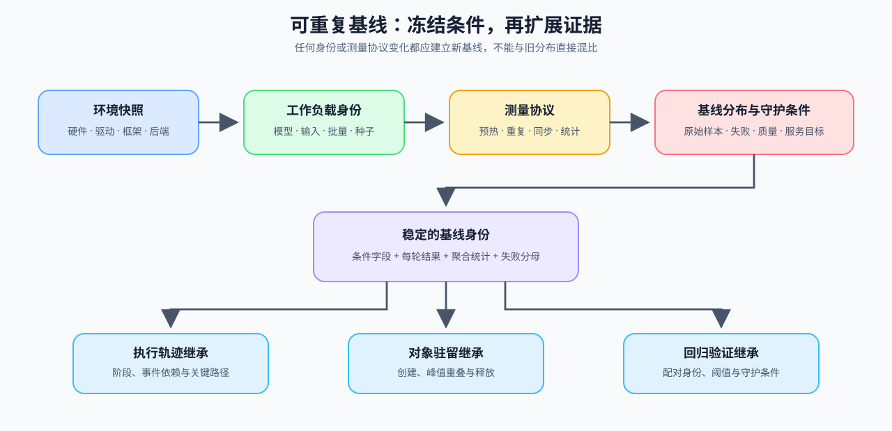

# 02 可重复基线与测量契约

基线的作用不是提供一个“看起来合理”的数字，而是让后续执行轨迹、性能剖析和候选对照都能回到同一组运行条件。模型、工作负载、环境或统计方法发生变化时，应建立新的基线，不能继续与旧结果直接比较。

## 固定环境、工作负载与测量过程

| 条件组 | 必须记录 | 常见错误 |
|:---|:---|:---|
| 环境 | 硬件、驱动、CUDA、框架、执行后端与版本 | 只写 GPU 型号，不记录软件执行路径 |
| 工作负载 | 模型版本、输入/输出长度、批量/并发、数据选择与随机种子 | 基线/候选使用不同输入或请求分布 |
| 测量 | 预热、重复次数、同步点、统计量和超时 | 混用首次运行、稳态结果和主机异步计时 |
| 守护条件 | 正确性、质量、OOM、失败率和 SLO | 只保留最快一次，忽略失败与质量回归 |

先完成环境和输入预检，再执行预热；正式重复运行必须记录每次结果，不能只保存聚合均值。失败运行保留失败阶段和原因，不从分布中静默删除。

## 基线如何交给后续任务

执行轨迹、对象驻留和回归判断必须引用同一工作负载身份和环境快照，并使用相同的基线 / 候选口径检查分布变化。这样才能区分“执行路径真的改变”与“运行条件漂移”。

| 后续任务 | 从基线继承什么 | 新增什么 |
|:---|:---|:---|
| 执行轨迹 | 工作负载、环境、阶段定义 | 事件时间线、同步与关键路径 |
| 性能剖析 | 工作负载、环境、预热 | 算子、状态、缓冲区和驻留证据 |
| 性能回归 | 基线分布、失败样本、质量门槛 | 候选分布、阈值和回退判断 |

## 进入时间线与回归判断

[Part 00 · 17 性能分析基础](../../00_Prerequisites/17_PyTorch_Profiling_Basics.ipynb)提供同步计时、预热和显存观测入口。真实训练、推理和多卡工作负载各自保存输入分布和环境快照，但复用同一基线契约。

相关阅读：[PyTorch Benchmark Utilities](https://pytorch.org/tutorials/recipes/recipes/benchmark.html)。
