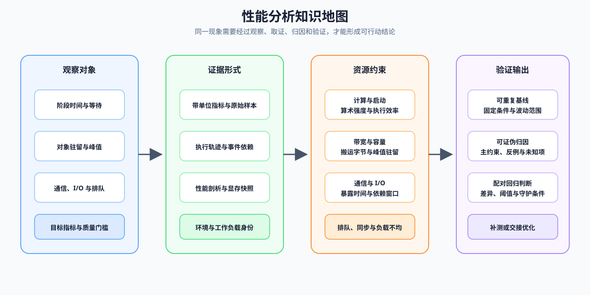
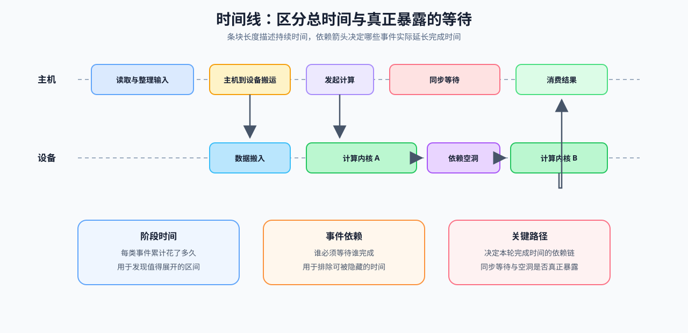
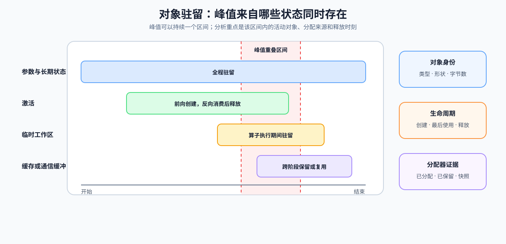
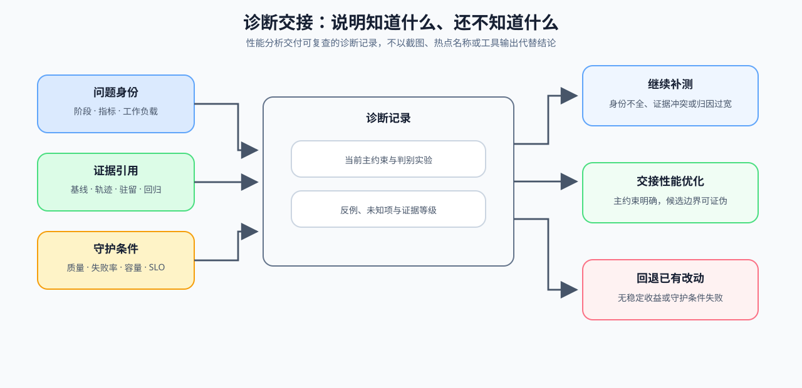

# 性能分析问题链 | Profiling Walkthrough

性能分析把一次“变慢”推进为可复查的行动：

`现象与质量门槛 → baseline → 时间 / 状态 / 通信证据 → 候选对照 → 回归 → 行动`

它服务训练、推理和分布式项目。策略本身由性能优化、推理优化或通信与并行专题说明；这里关注如何确认问题发生的位置、代价与证据强度。

## 一、把现象写成问题

先固定 workload，并写出目标指标、质量门槛和待验证假设。例如“TTFT 上升”还要说明 prompt 长度、并发、模型和 backend；“step 变慢”还要说明是否包含数据读取、同步和 optimizer step。

对应 [01 测量问题与证据链](./01_why_profiling_matters.md)。

## 二、建立可重复 baseline

记录环境、warmup、重复次数与统计方式。没有 baseline，就无法判断后续 trace 的变化来自代码、输入还是偶然波动。

先用 [02 可重复 Baseline](./02_reproducible_baseline.md) 固定运行条件，再进入 [03 时间线、I/O 与关键路径](./03_time_breakdown_and_trace_reading.md)。

## 三、沿关键路径收集证据

时间线回答计算、launch、输入搬运和等待；memory timeline 回答峰值与驻留对象；通信 trace 回答 collective、同步和 overlap。三类证据可以相互解释，但不能互相替代。

对应 [03 时间线与关键路径](./03_time_breakdown_and_trace_reading.md)、[04 对象驻留](./04_memory_timeline_and_residency.md) 与 [05 瓶颈归因](./05_bottleneck_attribution.md)。

## 四、以对照和回归验证候选

只改变一个候选变量，并同时记录目标指标、质量、波动与失败。局部热点下降但端到端结果没有改善，仍不能视为有效优化。

对应 [06 基准设计与回归验证](./06_benchmark_design_and_regression_validation.md)。

## 五、形成带条件的行动

证据不足时继续检查；归因明确时再修改候选；对照稳定后验证；若产生回归则回退。最终记录应说明适用 workload 与复查条件。

对应 [07 从归因到行动](./07_diagnosis_and_action_decision.md)。

## 图解阅读顺序

| 图解 | 用来回答的问题 |
|:---|:---|
|  | 观察对象、证据形式、资源约束与验证输出如何对应？ |
|  | 哪个时间段进入关键路径？ |
|  | 峰值与驻留发生在何处？ |
|  | 通信是否暴露在关键路径上？ |
|  | 如何保证 before / after 可比较？ |
|  | 证据足以支持哪一步？ |

已有结果时，可回到[性能分析判断手册](./casebook.md)按症状和证据选择下一步。
