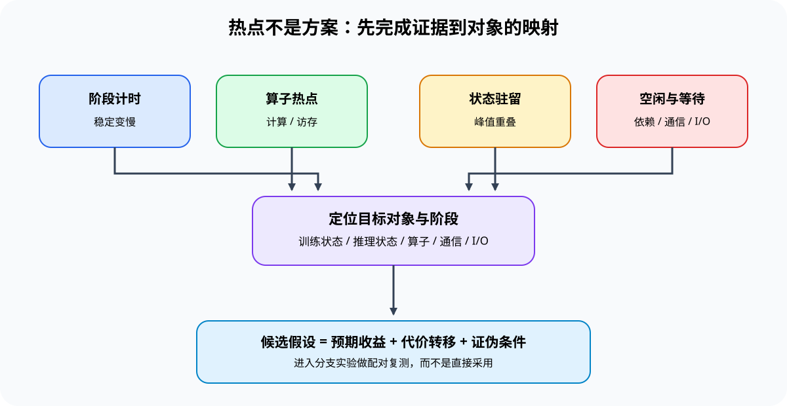

# 02 资源约束与候选代价

## 本节导读

同一种“慢”可能来自计算量、显存带宽、驻留容量，也可能来自启动、同步或等待。候选只有作用于已经确认的约束，才可能缩短目标工作负载的完成时间。

本节把工作量拆成浮点运算、最低搬运字节和驻留容量，再记录候选预计减少的量、新增代价和证伪条件。完成后，学习者能够解释为什么选择某个候选，以及什么结果会否定这项选择。

## 当前受哪类资源上界约束

| 已有证据 | 可提出的资源假设 | 不能直接得出的结论 |
|:---|:---|:---|
| 算术强度低，实测接近经验带宽上界 | 最低搬运字节可能限制吞吐 | 降低表示位宽一定加速 |
| 算术强度高，实测接近经验计算上界 | 浮点运算量或计算路径可能限制吞吐 | 更换计算内核一定缩短端到端时间 |
| 实测吞吐远低于两类上界 | 启动、同步、排队、通信或 I/O 可能暴露在关键路径上 | 仅凭 Roofline 确认具体等待来源 |
| 峰值由多个对象同时驻留形成 | 容量首先限制可运行规模 | 减少任意一个对象都能降低原峰值 |

[PERF-ROOFLINE](../../02_PyTorch_Algorithms/PERF-ROOFLINE_Arithmetic_Intensity_and_Resource_Ceiling.ipynb)使用经验带宽、经验计算吞吐和候选工作量划分资源区间；资源相关性仍需由执行轨迹或对象时间线验证。

## 候选减少了什么工作量

候选契约分别记录作用对象、预期减少量和守护条件，不把不同单位压成一个任意加权分数。

| 候选动作 | 预期减少量 | 可能新增的代价 | 必须保持的条件 |
|:---|:---|:---|:---|
| 降低权重或状态位宽 | 搬运字节与驻留容量 | 反量化、格式转换、误差 | 质量和执行路径 |
| 融合相邻算子 | 中间张量读写与启动次数 | 融合工作区、编译和形状限制 | 正确性和目标形状命中 |
| 激活重算 | 跨越峰值的保存张量 | 额外前向计算 | 单步时间和收敛 |
| 增大批量 | 每 Token 分摊的权重读取 | 激活/KV 容量和单次迭代延迟 | 峰值、P99 或单步预算 |
| 通信—计算重叠 | 暴露通信时间 | 额外缓冲区、调度和资源争用 | 数值一致性和总时间 |

## 代价转移与证伪条件

| 候选假设 | 支持它的结果 | 证伪它的结果 |
|:---|:---|:---|
| 激活重算能够缓解容量限制 | 跨越原峰值的保存张量减少，峰值下降 | 释放时刻不跨越原峰值，或发生新的工作区峰值 |
| 低精度能够缓解搬运限制 | 目标计算路径读取字节下降，端到端时间同步下降 | 产物变小但执行回退，或反量化抵消收益 |
| 增大批量能够提高利用率 | 吞吐提高且延迟、容量仍在门槛内 | 吞吐进入平台期而延迟继续增加 |
| 重叠能够隐藏通信或搬运 | 总时间下降，暴露等待缩短 | 时间线重叠但总时间不变，或资源争用使计算变慢 |

[PERF-CANDIDATE](../../02_PyTorch_Algorithms/PERF-CANDIDATE_Constraint_to_Candidate_and_Cost_Transfer.ipynb)把作用对象、预期减少量、新增代价、守护条件和证伪条件写入同一份候选记录。
