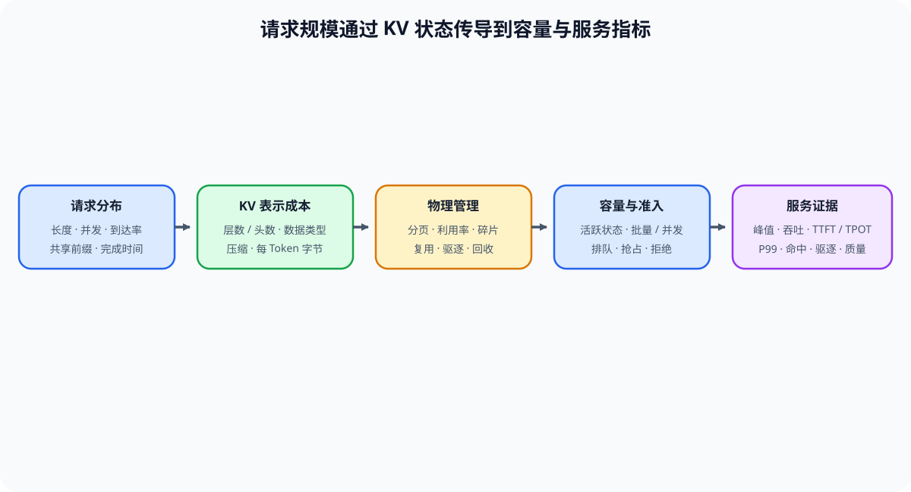

# 04 推理状态容量与 KV Cache 成本

## 本节导读

推理容量不仅由模型权重决定。KV Cache 随上下文和活跃请求持续增长，其表示、物理分配、复用、驱逐和数据类型共同限制并发，并影响 TTFT、TPOT 与尾延迟。

本节把每 Token 状态成本、请求分布和服务指标放入同一组对照。完成后，学习者能够判断分页、复用、驱逐或压缩是否真正扩大了可服务容量。

## KV 状态怎样随请求增长

| 容量字段 | 回答的问题 | 必须配对的运行信息 |
|:---|:---|:---|
| 每 Token 的 K/V 表示与数据类型 | 单请求每增加一个 Token 需要多少状态 | 模型结构、层数、KV Head、数据类型 |
| 活跃序列长度 | 当前请求各自保留多少历史状态 | 输入/输出长度分布与终止状态 |
| 活跃请求数 | 多少请求同时占用状态 | 排队、准入和迭代批次 |
| 块利用率与碎片 | 物理分配是否浪费容量 | 块大小、尾块和空闲块 |
| 共享与引用计数 | 前缀状态能否被多个请求复用 | 命中、失效、驱逐与回收事件 |

[Part 01 · 11 KV Cache 增长](../../01_Hardware_Math_and_Systems/11_KV_Cache_and_Memory_Growth.ipynb)给出基础容量估算；[Part 02 · 22 PagedAttention](../../02_PyTorch_Algorithms/22_vLLM_PagedAttention.ipynb)和[37 KV Cache 生命周期](../../02_PyTorch_Algorithms/37_KV_Cache_Lifecycle_and_Capacity_Control.ipynb)分别解释物理分配与状态回收。

## 请求分布如何改变容量与延迟

相同缓存策略在共享前缀较多的请求中可能显著降低 TTFT，在随机请求中却可能只增加匹配与维护开销。长度、并发和共享前缀分布必须与缓存结果一起记录。

| 请求分布变化 | 首先改变的对象 | 可能出现的服务结果 |
|:---|:---|:---|
| 上下文变长 | 单请求 KV 与注意力读取量 | 并发下降、TPOT 上升、驱逐增加 |
| 活跃请求增多 | 同时驻留的 KV 和迭代工作量 | 吞吐先升后平台，P99 持续增长 |
| 共享前缀增多 | 可复用块与避免的预填充 Token | TTFT 下降，也可能增加匹配成本 |
| 输出长度离散 | 请求退出时刻和尾块占用 | 批次空槽、碎片和尾延迟增加 |

## 分配、复用、驱逐与压缩的代价

| 候选 | 预期收益 | 新增代价或限制 |
|:---|:---|:---|
| 分页分配 | 降低连续内存要求和外部碎片 | 页表、尾块与块管理开销 |
| 前缀复用 | 避免重复预填充和状态创建 | 匹配、索引、引用计数和失效处理 |
| 驱逐或重算 | 在容量不足时释放状态 | 命中损失、重算、换入换出或请求延迟 |
| KV 量化 | 降低每 Token 存储和搬运字节 | 误差、反量化和执行后端限制 |
| MLA 等紧凑表示 | 从模型结构上减少历史状态 | 需要匹配的模型架构和计算路径 |

[Part 02 · 24 Prefix Cache](../../02_PyTorch_Algorithms/24_Prefix_Cache_Matching_and_Reuse.ipynb)、[34 RadixAttention](../../02_PyTorch_Algorithms/34_SGLang_RadixAttention.ipynb)和[54 KV Cache 量化](../../02_PyTorch_Algorithms/54_KV_Cache_Quantization_Strategies.ipynb)分别提供复用索引与低比特表示的机制证据。

## 容量收益如何验证

| 观察 | 必须补查的证据 | 判断 |
|:---|:---|:---|
| 峰值显存下降 | 相同长度、并发、质量和执行路径 | 只能确认容量收益，不能自动确认加速 |
| 命中率提高 | 复用 Token、匹配时间、TTFT 与请求分布 | TTFT 同步下降才说明复用有效 |
| 并发上限提高 | 排队、TPOT、P99、拒绝和 OOM | 尾延迟与质量仍在门槛内才可采用 |
| 量化后容量提高 | 真实后端、计算内核、反量化和质量 | 执行路径成立后再判断性能收益 |
| 驱逐减少 OOM | 重算/换入换出时间、失败率和请求完成率 | 不能用更高尾延迟掩盖容量不足 |
