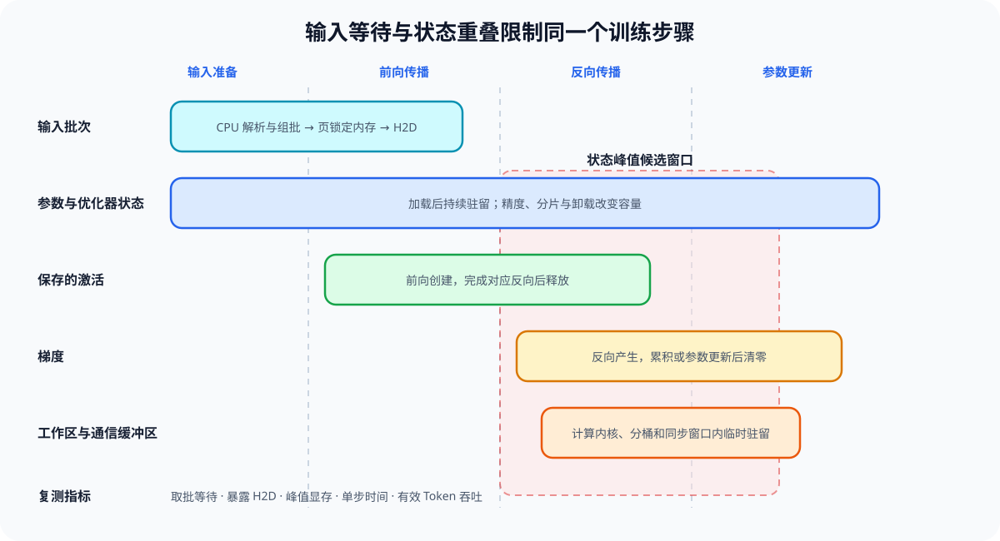
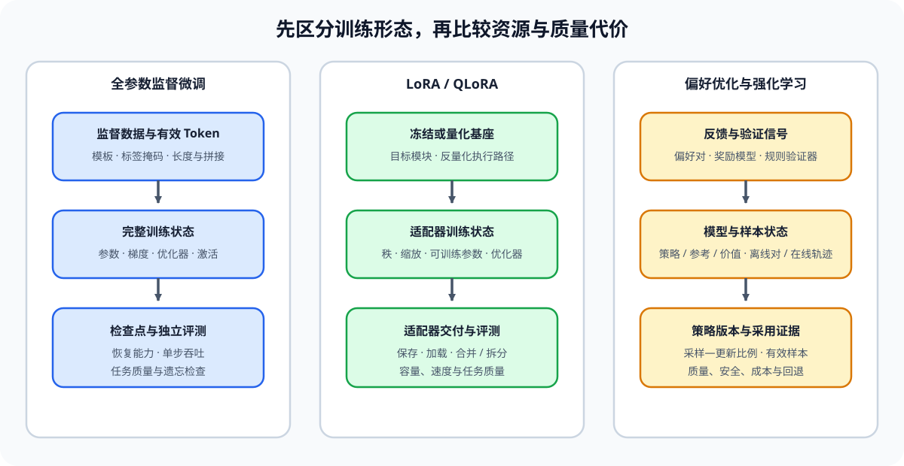

# 性能优化问题链：从现象到候选决策

性能优化从可复查的现象开始，并沿着固定顺序推进：建立可比较基线，确认主要约束，选择能够改变该约束的候选，再检查代价转移和瓶颈变化。任一步缺少证据，都应回到对应阶段补测，而不是继续叠加策略。

## 建立比较基线并提出候选

先在[01 性能问题与比较契约](./01_performance_problem_and_benchmark.md)固定模型、输入分布、硬件、数据类型、执行后端、预热、重复规则和守护条件。两次运行的工作量或质量门槛不同，就不能计算候选相对基线的收益。

随后使用[性能分析专题](../performance_analysis/intro.md)取得阶段时间、执行轨迹、对象驻留或回归证据，再进入[02 资源约束与候选代价](./02_observability_and_profiling.md)。候选记录必须写清作用对象、预期减少量、新增代价和证伪条件。

## 根据主要约束选择分支

| 已确认的主要约束 | 需要继续解释的关系 | 正文入口 | 返回主线时带回的证据 |
|:---|:---|:---|:---|
| 输入等待或训练状态峰值 | 输入供给、状态生命周期与单步时间怎样相互影响 | [03 训练输入、状态与资源账本](./03_training_memory_ledger.md) | 取批等待、暴露 H2D、峰值对象、单步时间、吞吐与质量 |
| 请求状态容量 | 长度、并发、KV 分配与复用怎样影响服务指标 | [04 推理状态容量与 KV Cache](./04_inference_memory_and_kv_cache.md) | 每 Token 状态、峰值、命中/驱逐、TTFT、TPOT、P99 与质量 |
| 计算、搬运、通信或排队等待 | 哪个事件位于关键路径，依赖是否允许重叠 | [05 计算、通信与 I/O](./05_compute_communication_and_io.md) | 前驱关系、总时间、暴露时间、资源争用和失败状态 |

### 训练输入与状态

训练分支先检查输入批次何时就绪，再观察参数、激活、梯度、优化器状态、工作区和通信缓冲区在什么阶段同时驻留。

SFT、LoRA/QLoRA、偏好优化和强化学习具有不同的模型驻留与阶段路径，因此不能复用同一份静态显存估算。

### 推理状态容量

推理分支把请求长度、共享前缀和并发分布传入 KV 表示、物理管理和容量准入，再观察延迟、吞吐与质量。

### 计算、通信与 I/O 关键路径

关键路径分支按输入、模型产物、运行时状态和输出回写区分对象，只有暴露在依赖链上的等待才是当前候选需要减少的时间。

训练算法本身由[训练机制](../backpropagation_training_mechanism/intro.md)和[后训练优化](../post_training_optimization/intro.md)解释；缓存、调度和解码机制由[推理优化](../inference_optimization/intro.md)解释；多卡切分与集合通信由[通信与并行](../communication_parallelism/intro.md)解释。返回性能优化主线时，需要使用相同工作负载重新测量候选，而不是复用不同条件下的局部结果。

## 从单候选准入到组合复测

[06 单候选执行与准入](./06_cost_model_and_production_decision.md)先检查候选是否命中目标产物、加载器、执行后端和计算内核，再检查正确性、质量、性能、容量与成本。只有结论为 `accept` 的候选才进入组合实验；`tune` 需要缩小适用范围或调整配置，`reject` 保存失败证据并恢复基线。

[07 策略组合与瓶颈转移](./07_end_to_end_performance_engineering.md)比较基线、单项候选、组合顺序和回退方案。组合后重新检查关键路径与资源上界，确认收益是否保留，以及主要约束是否转移到输入、计算、容量、通信或调度。

