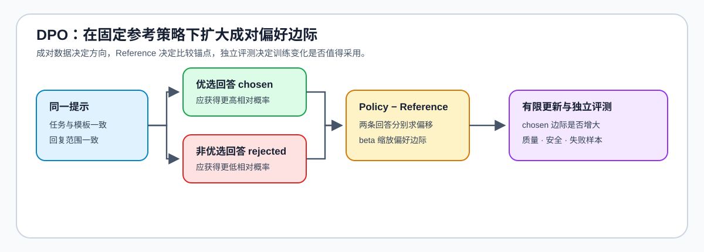

# 05 · DPO 与离线偏好优化

DPO 处理的是“同一个问题有多个可行回答时，模型应更偏好哪一个”的问题。它在可靠的偏好对上直接优化当前策略相对参考策略的偏好，不需要每轮都启动奖励模型和轨迹采样；因此系统成本较低，但结论强烈依赖偏好数据、参考策略和评测协议是否可信。

## 从偏好对到更新方向

一条可用的偏好样本先固定同一提示，再提供可比较的优选回答（`chosen`）与非优选回答（`rejected`）。当前策略应提高前者相对后者的概率；SFT 参考策略约束这种偏离不能脱离已有可用行为。`beta` 控制偏好信号相对参考策略约束的强度，而不是一个脱离数据质量单独调大的“效果旋钮”。

| 对象 | 在 DPO 中的作用 | 需要先确认的证据 |
| --- | --- | --- |
| 提示 | 让两个候选处于同一任务与上下文 | 任务、模板和上下文一致 |
| `chosen / rejected` | 提供相对排序信号 | 选择理由、标注一致性、难例与重复关系 |
| SFT 参考策略 | 给当前策略偏离提供比较基线 | 来自可用 SFT 检查点，版本可回查 |
| `beta` | 调节偏好更新与贴近参考策略的相对力度 | 固定数据与训练预算下的对照结果 |
| 独立评测集 | 判断偏好拟合是否转化为任务改善 | 与训练 pair 隔离，保留失败样本 |

## 选择 DPO 前先判断反馈形态

| 反馈条件 | 更合适的路径 | 原因 |
| --- | --- | --- |
| 已有高质量、离线、可复查的偏好对 | DPO | 直接利用成对偏好，训练和系统成本较低 |
| 需要通过新生成的候选继续探索 | PPO / GRPO | 离线 pair 无法覆盖新策略产生的行为 |
| 任务结果可由测试、规则或环境明确验证 | GRPO / RLVR | 验证器可提供比主观偏好更直接的反馈 |
| 偏好对来源不稳定、排序理由不清 | 先回到数据工程 | 先修数据、切分和标注一致性，不能用优化器掩盖信号问题 |

## 常见失败如何进入项目决策

DPO 的损失下降可能只是模型更会区分当前偏好对；它不自动证明新模型在独立任务上更有帮助、更安全或更鲁棒。比较时固定参考策略、`beta`、数据版本、解码条件和评测集；若质量改善只出现在训练分布、模型评审器不稳定，或安全门槛下降，应先输出 `tune`，而不是继续扩大训练。

| 现象 | 优先回查 | 下一步 |
| --- | --- | --- |
| 训练稳定但独立质量无提升 | 偏好对覆盖、参考策略、评测集隔离 | 调整数据或 `beta`，保留失败样本 |
| 输出明显偏离原有可用行为 | 参考策略版本、`beta`、优选回答定义 | 降低偏离强度并复测行为回归 |
| 需要新轨迹才能判断好坏 | 轨迹采样与验证器 | 转入 PPO、GRPO 或 RLVR 路径 |

## 验证与出口

[17 DPO Loss Tutorial](../../02_PyTorch_Algorithms/17_DPO_Loss_Tutorial.ipynb) 实现成对偏好目标，[50 偏好数据与评测](../../02_PyTorch_Algorithms/50_Preference_Data_and_Evaluation.ipynb) 固定数据与评测契约，[84 DPO 偏好优化项目](../../02_PyTorch_Algorithms/84_DPO_Preference_Project.ipynb) 将候选比较收口为训练决策。相关阅读：[DPO 论文](https://arxiv.org/abs/2305.18290)、[TRL DPOTrainer](https://huggingface.co/docs/trl/dpo_trainer)。
