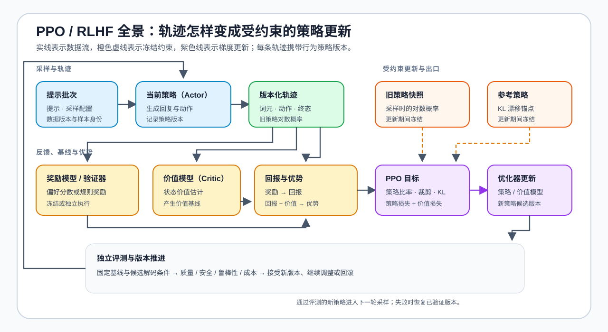

# 06 · PPO、RLHF 与完整反馈闭环

当离线偏好对不足以覆盖目标行为时，PPO / RLHF 通过“生成候选 → 获得反馈 → 计算更新信号 → 再生成”的循环继续探索。它是理解在线对齐资源代价的完整基线：当前策略、参考策略、奖励模型和价值模型会同时影响显存、吞吐、通信和调试难度。

## 一次 PPO 更新中的信号如何流动

同一批提示先由当前策略生成带版本轨迹；旧策略快照保存采样时的概率，参考策略提供 KL 漂移锚点，奖励模型或验证器给出任务反馈，价值模型估计状态基线。回报与价值之差形成优势后，PPO 才计算裁剪策略目标并分别更新策略模型与价值模型。旧策略、参考策略和奖励模型在这一轮更新中保持冻结。

奖励表示任务反馈，价值估计当前状态下的预期回报，优势以两者的差异表达“这条轨迹相对预期是否更好”。KL 约束放在策略更新中，防止模型为追求局部奖励而无依据地偏离参考策略；它不能修复错误奖励、污染数据或失真的评测集。

| 阶段 | 输入与输出 | 更新信号 | 需要观察的代价 |
| --- | --- | --- | --- |
| 轨迹采样 | 提示 → 当前策略回复 | 行为策略产生待评估候选 | 生成 Token、KV Cache、队列等待与执行后端吞吐 |
| 奖励计算 | 回复 → 奖励 / 验证器分数 | 候选是否满足偏好或任务目标 | 打分耗时、一致性与奖励漏洞 |
| 价值与优势 | 奖励、价值估计、轨迹 | 相对预期好多少，决定更新方向 | 价值模型驻留、激活与轨迹缓存 |
| PPO 更新 | 当前策略、旧策略、参考策略、优势 | 截断策略目标与 KL 约束 | 优化器、参考策略、通信与更新时长 |
| 独立评测 | 基线 / 候选 → 固定评测结果 | 是否真的改善而非只提高奖励 | 质量、安全、鲁棒性、成本与回滚条件 |

## PPO 与离线偏好优化的选择

| 条件 | DPO 更合适 | PPO / RLHF 更合适 |
| --- | --- | --- |
| 反馈来源 | 已有可靠的 chosen / rejected 对 | 需要对当前策略新生成的行为打分 |
| 探索能力 | 离线数据范围内优化 | 可从轨迹采样中探索新候选 |
| 系统成本 | 不必持续运行采样、奖励和价值模型 | 需要协调生成、打分、更新与恢复 |
| 主要风险 | 偏好对质量、参考策略偏离、离线覆盖不足 | 奖励投机、轨迹成本、系统不稳定 |

## 成本为什么会改变方法选择

PPO 的困难不只来自损失。轨迹采样是推理工作负载，奖励或验证器是额外计算，参数更新又是训练工作负载。先用[奖励模型训练、校准与过度优化](../../02_PyTorch_Algorithms/PT-REWARD-MODEL_Reward_Model_Training_and_Calibration.ipynb)检查代理奖励是否可信，再在固定轨迹上确认奖励、价值、优势、策略比率和 KL 约束；随后测量当前策略、旧策略、参考策略、奖励模型与价值模型的驻留代价。扩大到多工作进程后产生的队列、版本同步与恢复问题进入第 08 节。

## 验证与出口

[16 PPO / RLHF](../../02_PyTorch_Algorithms/16_RLHF_PPO_Memory.ipynb) 提供当前策略、旧策略、参考策略、奖励、价值模型与资源账本的机制入口；训练状态代价回补[反向传播与训练机制](../backpropagation_training_mechanism/intro.md)，大规模工作进程与通信进入[通信与并行](../communication_parallelism/intro.md)。下一页再处理 GRPO / RLVR 如何改变价值基线与奖励来源。
