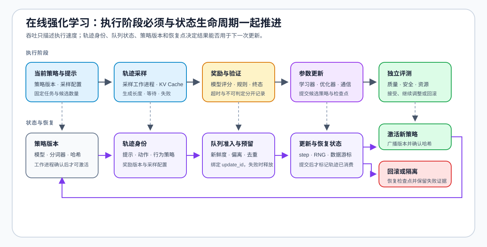

# 08 · RL 工程、Rollout 与效率

RL 训练的成本来自生成系统与训练系统的协同，而不是单一损失。一次可重复的闭环需要把轨迹采样、奖励或验证器、参数更新、评测和恢复分成可观察阶段；否则 GPU 空闲、队列等待、通信暴露或资源竞争会被混成“训练很慢”。

进入框架选型前，先用 [Rollout 与策略新鲜度](../../02_PyTorch_Algorithms/PT-ROLLOUT-LIFECYCLE_Rollout_and_Policy_Freshness.ipynb) 固定轨迹身份、策略版本和更新准入，再用 [采样、训练与奖励系统](../../02_PyTorch_Algorithms/PT-RL-SYSTEM_Rollout_Training_and_Reward_System.ipynb) 比较共置、解耦与混合拓扑。框架负责执行这些契约，不能替代契约本身。

## 轨迹为什么是在线后训练的核心对象

这里的轨迹是模型在一次生成或工具交互中产生的动作序列及运行状态，不等同于模型内部思维的完整记录。它连接奖励、策略更新、行为诊断和系统恢复；[奖励、价值与优势信号](../../02_PyTorch_Algorithms/PT-REWARD-SIGNAL_Reward_Model_Value_and_Advantage.ipynb)解释前两项，[Rollout 与策略新鲜度](../../02_PyTorch_Algorithms/PT-ROLLOUT-LIFECYCLE_Rollout_and_Policy_Freshness.ipynb)解释身份和版本状态。

| 作用 | 轨迹提供什么 | 需要避免的误解 |
| --- | --- | --- |
| 奖励载体 | RLHF 常由奖励模型评价完整回答，RLVR 常由规则或环境验证终态；也可以使用过程奖励 | 奖励不一定只出现在末尾，终局奖励也能通过回报或优势传向前序 Token |
| 更新信号 | PPO 用价值基线估计逐位置优势；GRPO 常把回答级组内优势作用到该回答的有效 Token | 轨迹本身不是梯度，奖励、参考策略和优势构造共同决定更新方向 |
| 行为诊断 | 长度、重复、失败位置、工具状态和奖励分量用于定位退化或奖励投机 | 轨迹变长不等于推理更好，也可能是冗长、循环或迎合奖励规则 |
| 生命周期 | 轨迹 ID、提示 ID、策略版本、采样配置、奖励状态和失败原因支持去重、准入与恢复 | 旧策略轨迹并非必然导致训练崩溃，但必须受新鲜度和算法允许的偏离范围约束 |

离线 DPO 在更新阶段直接消费已有偏好对，不需要当前策略在线生成新轨迹；这些偏好回答仍可能来自更早的模型采样或人工构造。在线 PPO、GRPO 或反馈循环则必须管理轨迹生成、奖励、版本同步和失败恢复。

## 从生成到更新的工程闭环

| 阶段 | 输入 → 输出 | 主要资源问题 | 最小证据 |
| --- | --- | --- | --- |
| 轨迹采样 | 提示 → 多个回复 / 轨迹 | 执行后端吞吐、KV Cache、长度波动、队列等待 | 输入 / 输出 Token、TTFT、TPOT、失败原因 |
| 奖励与验证 | 轨迹 → 分数 / 终止信号 | 打分并发、超时、规则版本与不可判定样本 | 奖励组成、验证器版本、失败类型 |
| 参数更新 | 轨迹 + 奖励 → 候选策略 | 激活、优化器、参考策略、通信与恢复 | 单步时间、显存、检查点、重试记录 |
| 独立评测 | 基线 / 候选 → 决策 | 数据隔离、质量回归、安全与成本 | 质量门槛、失败样本、决策与回滚点 |

先测阶段边界，再解释总耗时。轨迹采样是推理工作负载，参数更新是训练工作负载；二者即使使用同一模型，也不能共享同一份吞吐或显存结论。工作进程扩大后，还需要分别记录等待、通信和恢复，而不是只报告一个端到端时间。

## 从文本回答到 Agent 环境轨迹

Agentic RL 不是一种新的策略更新算法，而是把策略作用对象从单段回答扩展为多轮环境交互。模型产生动作，工具或沙盒返回观察，新的观察再进入下一轮生成；最终仍可使用 PPO、GRPO 或其他受约束策略优化方法更新模型。

| 轨迹对象 | 在训练中的作用 | 更新约束 |
| --- | --- | --- |
| 任务与初始观察 | 固定目标、工具集合和初始环境状态 | 相同任务只有在环境版本一致时才能比较 |
| 模型动作 | 文本、函数调用或代码动作 | 只有策略生成的有效 Token 进入策略损失 |
| 工具结果与环境观察 | 为下一步决策提供状态 | 作为上下文保留，但不伪装成模型动作参与梯度 |
| 终止状态 | 记录成功、失败、超时或不可恢复错误 | 终止条件必须由环境契约判断 |
| 奖励与验证记录 | 提供结果奖励、过程奖励或失败惩罚 | 记录验证器、工具和环境版本，保留不可判定状态 |

SFT 可以模仿已经验证的成功轨迹；DPO 可以比较同一初始状态下的优选与非优选轨迹；PPO 使用价值基线分配多步优势；GRPO 对同一任务的多条候选轨迹计算组内相对优势。无论采用哪种更新方式，动作掩码、环境观察和奖励来源都必须分开记录，否则工具输出可能被错误计入策略梯度，环境变化也可能被误判为模型提升。

后训练优化负责把合格轨迹转换为监督目标、偏好对或策略更新信号；[Agent 工作负载与执行链](../agent/00_agent_workload_and_trace.md)负责定义任务级轨迹，[Agent 轨迹数据与验证](../agent/01_agent_trajectory_data.md)负责数据结构与回放证据，[Agent 沙盒与执行环境](../agent/02_agent_sandbox_environment.md)负责工具权限、环境隔离和可复现执行。

## 拓扑、队列与恢复状态

在线训练系统需要明确谁生成轨迹、谁计算奖励、谁更新参数，以及新策略何时重新分发。共置拓扑减少传输但增加资源竞争；解耦拓扑允许独立扩缩容，但必须处理队列积压、策略陈旧和状态交接。

| 系统对象 | 必须携带的状态 | 失败或恢复检查 |
| --- | --- | --- |
| 采样 worker | 策略版本、采样配置、提示与轨迹身份 | 重试后不能把旧轨迹标成新版本 |
| 奖励 / 验证 worker | 规则或模型版本、奖励分量、失败类型 | 超时和不可判定样本不得静默记零 |
| 轨迹队列 | 生产版本、消费状态、时间戳与优先级 | 积压时检查新鲜度和重复消费 |
| 训练 worker | 接纳版本、批次身份、优化器与调度器状态 | 恢复后保持更新步与随机状态一致 |
| 检查点 | 策略、参考状态、训练进度与数据游标 | 能定位最后一个完整提交的更新批次 |

## RL 执行栈怎样分工

| 工具层 | 首选工具 / 组合 | 负责什么 | 仍需记录 |
|:---|:---|:---|:---|
| 算法语义 | TRL | 验证奖励建模、DPO、组采样或小规模策略更新 | 模型、参考策略、奖励、数据与质量结果 |
| 轨迹生成 | vLLM 或 SGLang + 训练框架 | 独立观察生成吞吐、KV Cache 与采样队列 | 后端版本、长度、并发、采样配置与失败 |
| RL 系统编排 | veRL 或 OpenRLHF | 连接采样、奖励、训练和权重同步 | 工作进程拓扑、策略版本、通信、恢复与资源占用 |
| 资源调度 | Ray 或框架内置调度器 | 分配资源、重试任务并协调阶段并发 | GPU 放置、等待、超时和回滚点 |
| 训练并行 | PyTorch FSDP、DeepSpeed 或 Megatron Core | 切分训练状态、模型或计算 | 并行策略、通信量、检查点格式与恢复条件 |

框架名称不构成算法或性能结论。比较前固定模型、候选数、最大生成长度、奖励函数、并行规模、评测集和版本；先用最小闭环确认机制，再按证据逐步扩大系统。

## 验证与出口

[85 GRPO 组内对齐项目](../../02_PyTorch_Algorithms/85_GRPO_Groupwise_Alignment_Project.ipynb) 验证组采样和奖励闭环，[86 在线 DPO 基准](../../02_PyTorch_Algorithms/86_DPO_Online_Benchmark.ipynb) 比较更新收益、稳定性与回滚条件。真实资源瓶颈回补[性能优化](../performance_optimization/intro.md)，多工作进程通信回补[通信与并行](../communication_parallelism/intro.md)。系统实现查阅 [veRL](https://verl.readthedocs.io/en/latest/)、[OpenRLHF](https://openrlhf.readthedocs.io/en/latest/)、[Ray](https://docs.ray.io/en/latest/)、[vLLM](https://docs.vllm.ai/) 与 [SGLang](https://docs.sglang.ai/) 官方文档；训练并行接口查阅 [PyTorch FSDP](https://docs.pytorch.org/docs/stable/fsdp.html)、[DeepSpeed](https://www.deepspeed.ai/) 与 [Megatron Core](https://docs.nvidia.com/megatron-core/developer-guide/latest/index.html)。
