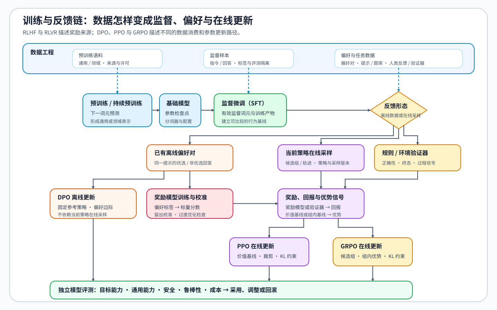

# 后训练优化问题链 | Post-Training Walkthrough

后训练先建立共同基线，再根据反馈形态进入不同分支，而不是依次套用 SFT、DPO、PPO 和 GRPO。下面始终跟踪同一个对象：一条用户提示及其回答，观察它怎样从监督样本变成偏好对、带奖励的轨迹和最终评测证据。

`提示与目标 → 监督样本与 SFT 基线 → 偏好对或奖励轨迹 → 策略更新 → 独立评测与决策`

## 一、先判断是否需要改变模型参数

先为目标任务固定一组提示和独立评测样本，判断失败来自指令表达、外部知识还是模型行为。提示工程、RAG 或工具调用已经能稳定解决的问题不必立即训练；确需改变模型行为时，再选择 SFT、偏好优化或强化学习。

预训练和持续预训练主要从大规模语料中学习通用或领域表示；后训练则把这些表示接到任务接口、偏好和环境反馈上。它们复用前向传播、反向传播、优化器和训练状态机制，但数据对象、学习信号和采用证据不同。

| 阶段 | 主要数据对象 | 学习信号 | 主要产物 | 进入下一阶段的证据 |
|:---|:---|:---|:---|:---|
| 预训练 | 大规模通用语料 | 下一词元预测 | 基础模型检查点 | 通用能力、训练稳定性和规模效率 |
| 持续预训练 | 领域、长上下文或新时间段语料 | 下一词元预测 | 更新后的基础模型 | 目标领域增益与通用能力保持 |
| SFT | 指令、输入与参考回答 | 有效监督词元上的交叉熵 | 全参数检查点或适配器 | 任务接口、格式与基础质量稳定 |
| 偏好优化 / RL | 偏好对、候选组、轨迹与奖励 | 偏好边际、优势或可验证奖励 | 对齐后的策略版本 | 质量、安全、鲁棒性与奖励一致性 |
| 独立评测与部署反馈 | 冻结评测集、线上失败样本与成本记录 | 不参与当前候选训练 | 采用、调整或回滚决策 | 数据隔离、资源预算和回滚条件齐全 |

## 二、从监督目标建立最小 SFT 基线

同一条提示与目标回答进入聊天模板后形成 `input_ids`、注意力掩码和标签。标签掩码决定哪些 Token 进入监督损失；样本身份、数据切分、去重和去污染决定这条监督能否进入训练池。随后用同一损失口径完成一次有效更新和独立验证，保存模型、分词器、模板、配置与结果，得到后续候选可以共同复用的最小 SFT 基线。

对应 [01 SFT 数据与监督契约](./01_sft_data_and_loss.md) 与 [04 SFT 实验与交付](./04_end_to_end_experiment.md)；机制顺序为 [Part 02 · 32 数据准入](../../02_PyTorch_Algorithms/32_Data_Engineering_for_SFT.ipynb) → [13 SFT 训练循环](../../02_PyTorch_Algorithms/13_SFT_Training_Loop.ipynb) → [15 端到端微调](../../02_PyTorch_Algorithms/15_End_to_End_Fine_Tuning_Experiment.ipynb)。

## 三、选择更新范围与资源方案

固定监督目标与最小基线后，再比较全参更新、LoRA、QLoRA、长上下文训练和 LoRA 变体。LoRA 决定哪些模块承担增量，QLoRA 改变冻结底座的存储形式，长上下文训练改变样本长度与显存约束，LoRA 变体则比较参数化和固定预算下的可用秩。第 11–12 节提供梯度累积、有效优化器步和学习率状态等训练机制回补，但不再作为本阶段的核心路线。

这些候选必须使用相同数据切分、评测与有效更新口径，分别记录可训练参数、峰值显存、更新时间和产物形态。是否从 SFT 升级到偏好或奖励优化仍由 Task0 的阶段门判断：先确认格式与指令遵循稳定，再检查独立质量是否进入平台期，以及剩余错误是否需要负反馈或在线探索。

对应 [02 LoRA / PEFT](./02_lora_peft_design.md) 与 [03 训练控制](./03_training_control.md)；机制入口为 [Part 02 · 14 LoRA](../../02_PyTorch_Algorithms/14_LoRA_Tutorial.ipynb)，26、30、31 分别承担低比特、长序列和变体分支。

## 四、根据反馈形态选择优化方法

先区分训练对象来自已有离线数据，还是必须由当前策略在线生成。已有可复查的优选 / 非优选回答时，可以使用 DPO 等离线偏好优化；引入负反馈本身不要求建立在线强化学习系统。必须探索新行为时，再根据基线形式选择更新机制：显式价值模型提供状态基线时可使用 PPO，同一提示下候选组提供组内基线时可使用 GRPO。

RLHF 与 RLVR 描述反馈来源，不与某一种更新算法一一绑定。人类偏好或奖励模型可以服务 DPO、PPO 或 GRPO；标准答案、单元测试和环境终态等可验证反馈也可以接入不同在线更新方法。典型组合分别见 [05 DPO](./05_dpo_and_preference_optimization.md)、[06 PPO / RLHF](./06_rlhf_and_ppo_system_cost.md) 与 [07 GRPO / RLVR](./07_grpo_and_groupwise_alignment.md)。

| 数据与执行形态 | 基线形式 | 典型更新机制 | 可用反馈来源 |
|:---|:---|:---|:---|
| 已有离线偏好对 | 固定参考策略下的相对偏好边际 | DPO | 人工偏好、模型偏好或规则生成的偏好对 |
| 当前策略在线生成轨迹 | 价值模型估计的状态基线 | PPO | 奖励模型或可验证奖励 |
| 当前策略在线生成候选组 | 同一提示下的组内基线 | GRPO | 模型评分、标准答案、测试或环境终态 |

## 五、把算法接回训练与生成系统

强化学习需要把轨迹采样、奖励或验证器、参数更新与评测拆成可测阶段。每条轨迹记录提示、回复 Token、行为策略版本、奖励分量和消费状态；学习器只接纳满足策略新鲜度条件的轨迹。需要多工作进程编排时进入 RL 系统分支，需要持续收集偏好并更新策略时进入在线 DPO 分支。

`TRL` 适合机制和小规模闭环；需要更重的轨迹采样与资源编排时，再依据实验条件选择 `verl`、OpenRLHF、vLLM / SGLang 与 Ray。

对应 [08 RL 工程与效率](./08_rl_engineering_and_efficiency.md)。

## 六、用独立评测和回滚条件收口

训练损失、奖励或胜率上升都不足以直接采用。回到开头冻结的提示和评测样本，对基线与候选执行相同解码与评分协议，再结合任务正确性、安全、鲁棒性、模型评审器一致性、资源成本和失败样本，给出 `accept / tune / reject`。

对应 [09 评测、反馈与项目决策](./09_preference_data_and_project_decision.md)。
