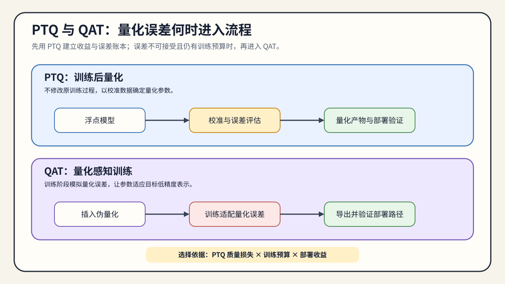

# 02. Calibration Protocol and PTQ/QAT Branching | 校准协议与 PTQ/QAT 分流

## 学习问题

本节回答两个连续问题：如何冻结校准、验证与测试数据的职责；PTQ 质量不达标时，什么时候值得把量化误差带回训练过程。

范围搜索得到候选缩放参数后，还要冻结校准、验证和测试数据的职责，再根据独立质量结果选择 PTQ、QAT 或低比特适配。权重、激活和混合位宽候选应复用同一数据协议，避免数据划分变化干扰方法比较。

## 核心机制

量化真正的第一道选择，不是 GPTQ 还是 AWQ，而是先用什么数据估计范围、再根据什么独立证据决定是否训练。介入时机决定了：

- 你能不能用最小成本快速落地；
- 你有没有机会让模型适应量化误差；
- 量化路线会不会和 LoRA / QLoRA、继续训练等动作绑在一起。

选择介入时机前，先确认：

- 你有没有训练预算。
- PTQ 后精度损失是否已经不可接受。
- 你的目标是快速得到可比较候选，还是用训练成本恢复质量。

PTQ 便宜、快、适合快速验证；QAT 更重，但能让模型在训练时学会适应量化误差。两者的差别，不只是“训练前后”的时间点，而是你愿意把多少复杂度付给训练过程。

### 校准协议与介入时序

PTQ 通常先使用代表性数据估计量化参数，再冻结量化表示评估模型；QAT 则在训练过程中插入伪量化或等价的量化误差模拟，让前向路径感知离散化带来的偏差，反向传播仍需要可训练的近似梯度。

| 阶段 | 主要状态 | 主要风险 | 最小证据 |
|:---|:---|:---|:---|
| PTQ 校准 | 模型参数基本不变，估计缩放因子 / 零点 | 校准数据不代表目标输入 | 校准集摘要、误差分布、任务质量 |
| PTQ 执行 | 量化参数冻结，由加载器/执行后端接收 | 格式或计算内核不匹配 | 加载状态、执行路径、质量与资源指标 |
| QAT / 量化微调 | 训练过程适应量化噪声 | 训练成本、收敛和部署格式不一致 | 训练 / 验证曲线、最终量化产物、部署复验 |

### 数据角色协议

校准、验证和测试数据承担不同职责。校准数据还要覆盖会改变激活范围的长度、领域和批次形态，不能只“随便取几条样本”。如果只是比较 PTQ 与 QAT 的方向，可以先使用小规模、固定版本的校准集；如果要形成训练或推理结论，则必须保存数据版本、抽样规则、长度分布和独立评测入口。

| 数据角色 | 主要用途 | 必须固定的字段 | 常见风险 |
|:---|:---|:---|:---|
| 校准集 | 估计缩放因子、零点、敏感性或激活范围 | 版本、数据划分、抽样规则、样本数、长度分桶、领域比例、批次/并发形态 | 分布过窄，范围覆盖不足 |
| 验证集 | 调整 QAT 或低比特适配过程 | 版本、数据划分、随机种子、指标与评测脚本 | 反复调参导致结果偏乐观 |
| 测试集 / 业务样例 | 给出最终独立质量证据 | 固定样例、指标版本、运行配置 | 与校准分布不同，暴露长上下文或格式问题 |

## 选择条件与验证证据

### 从 PTQ 结果选择下一步

PTQ 是一次低成本分流，而不是质量保证；改用 QAT 也不能直接推出部署后更快。两种方案都要使用同一独立评测入口和部署目标。CPU 实验可以验证流程、误差注入与数据职责，训练稳定性和推理收益则需要真实工作负载证据。用同一份质量评测结果决定下一步：

| PTQ 观察到的结果 | 推荐动作 | 交给下一页的信息 |
|:---|:---|:---|
| 质量达标，权重仍是主要成本 | 进入 W8A16 或 GPTQ / AWQ | 校准协议、质量门槛、目标格式 |
| 质量轻微下降，训练预算有限 | 进入 QLoRA 或量化微调 | SFT 模型检查点、训练预算和验证协议 |
| 激活范围或执行路径成为瓶颈 | 进入激活量化 / FP8 局部机制验证 | 激活统计、目标硬件和工作负载 |
| 长上下文下显存或并发不足 | 进入 KV Cache 量化 | Cache 账本、上下文和并发条件 |
| 无法加载或质量明显不达标 | 暂停部署并定位原因 | 失败日志、配置差异和复测条件 |
