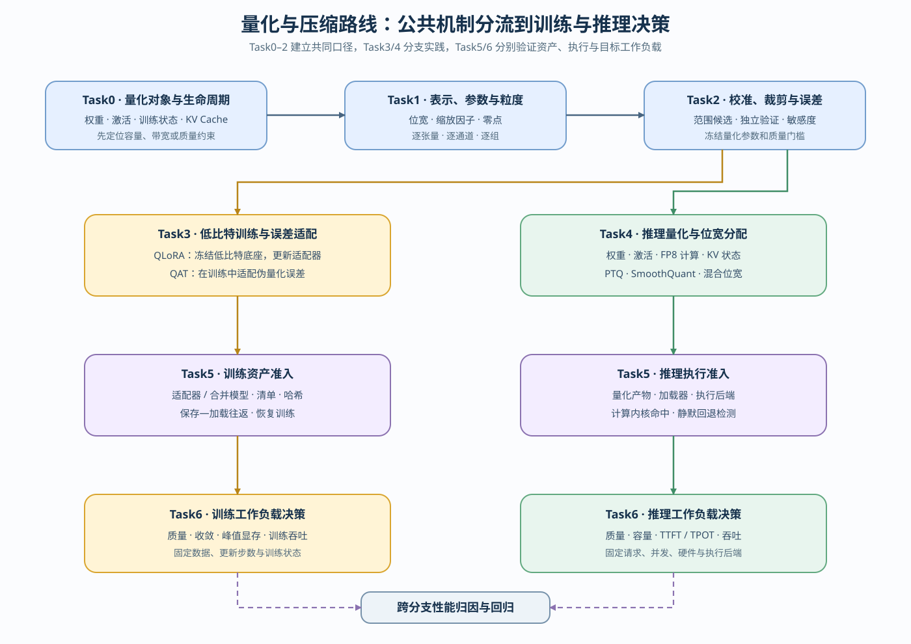
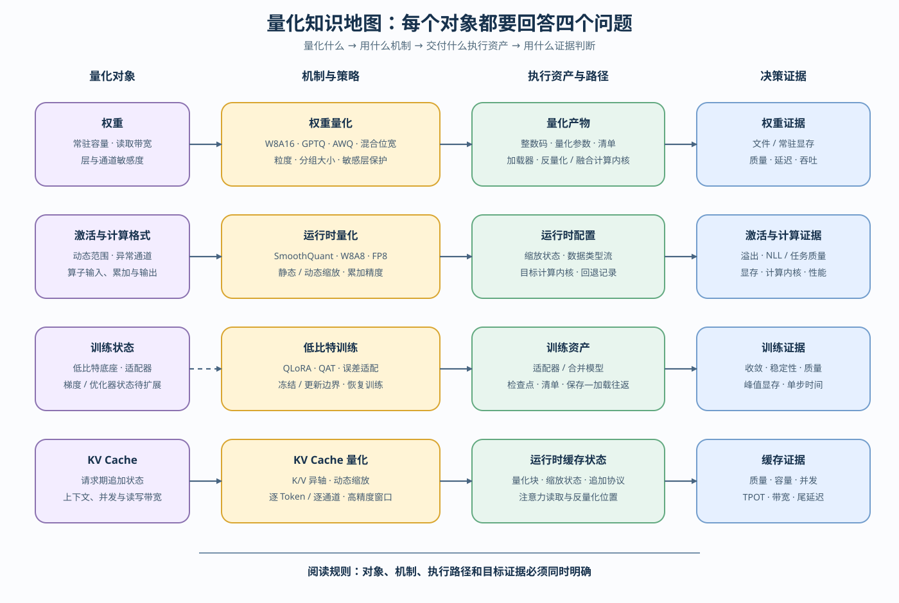

# 量化与压缩（Quantization and Compression）

> 专题类型：横向支撑　主服务目标：数值表示、质量、资源与执行路径取舍

量化与压缩研究怎样用更紧凑的表示或结构降低容量、带宽和计算成本，同时把数值误差、质量风险和执行条件保持在可接受范围。权重、激活、训练状态和 KV Cache 位于不同生命周期，必须分别选择粒度、校准方式和验证指标。

本路线先建立表示、校准与误差的公共机制，再分流到低比特训练和推理量化，最后检查训练资产、量化产物、计算内核与目标工作负载。剪枝、蒸馏和结构稀疏作为压缩扩展，沿用同一套“对象—机制—执行—证据”判断框架。

## 学习路线

按 Task 顺序学习时使用下表；需要连续理解因果关系时进入[量化问题链](./walkthrough.md)，遇到质量、容量、加载或吞吐异常时使用[量化问题排查手册](./casebook.md)，术语差异查询[专题术语表](./glossary.md)。

Task0–2 建立公共机制，Task3 和 Task4 分别承载训练与推理分支，Task5 检查资产和执行路径，Task6 在固定工作负载中作出决策。当前训练分支覆盖低比特底座、适配器和 QAT；优化器状态与梯度量化仍是待建设内容。

| Task / 主题 | 本阶段要回答的问题 | 学习入口与验证出口 | 学习顺序 | 主要正文入口 |
|:---|:---|:---|:---|:---|
| Task0 · 量化对象、生命周期与证据 | 权重、激活、训练状态和 KV Cache 何时存在，局部数值证据与工作负载证据如何区分？ | 基础：[Part 00 · 05 Tensor](../../00_Prerequisites/05_PyTorch_Tensor_Fundamentals.ipynb) → [Part 01 · 01 数据类型与精度](../../01_Hardware_Math_and_Systems/01_Data_Types_and_Precision.ipynb) | 对象 → 生命周期 → 风险 → 证据等级 | [01 量化对象、表示与误差](./01_quantization_object_and_error.md) |
| Task1 · 数值表示、量化参数与粒度 | 给定浮点范围后，怎样映射到低精度网格；逐张量、逐通道、逐组分别带来多少表示误差和量化参数元数据？ | 核心：[Part 01 · 21 量化理论](../../01_Hardware_Math_and_Systems/21_Quantization_Theory_and_INT4_INT8.ipynb) → [Part 02 · 25 W8A16](../../02_PyTorch_Algorithms/25_Quantization_W8A16.ipynb) | 码值与数据类型 → 缩放因子 / 零点 → 粒度状态 → 误差—元数据对照 → 反量化 | [01 量化对象、表示与误差](./01_quantization_object_and_error.md) |
| Task2 · 校准范围、裁剪与误差验证 | 位宽、表示和粒度固定后，范围应从哪些校准样本与统计量得到，裁剪如何平衡舍入误差和饱和误差？ | 核心：[Part 02 · 52 校准范围与裁剪](../../02_PyTorch_Algorithms/52_Quantization_Calibration_and_Error.ipynb)；Task1 的 25 提供表示前置 | 校准分布 → 范围候选 → 舍入 / 裁剪误差 → 独立验证 → 冻结量化参数 | [02 校准协议与 PTQ/QAT 分流](./02_ptq_and_qat_timing.md) |
| Task3 · 低比特适配与训练辅助量化 | 显存受限时如何训练适配器；PTQ 质量不足时如何用 QAT 适配量化噪声？ | 核心：[Part 02 · 26 QLoRA](../../02_PyTorch_Algorithms/26_QLoRA_and_4bit_Quantization.ipynb) 与 [QUANT-QAT](../../02_PyTorch_Algorithms/QUANT-QAT_Quantization_Aware_Training.ipynb)；出口：[65 QLoRA 选型](../../02_PyTorch_Algorithms/65_QLoRA_Selection_Project.ipynb) | QLoRA：低比特底座 → 适配器；QAT：伪量化 → 误差适配 → 转换；优化器状态 / 梯度量化待建设 | [03 低比特训练适配](./03_low_bit_training_adaptation.md) |
| Task4 · 推理量化与位宽分配 | 权重、激活、计算格式和 KV 状态应分别使用哪种量化方法？ | 权重：[40 GPTQ / AWQ](../../02_PyTorch_Algorithms/40_GPTQ_and_AWQ_Weight_Quantization.ipynb)；激活：[53 SmoothQuant](../../02_PyTorch_Algorithms/53_Activation_Quantization_and_SmoothQuant.ipynb)；计算：[41 FP8](../../02_PyTorch_Algorithms/41_FP8_Runtime_Low_Precision_Paths.ipynb)；状态：[54 KV Cache](../../02_PyTorch_Algorithms/54_KV_Cache_Quantization_Strategies.ipynb)；分配：[Mixed-bit](../../02_PyTorch_Algorithms/QUANT-MIXED-BIT_Mixed_Bit_Allocation.ipynb) | 简单基线 → 统计驱动算法 → 按对象选型 → 混合位宽 | [04 权重量化](./04_weight_only_compression.md) → [05 运行期量化路径](./05_fp8_and_kv_cache_quantization.md) |
| Task5 · 量化产物与执行路径验证 | 候选能否被目标系统正确消费，训练产物能否恢复，推理产物是否命中声明的低精度计算内核而没有静默反量化或回退？ | 输入：Task3 的适配器 / 合并模型与 Task4 的量化产物 / 运行时配置；验证出口：[82 量化产物评估](../../02_PyTorch_Algorithms/82_Quantization_Artifact_Evaluation_Project.ipynb) | 产物清单 / 哈希 → 保存—加载往返验证 → 训练恢复或加载器 / 执行后端 → 计算内核 / 回退路径 | [06 执行与基准测试决策](./06_deployment_and_benchmark_decision.md) |
| Task6 · 分工作负载的质量与性能决策 | 已通过 Task5 的候选，在固定训练或推理工作负载中是否达到质量、容量、延迟和吞吐目标？ | 训练出口：[65 QLoRA 选型](../../02_PyTorch_Algorithms/65_QLoRA_Selection_Project.ipynb)；推理项目链：[82 产物准入](../../02_PyTorch_Algorithms/82_Quantization_Artifact_Evaluation_Project.ipynb) → [67 匹配部署](../../02_PyTorch_Algorithms/67_Quantized_Inference_and_Deployment.ipynb) → [83 服务 Profile](../../02_PyTorch_Algorithms/83_Quantized_Serving_Profile_Benchmark.ipynb)，[66 浮点基线](../../02_PyTorch_Algorithms/66_Inference_Performance_Comparison.ipynb)作为可选历史对照 | 固定条件 → 分支基线 / 候选 → 质量与资源 → 归因 → `accept / tune / reject` | [06 执行与基准测试决策](./06_deployment_and_benchmark_decision.md) |

## 扩展与跨专题入口

需要比较量化之外的压缩方法时，进入[07 剪枝、蒸馏与结构稀疏](./07_pruning_distillation_and_structured_sparsity.md)。该页区分数值表示、连接或结构变化与教师—学生目标，并标出仍需补建的训练、计算内核和项目证据。

### 按需回补

需要继续解释结构压缩、底层执行或设备兼容性时，按实际问题回补下列内容。

| 补充主题 | Notebook 入口 | 建议时机 |
|:---|:---|:---|
| Tensor Core 深入 | [Part 01 · 23 Tensor Core 深入](../../01_Hardware_Math_and_Systems/23_TensorCore_Deep_Dive.ipynb) | Task4–5；需要解释累加精度和计算内核条件时 |
| Attention 结构与 KV 表示 | [Part 01 · 04 Attention 显存优化](../../01_Hardware_Math_and_Systems/04_Attention_Memory_Optimization.ipynb) | Task4；需要区分结构压缩、表示量化与缓存管理时 |
| 异构设备与运行时兼容性 | [Part 01 · 34 异构加速器与运行时约束](../../01_Hardware_Math_and_Systems/34_Heterogeneous_Accelerators_and_Runtime_Constraints.ipynb) | Task5；需要检查数据类型、量化产物、算子和运行时支持时 |

### 跨专题入口

需要沿训练质量与适配器继续学习时进入[后训练优化](../post_training_optimization/intro.md)；需要解释 TTFT、TPOT 和 Serving 行为时进入[推理优化](../inference_optimization/intro.md)；需要归因容量、带宽和关键路径收益时进入[性能优化](../performance_optimization/intro.md)与[性能分析](../performance_analysis/intro.md)；需要判断设备、运行时和回退路径时进入[部署与异构系统](../deployment_heterogeneous/intro.md)。

## 实验与项目出口

首次运行先按[实验 Quickstart](./quickstart.md)创建或恢复环境，再从[实验资产表](./experiment_assets.md)选择实验 ID、模型、数据、候选和结果路径；跨专题的软件版本与硬件快照查询[GPU 环境资产表](../../docs/gpu_environment_assets.md)。机制页确认数值、质量或状态变化，项目页再检查产物准入、真实执行后端和目标工作负载。

| 证据阶段 | 要回答的问题 | 输出与入口 |
|:---|:---|:---|
| 机制证据 | 量化对象、误差、容量或训练行为是否按预期改变？ | 52 的 CPU 校准搜索，以及 25、26、40、41、53、54、Mixed-bit、QAT 的机制 JSON |
| 产物准入 | 产物血缘、质量、产物清单和目标加载器是否合格？ | `QUANT-ARTIFACT-GATE` / 82 |
| 部署验证 | 合格产物是否被目标后端正确加载并执行？ | `QUANT-INFERENCE-DEPLOY` / 67 |
| 服务决策 | 在固定请求下，质量、容量、TTFT、TPOT 和吞吐是否达到目标？ | `QUANT-SERVING-PROFILE` / 83 |
